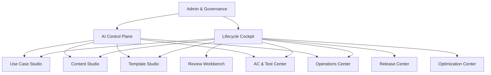

# AI Messaging Lifecycle Platform — 产品需求文档 PRD v2

> 面向银行信息发送部门的企业级 AI 产品设计文档。本文档用于对齐领导、业务部门、IT、Compliance、QA 及潜在外包供应商，重点说明产品价值、用户流程、功能模块、MVP 边界和验收标准。

---

## 1. 产品一句话定义

**AI Messaging Lifecycle Platform** 是一个面向银行内部业务部门的 **AI 驱动消息发送全生命周期管理平台**，帮助业务用户从需求提出、Use Case 创建、内容准备、模板选择/生成、自动测试、UAT、发布、生产监控到定期优化与下线，形成可审计、可复用、可持续学习的闭环。

这个产品不是简单的 Chatbot，也不是把现有流程电子化，而是把消息发送过程中的 **业务资产、审批流程、AI智能能力、测试证据和生产数据** 统一管理。

---

## 2. 产品定位

### 2.1 当前问题

银行信息发送流程涉及多个角色和多种资产：业务需求、Use Case 表单、消息内容、合规意见、邮件/SMS/WhatsApp 模板、验收标准、测试截图、发送日志、供应商状态、生产监控等。目前这些环节通常分散在邮件、Excel、聊天记录、Jira、Confluence、测试系统和人工经验中，导致：

1. **业务需求收集成本高**：业务用户不熟悉 30+ 字段，IT 需要反复追问。
2. **流程割裂**：Use Case、Content、Template、Testing、Release、Monitoring 之间缺少统一追踪。
3. **模板和AC复用不足**：历史 Use Case、历史模板、常用验收标准没有沉淀成可复用资产。
4. **测试和证据依赖人工**：测试截图、日志、AC validation 需要人工比对，耗时且容易漏。
5. **生产数据没有反哺设计**：上线后的失败率、fallback、成本、低使用率等没有系统性反馈到 Use Case 优化。
6. **AI能力难以治理**：如果直接把 AI 放到每个步骤，容易出现无法审计、无法控制、无法复现的问题。

### 2.2 目标状态

平台希望达到以下目标：


最终平台应实现：

- 业务用户可以自助创建和维护消息发送需求。
- IT 从“反复问需求”转为“审核AI整理好的业务包”。
- Compliance 从“全文人工查找风险”转为“重点审核AI标记的风险和来源”。
- QA 从“人工写验收标准和看截图”转为“审核自动生成的 AC、测试证据和 AI 判断”。
- 管理层能够看到端到端效率、质量、成本和风险。
- AI能力可以持续变聪明，但必须经过评测、审批和版本发布。

---

## 3. 产品核心卖点

### 卖点一：从需求到发布的全生命周期闭环

平台不是只做需求收集或内容生成，而是完整覆盖：

**需求 → Use Case → Content → Compliance → Template → AC → Testing → UAT → Release → Monitoring → Review**

每一步都保留状态、版本、责任人、审批和证据。

### 卖点二：业务用户真的可以自助

AI 不只是回答问题，而是主动引导业务用户：

- 根据一句自然语言生成 Use Case 初稿。
- 识别缺失字段和冲突字段。
- 每轮只问 1–3 个高价值问题。
- 用业务语言解释技术配置影响。
- 自动生成可提交 IT Review 的 Use Case Pack。

### 卖点三：AI + Rule + Workflow 三层控制

AI 负责理解、生成和推荐；Rule Engine 负责硬规则；Workflow 负责状态流转；人工负责高风险审批。

这让产品既智能，又可控。

### 卖点四：Memory 让平台越用越懂业务

平台会沉淀：

- 用户常用渠道和语言。
- 部门常用模板和 AC。
- 某类 Use Case 常见配置模式。
- 过去的 IT reject reason。
- 过去的合规修改原因。
- 过去测试失败与生产事故。

但 Memory 只用于推荐和预填，不会绕过审批或直接替代企业规则。

### 卖点五：自动测试不仅看截图，而是管理完整 Evidence Bundle

每条 AC 对应完整证据：

- 测试数据。
- 消息 payload。
- 渲染截图。
- 系统日志。
- 供应商回执。
- AI validation 结果。
- 人工 override。

这样 AC 结果可解释、可复核、可审计。

### 卖点六：生产数据反向优化 Use Case 和成本

上线后平台会监控：

- 各部门发送量。
- Channel 成功率。
- Fallback 触发率。
- 供应商失败率。
- 成本。
- 低使用率 Use Case。
- 高风险或高成本 Use Case。

AI 可以给出优化建议，例如切换更低成本 channel、调整 vendor、合并重复 Use Case 或建议下线低价值 Use Case。

---

## 4. 产品原则

1. **以 Use Case 生命周期为核心，而不是以 Chatbot 为核心。**
2. **AI 只提出建议，不能绕过规则、审批和状态机。**
3. **所有核心资产必须版本化。**
4. **所有 AI 结果必须可追踪、可解释、可人工 override。**
5. **Memory 分层管理：个人偏好、团队模式、Case 历史、企业知识不能混用。**
6. **Learning Loop 必须受控：反馈进入评测和版本发布流程，不能生产在线自我修改。**
7. **第一版优先跑通闭环，不追求每一步100%自动化。**
8. **系统配置化优先，避免业务规则写死在代码或 Prompt 中。**

---

## 5. 用户角色

| 角色 | 核心诉求 | 主要功能 |
|---|---|---|
| Business Requester | 快速提交消息发送需求，不理解复杂技术字段 | AI Intake、Content选择、Template选择、UAT |
| Business Owner | 对业务场景和上线结果负责 | Use Case确认、审批、Review、优化决策 |
| IT Reviewer | 确认技术可行性、配置完整性和系统风险 | Review Workbench、Impact Analysis、Reject Reason |
| Content Owner | 负责消息内容质量和业务语义 | Content Studio、内容版本、内容修订 |
| Compliance Reviewer | 判断内容和流程是否合规 | Compliance Workbench、风险高亮、审批 |
| Template Designer | 管理模板和设计资产 | Template Studio、Component Library、Preview |
| QA / Tester | 设计验收标准、执行测试、验证证据 | AC Center、Test Hub、Evidence Viewer |
| UAT Approver | 确认业务验收通过 | UAT Sign-off、测试报告 |
| Release Manager | 管理发布、回滚和生产变更 | Release Center、Release Gate |
| Operations | 监控生产发送和异常处理 | Production Operations Center |
| Platform Admin | 管理规则、字段、权限、AI配置 | Admin Center、AI Control Plane |
| AI Product/Admin Team | 管理Agent、Prompt、Memory、Evaluation | Agent Registry、Eval、Learning Loop |
| Management | 看效率、质量、风险、成本和ROI | Executive Dashboard |

---

## 6. 核心业务对象

产品必须先定义清楚核心对象，避免后续功能混乱。

| 对象 | 定义 | 示例 |
|---|---|---|
| Business Requirement | 用户原始业务需求 | 想给投资客户发送市场展望 |
| Use Case | 长期可复用的消息发送业务场景 | Monthly Market Commentary Notification |
| Use Case Version | 某次经过审批的Use Case版本 | UC-1001 v3 |
| Content Package | 某Use Case下的内容集合 | English Email、Chinese SMS |
| Content Block | 结构化内容片段 | Subject、Headline、CTA、Disclaimer |
| Template | 消息展示和布局结构 | Investment Email Template A |
| Template Component | 可组合设计组件 | Header、CTA Button、Disclaimer Block |
| Acceptance Criteria | 验收标准 | Whether fallback SMS is triggered after Email failure |
| Test Case | 可执行测试定义 | 输入、步骤、预期、证据要求 |
| Evidence Bundle | 测试证据集合 | Screenshot、Payload、Log、Receipt |
| Release Package | 上线版本集合 | Use Case+Content+Template+AC+Evidence+Approval |
| Campaign / Execution | 一次实际发送执行 | 2026 Aug Market Update Run |
| Memory | 用户/团队/Case/企业知识的受控记忆 | Team常用中英双语Email+SMS fallback |

---

## 7. 用户旅程

### 7.1 业务用户创建新 Use Case

1. 用户输入自然语言需求。
2. AI 分析需求并推荐历史相似 Use Case。
3. 用户选择：复用、基于历史修改、全新创建。
4. AI 预填字段并展示置信度和来源。
5. AI 每轮提出 1–3 个问题补充缺失或冲突字段。
6. 用户确认 Action Preview。
7. 系统生成 Use Case Summary、Routing Simulation、Risk Score。
8. 用户提交 IT Review。

### 7.2 IT 审核不通过后修订

1. IT Reviewer 在结构化 Checklist 中标记问题。
2. 系统保存 Reject Reason。
3. AI 生成修订计划。
4. 业务用户按 AI 引导补充或修改。
5. 系统展示修改 Diff 和 Impact。
6. 重新提交 Review。

### 7.3 Content Preparation 与合规审核

1. 系统根据 Use Case 生成 Content Brief。
2. 用户确认 Content Brief。
3. AI 生成多渠道、多语言、多 Content Type 内容。
4. 系统进行合规预检查和事实来源检查。
5. Compliance Reviewer 审核风险高亮和原文。
6. 若不通过，AI 根据拒绝原因进行局部修订。
7. 审核通过后锁定 Content Version。

### 7.4 Template 与 AC / Testing

1. AI 推荐历史模板或组件组合方案。
2. 用户选择或调整 Template。
3. 系统根据 Use Case、Content、Template、Routing 生成 AC。
4. QA 审核 AC 覆盖率。
5. 系统生成 Test Plan 和 Evidence Requirement。
6. 自动测试执行并收集 Evidence Bundle。
7. Evidence Agent 判断 Pass / Fail / Inconclusive。
8. 人工处理失败或不确定项。

### 7.5 Release 与生产运营

1. 系统检查 Release Gate。
2. UAT和Release审批完成后生成 Release Package。
3. 上线后监控发送状态、失败、fallback、成本和供应商表现。
4. 异常时 AI 生成 Incident Summary。
5. 定期 Review 时 AI 生成优化或下线建议。

---

## 8. 功能模块总览



---

## 9. 详细功能需求

### 9.1 Lifecycle Cockpit

#### 功能目标

作为统一入口，让不同角色清楚看到当前需要处理什么、哪些项目被阻塞、哪些 Use Case 存在风险。

#### 功能清单

| 功能 | 具体内容 | 优先级 |
|---|---|---|
| My Task Dashboard | 展示当前用户待处理任务，包括补充需求、审核、合规、UAT、测试复核、release审批 | Must |
| Use Case Pipeline | 按阶段展示所有 Use Case 状态：Draft、IT Review、Content、Compliance、Template、Testing、UAT、Released、Review Due | Must |
| Blocker View | 汇总阻塞项，如缺字段、审批超时、测试失败、证据不足、Content过期 | Must |
| AI Next Best Action | AI 根据状态和阻塞项生成下一步建议 | Must |
| SLA Tracking | 展示每个审批和任务是否超时 | Should |
| Executive Summary | 管理层视图，展示效率、质量、成本、风险 | Should |
| Global Search | 搜索 Use Case、Content、Template、AC、Release、Incident | Should |

#### 验收标准

- 用户登录后可在 5 秒内看到与自己角色相关的任务。
- 每个 Use Case 必须有唯一状态，不允许出现多状态冲突。
- AI Next Best Action 必须引用实际阻塞项，不允许编造。

---

### 9.2 Use Case Studio

#### 功能目标

让业务用户通过 AI 引导完成 Use Case 创建和修改，减少 IT 反复沟通。

#### 核心页面

1. Requirement Capture 页面。
2. Historical Use Case Recommendation 页面。
3. Structured Form 页面。
4. AI Guidance Panel。
5. Routing Simulator。
6. Review Pack Preview。

#### 功能清单

| 功能 | 具体内容 | 优先级 |
|---|---|---|
| Natural Language Intake | 用户输入一句或一段业务需求，AI抽取目的、受众、渠道、语言、触发条件、发送频率、内容类型 | Must |
| Historical Use Case Matching | 检索历史相似Use Case，区分“可复用”“可修改”“仅参考” | Must |
| 33字段Metadata Form | 表单字段由配置驱动，包含字段解释、示例、枚举、是否必填、是否可预填、依赖关系 | Must |
| AI Field Prefill | AI预填字段，并记录来源、证据、置信度和是否用户确认 | Must |
| Guided Question Planner | 每轮最多问1–3个问题，优先问必填、依赖阻塞、冲突字段 | Must |
| Action Preview | AI修改字段前展示拟修改内容，用户确认后才写入系统 | Must |
| Dependency Validation | 基于规则引擎检查字段依赖，例如选择Email后必须配置Sender、Subject、Template | Must |
| Conflict Detection | 检查冲突，如选择WhatsApp但未有客户consent，选择SMS但内容超字数 | Must |
| Routing Simulator | 可视化展示主渠道、fallback、retry、等待时间和终止条件 | Should |
| Impact Analysis | 修改字段时展示受影响的Content、Template、AC、审批、测试 | Should |
| Risk Scoring | 按渠道、内容类型、客户数据、发送量、合规敏感度给风险等级 | Should |
| Duplicate Detection | 对比历史Use Case并提示可能重复 | Should |
| Review Pack Generation | 生成提交IT Review的摘要、字段清单、风险点、待确认项 | Must |

#### 数据要求

每个字段需要保存：

```json
{
  "field_name": "primary_channel",
  "value": "Email",
  "source": "user_requirement | historical_use_case | user_input | default | ai_inference",
  "confidence": 0.91,
  "evidence": "User said: monthly email update",
  "confirmed_by_user": true,
  "updated_by": "user_id",
  "updated_at": "timestamp"
}
```

#### AI 需要做什么

- 从自然语言抽取结构化字段。
- 解释字段含义。
- 推荐历史 Use Case。
- 生成补充问题。
- 总结当前 Use Case。
- 生成 Review Pack。

#### AI 不能做什么

- 不能绕过用户确认直接提交审批。
- 不能把低置信度推断写成已确认事实。
- 不能自行修改依赖规则和审批规则。

---

### 9.3 Review Workbench

#### 功能目标

让 IT、Compliance、QA、Release Manager 使用统一审核框架，但每个阶段配置不同 Checklist。

#### 功能清单

| 功能 | 具体内容 | 优先级 |
|---|---|---|
| Review Queue | 按角色展示待审核项目 | Must |
| Structured Checklist | 审核项配置化，例如完整性、可行性、合规风险、测试覆盖、发布准备 | Must |
| AI Review Summary | AI总结审核对象、风险点、变更点、推荐审核重点 | Must |
| Diff Viewer | 展示当前版本与上一版本或历史Use Case的差异 | Must |
| Reject Reason Taxonomy | 结构化选择Reject原因，例如缺字段、配置不支持、合规风险、重复Use Case | Must |
| Clarification Request | Reviewer可以要求业务补充信息，系统自动生成任务 | Must |
| Conditional Approval | 支持带条件批准，例如“补充SMS fallback delay后可继续” | Should |
| Approval Matrix | 根据风险等级、部门、渠道、内容类型自动判断需要哪些审批人 | Must |
| Human Override | Reviewer可覆盖AI建议，但必须填写原因 | Must |
| Review History | 保留完整审核历史、评论、版本和时间线 | Must |

---

### 9.4 Content Studio

#### 功能目标

根据 Use Case 生成受控、可追踪、可合规审核的多渠道多语言内容。

#### 功能清单

| 功能 | 具体内容 | 优先级 |
|---|---|---|
| Content Brief | 先生成内容简报，包括目的、受众、渠道、语言、CTA、必须包含/禁止内容、Source Pack | Must |
| Source Pack Management | 上传或选择经批准的市场材料、产品信息、免责声明、合规话术 | Must |
| Content Block Model | 将内容拆成Subject、Preheader、Headline、Body、CTA、Disclaimer等Block | Must |
| Multi-Type Generation | 支持Investment Outlook、Market Commentary、Portfolio Advisory等内容类型 | Must |
| Multi-Language Generation | 支持英文、简体、繁体等语言版本 | Must |
| Channel Adaptation | 按Email、SMS、WhatsApp生成不同长度和格式版本 | Must |
| Grounding Check | 关键事实必须有Source Pack来源 | Must |
| Tone and Length Control | 支持专业、简洁、指导性等风格调整 | Should |
| Localized Revision | 合规拒绝某段时只修订对应Block，不重写全文 | Must |
| Diff View | 展示修改前后差异和修改原因 | Must |
| Content Versioning | 每次提交合规审核形成版本 | Must |
| Content Expiry | 内容设置有效期，到期后不可直接发送或需重新审核 | Must |

#### 内容对象结构

```json
{
  "content_package_id": "CP-1001",
  "use_case_version_id": "UC-1001-v2",
  "content_type": "Market Commentary",
  "channel": "Email",
  "language": "English",
  "blocks": [
    {"block_type": "subject", "text": "...", "source_refs": []},
    {"block_type": "body", "text": "...", "source_refs": ["SRC-01"]},
    {"block_type": "disclaimer", "text": "...", "mandatory": true}
  ],
  "status": "Draft | Pending Compliance | Approved | Rejected | Expired"
}
```

---

### 9.5 Compliance Workbench

#### 功能目标

提高合规审核效率，但不替代合规最终审批。

#### 功能清单

| 功能 | 具体内容 | 优先级 |
|---|---|---|
| Compliance Pre-check | AI和规则引擎预检查内容风险 | Must |
| Mandatory Statement Check | 检查必须包含的免责声明、监管话术、产品风险提示 | Must |
| Prohibited Claim Check | 检查承诺收益、夸大表述、未经批准声明 | Must |
| Source Grounding Review | 标记没有来源支持的市场事实或数字 | Must |
| Multi-language Consistency | 检查不同语言含义是否一致 | Should |
| Risk Highlighting | 在Content Block中高亮风险句子并解释原因 | Must |
| Similar Past Decision | 检索历史相似合规案例供Reviewer参考 | Should |
| Reviewer Annotation | 合规人员可逐段批注 | Must |
| AI Revision Suggestion | AI根据批注提出替代表达 | Must |
| Final Decision Record | 保存批准、拒绝、条件批准和原因 | Must |

---

### 9.6 Template Studio

#### 功能目标

将邮件/SMS/WhatsApp模板从人工经验变成可复用、可组合、可审计的设计资产。

#### 功能清单

| 功能 | 具体内容 | 优先级 |
|---|---|---|
| Template Library | 管理历史模板，按渠道、业务类型、语言、部门、表现搜索 | Must |
| Template Recommendation | AI根据Use Case和Content推荐模板 | Must |
| Component Library | 管理Header、Hero、Text Block、CTA、Disclaimer、Footer等组件 | Should |
| Asset Library | 管理Icon、图片、Logo、颜色、字体、品牌素材及使用规则 | Should |
| AI Layout Suggestion | AI根据Content Block和Approved Components生成布局建议 | Should |
| Drag-and-Drop Editor | 用户可调整组件顺序和位置 | Should |
| Content Binding | 将Content Block绑定到模板组件 | Must |
| Preview | 预览不同渠道、语言、设备和邮件客户端显示效果 | Must |
| Template Validation | 检查缺组件、品牌规则、链接、Alt Text、移动端溢出 | Must |
| Template Versioning | 保存模板版本和审批记录 | Must |
| Template Performance | 上线后追踪不同模板的打开率、失败率、投诉等 | Could |

#### 设计原则

AI 不直接自由生成 HTML。AI 只能基于 **Approved Component + Approved Asset + Approved Layout Rule** 输出结构化 Template Plan，再由确定性 Renderer 生成最终模板。

---

### 9.7 AC & Test Design Center

#### 功能目标

把业务需求、Content、Template、Routing转换成可验证的验收标准和测试计划。

#### 功能清单

| 功能 | 具体内容 | 优先级 |
|---|---|---|
| AC Generation | 根据Use Case、Content、Template、Routing、Compliance规则生成AC | Must |
| AC Categorization | 将AC分类为Content、Language、Template、Routing、Consent、Fallback、Compliance、Rendering等 | Must |
| Traceability Matrix | 每条AC关联来源需求、字段、Content Block、Template Component或Routing Rule | Must |
| AC Library | 沉淀常用AC模式 | Must |
| Memory-based AC Suggestion | 根据用户/团队历史偏好推荐额外AC | Should |
| Coverage Check | 检查P0字段、关键Routing、Compliance要求是否都有AC覆盖 | Must |
| Test Case Conversion | 将AC转换成测试数据、步骤、预期结果和证据要求 | Must |
| Automation Feasibility | 标记全自动、半自动、人工验证 | Must |
| QA Review | QA可编辑、接受、拒绝AC | Must |
| AC Versioning | AC变更后形成版本并触发影响分析 | Must |

#### 内部AC结构

用户看到：

```text
AC1: Whether an English Email body is provided.
```

系统内部保存：

```json
{
  "ac_id": "AC1",
  "display_text": "Whether an English Email body is provided.",
  "category": "content_presence",
  "source_objects": ["use_case.language", "use_case.channel"],
  "expected_result": {"email_body_exists": true, "language": "English"},
  "evidence_required": ["message_payload", "rendered_screenshot"],
  "automation_level": "full",
  "severity": "mandatory"
}
```

---

### 9.8 Auto Testing & Evidence Hub

#### 功能目标

自动执行测试，收集多源证据，并由AI辅助判断AC是否通过。

#### 功能清单

| 功能 | 具体内容 | 优先级 |
|---|---|---|
| Test Plan Management | 按Release Package管理测试计划 | Must |
| Test Data Management | 生成或选择测试客户、渠道、失败场景、fallback场景 | Must |
| API Test Integration | 调用测试环境API触发消息 | Must |
| Device/Screenshot Capture | 获取测试机或渲染环境截图 | Must |
| Payload Capture | 保存消息payload、subject、body、routing配置 | Must |
| Log Capture | 获取系统日志、retry日志、fallback日志 | Must |
| Vendor Receipt Capture | 获取供应商返回状态 | Should |
| Evidence Bundle | 将每条AC所需证据打包 | Must |
| AI Evidence Validation | AI读取AC和证据，判断Pass/Fail/Inconclusive | Must |
| Human Review | QA可复核AI判断并override | Must |
| Defect Creation | 失败项自动生成defect或修订任务 | Should |
| Retest | 修复后支持只重跑受影响测试 | Should |

---

### 9.9 Release Center

#### 功能目标

确保上线前所有必要资产、审批、测试和监控都完成。

#### 功能清单

| 功能 | 具体内容 | 优先级 |
|---|---|---|
| Release Package | 固化Use Case、Content、Template、AC、Test Result、Evidence、Approval | Must |
| Release Gate | 检查必需审批、必过AC、Content未过期、Monitoring已配置 | Must |
| UAT Sign-off | 业务验收和签署记录 | Must |
| Scheduled Release | 支持预约发布 | Should |
| Rollback Plan | 记录可回滚版本和回滚步骤 | Must |
| Release Notes | AI生成发布摘要、风险和变更点 | Must |
| Release Calendar | 展示即将发布项目 | Should |
| Emergency Release | 支持紧急发布流程和额外审批 | Could |

---

### 9.10 Production Operations Center

#### 功能目标

上线后实时监控发送质量、异常、成本和供应商表现。

#### 功能清单

| 功能 | 具体内容 | 优先级 |
|---|---|---|
| Delivery Dashboard | 按Use Case、部门、渠道、供应商展示发送、成功、失败 | Must |
| Fallback Dashboard | 展示fallback触发量、触发原因、成功率 | Must |
| Failure Analysis | 按错误码、供应商、渠道、时间分析失败 | Must |
| Cost Dashboard | 展示不同渠道和供应商成本 | Should |
| SLA Monitoring | 监控延迟和成功率是否达标 | Should |
| Anomaly Detection | 发现失败率突增、fallback异常、供应商异常 | Should |
| AI Incident Summary | AI生成影响范围、可能原因、建议动作 | Should |
| Incident Management | 创建、跟踪、关闭生产事件 | Should |
| Post-Incident Review | 事故后沉淀原因、补充测试和规则建议 | Could |

---

### 9.11 Optimization & Lifecycle Review

#### 功能目标

基于生产数据，持续优化Use Case、Channel、Vendor和Template。

#### 功能清单

| 功能 | 具体内容 | 优先级 |
|---|---|---|
| Regular Review Queue | 自动识别到期需要Review的Use Case | Must |
| Use Case Health Score | 综合使用量、成功率、成本、事故、owner活跃度、过期情况 | Should |
| Low Usage Detection | 识别长期未使用Use Case | Should |
| Duplicate Use Case Detection | 识别与其他Use Case高度重叠 | Should |
| Cost Optimization | 推荐更低成本Channel或Vendor组合 | Should |
| Channel Optimization | 根据送达率、成本、客户偏好推荐Channel策略 | Could |
| Retirement Proposal | 生成下线建议，但必须业务和IT批准 | Should |
| Optimization Simulation | 展示建议节省、风险、影响范围、需要重审内容 | Could |

---

### 9.12 AI Memory & Personalization Center

#### 功能目标

让平台逐渐理解用户、团队和Use Case的习惯，提高预填、推荐和AC生成质量。

#### Memory类型与具体存储内容

| Memory类型 | 存什么 | 用在哪里 | 是否用户可见 | 是否可自动应用 |
|---|---|---|---|---|
| Session Memory | 当前对话、当前字段、已问问题、用户临时选择 | 当前任务连续对话 | 否/可隐藏 | 是，仅当前会话 |
| User Preference Memory | 用户常用语言、channel、模板、AC、输出风格、常用部门 | 预填和推荐 | 是 | 不能静默应用，需确认 |
| Team Pattern Memory | 部门常用Use Case模式、常用审批人、常见AC、常见模板 | 团队推荐 | 是，管理员可见 | 不能静默应用 |
| Case Memory | 某Use Case从创建到发布的决策历史、reject原因、测试失败、事故 | Case复盘和后续修改 | 是，按权限 | 不自动应用 |
| Enterprise Knowledge | 正式政策、渠道规则、合规模板、AC标准、品牌规范 | RAG和规则解释 | 是，按权限 | 规则类由Rule Engine执行 |
| Learning Store | AI输入输出、用户修改、审批结果、测试结果、生产结果 | Agent评测和改进 | AI管理员可见 | 不直接进生产上下文 |

#### Memory功能清单

| 功能 | 具体内容 | 优先级 |
|---|---|---|
| Memory Capture | 从用户确认、审核结果、测试结果中提取候选Memory | Must |
| Memory Classification | 分类为Session/User/Team/Case/Knowledge/Learning | Must |
| Memory Approval | 对Team Pattern和Enterprise Rule类记忆需要管理员审批 | Must |
| Memory Viewer | 用户可以查看和删除个人Memory | Must |
| Memory Scope Control | 控制个人、团队、部门、全行范围 | Must |
| Memory Expiry | Memory支持TTL和过期复核 | Must |
| Memory Retrieval | Agent按任务检索相关Memory，并显示使用了哪些Memory | Must |
| Memory Conflict Handling | 当用户Memory与当前规则或部门标准冲突时，以规则为准 | Must |
| Memory Audit | 记录Memory来源、使用、修改、删除 | Must |

#### Memory示例

```json
{
  "memory_id": "MEM-000124",
  "memory_type": "user_preference",
  "subject_type": "user",
  "subject_id": "USER_1028",
  "content": "User often creates English and Traditional Chinese Email use cases with SMS fallback.",
  "structured_value": {
    "languages": ["English", "Traditional Chinese"],
    "primary_channel": "Email",
    "fallback_channel": "SMS"
  },
  "source": "5 user-confirmed use cases in last 90 days",
  "confidence": 0.82,
  "scope": "personal",
  "status": "active",
  "expires_at": "2027-07-07"
}
```

---

### 9.13 AI Control Plane

#### 功能目标

统一管理所有 Agent、Prompt、Model、Tool、Memory、Evaluation 和发布流程。

#### 功能清单

| 功能 | 具体内容 | 优先级 |
|---|---|---|
| Agent Registry | 管理Agent名称、职责、版本、Owner、权限、可用工具 | Must |
| Prompt Registry | 管理Prompt版本、变更记录、评测结果、回滚版本 | Must |
| Model Gateway | 统一模型调用、超时、Fallback、限流、成本、脱敏 | Must |
| Tool Registry | 管理Agent可调用的内部服务和外部系统 | Must |
| Evaluation Dataset | 为每个Agent维护golden dataset和regression tests | Must |
| Online Feedback | 收集用户接受、修改、拒绝、审批、测试和生产结果 | Must |
| Release Management | Agent变更需评测、审批、灰度、回滚 | Must |
| AI Observability | 记录调用链、输入输出、token、延迟、错误、成本 | Must |
| Kill Switch | 可停用某个Agent、Prompt、Tool或模型 | Must |

---

## 10. MVP范围建议

### MVP目标

第一版目标不是实现所有智能优化，而是跑通一条可演示、可审计、可扩展的端到端链路。

### MVP建议范围

| 模块 | MVP包含 | 暂不包含 |
|---|---|---|
| Lifecycle Cockpit | 任务、状态、阻塞项 | 高级管理分析 |
| Use Case Studio | 自然语言intake、字段预填、AI提问、提交IT Review | 高级成本模拟 |
| Review Workbench | IT审核、Reject Reason、重新引导 | 复杂审批矩阵 |
| Content Studio | Content Brief、多语言/多渠道初稿、版本 | 高级事实验证自动化 |
| Compliance | 预检查、风险高亮、人工审批 | 自动批准 |
| Template | 历史模板选择、Preview、基础验证 | AI全自动设计模板 |
| AC/Test | AC生成、覆盖矩阵、部分自动测试、Evidence Bundle | 全量device farm集成 |
| Release | Release Package、UAT、Release Gate | Canary和自动rollback |
| Monitoring | 基础发送状态dashboard | 成本优化和自动根因分析 |
| AI Control | Agent Registry、Prompt Version、基本Memory、日志 | 完整A/B和自动学习平台 |

---

## 11. 指标体系

### 效率指标

- Use Case创建平均时长。
- IT Review往返次数。
- Content准备时间。
- AC生成和测试设计时间。
- 从需求到上线的总周期。

### 质量指标

- Use Case首次审核通过率。
- Content首次合规通过率。
- AC覆盖率。
- 自动测试通过率。
- 生产事故率。

### AI指标

- 字段预填准确率。
- AI建议采纳率。
- AI内容被人工修改比例。
- AI Evidence判断准确率。
- Inconclusive比例。
- Hallucination/unsupported claim数量。

### 运营指标

- Delivery success rate。
- Fallback rate。
- Cost per delivered message。
- Vendor failure rate。
- 低使用率Use Case数量。
- Use Case复用率。

---

## 12. 非目标

第一阶段不做：

- AI自动合规批准。
- AI自动Release生产。
- AI自动切换供应商。
- AI自动删除Use Case。
- 完全自动设计所有模板。
- 用生产客户数据训练外部模型。
- 让Agent在线自我修改Prompt或规则。

---

## 13. 待确认问题

1. 33个Use Case字段的最终定义、必填级别、依赖关系和业务解释。
2. Investment Outlook、Market Commentary、Portfolio Advisory 是内容类型还是客户人群。
3. Content Source Pack 的正式来源和权限。
4. Template资产是否已有标准组件库。
5. 测试机能否提供截图、payload、日志和vendor receipt。
6. 生产监控数据是否可以按Use Case和Release Version关联。
7. Memory的保存期限、用户可见性和合规要求。
8. 外包团队是否允许接触真实数据，还是只使用脱敏数据。
9. 平台部署位置、模型使用约束和内网集成方式。

---

## 14. 版本规划

| 阶段 | 目标 | 主要交付 |
|---|---|---|
| Phase 0 | 业务和架构设计 | PRD、字段字典、Rule Catalogue、AI架构、原型 |
| Phase 1 | 平台骨架 | SSO、Workflow、Use Case Studio、Review、Audit |
| Phase 2 | 端到端MVP | Content、Compliance、Template选择、AC、Testing、Release |
| Phase 3 | 智能深化 | Memory、Learning Loop、Template组件化、Evidence增强 |
| Phase 4 | 生产运营 | Dashboard、Incident、Cost、Vendor分析 |
| Phase 5 | 优化闭环 | Health Score、Retirement、Channel/Vendor优化 |

