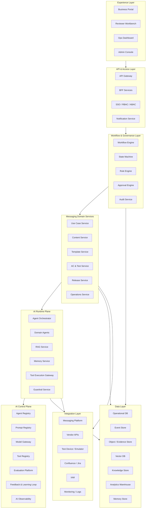
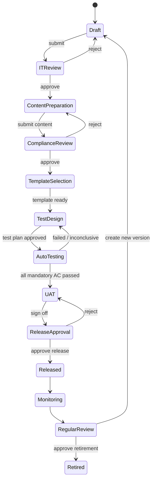
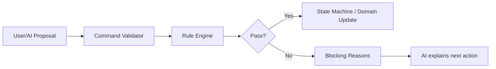
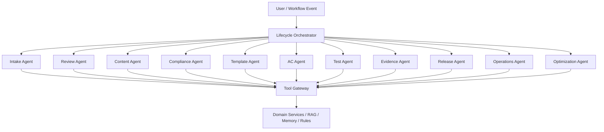
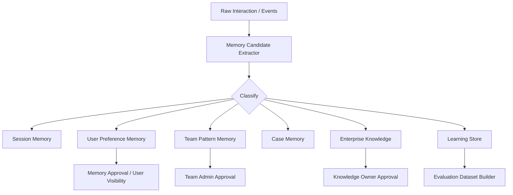
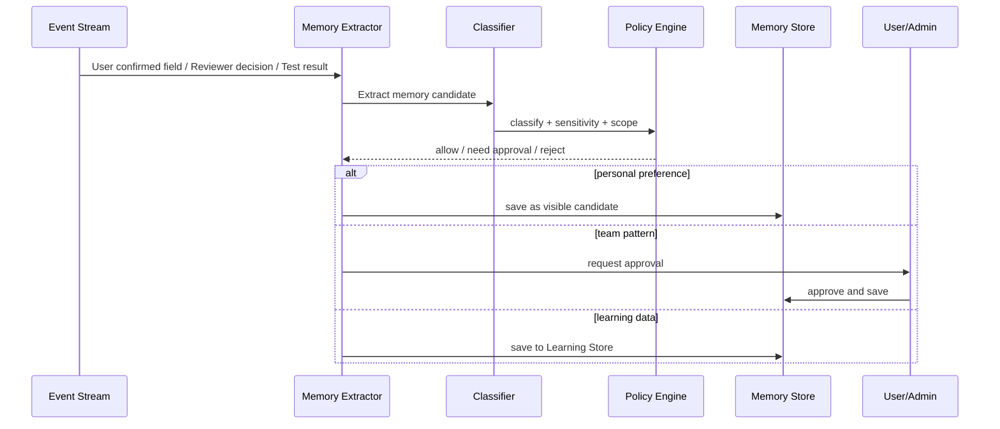
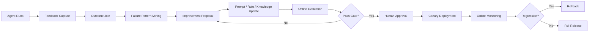
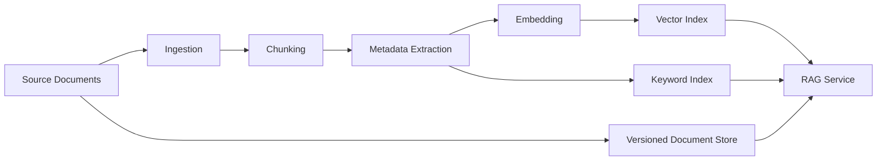
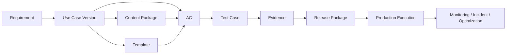

# AI Messaging Lifecycle Platform — AI技术架构设计文档 v2

> 本文档从 AI 架构师和企业系统架构师角度，定义 AI Messaging Lifecycle Platform 的目标架构、Agent 设计、Memory 设计、Learning Loop、数据架构、安全治理、集成方式和技术选型建议。

---

## 1. 架构目标

平台要解决的不是“如何调用大模型”，而是如何在银行环境中把 AI 放进一个可控、可审计、可持续演进的企业流程中。

核心架构目标：

1. **流程可控**：所有状态变更必须经过 Workflow / State Machine。
2. **规则可配置**：字段依赖、审批、合规、发布 Gate 由 Rule Engine 控制。
3. **AI可治理**：Agent、Prompt、Model、Tool、Memory、Evaluation 必须版本化、可审计、可回滚。
4. **资产可追踪**：Use Case、Content、Template、AC、Evidence、Release 必须端到端 lineage。
5. **Memory可解释**：记忆必须有来源、范围、权限、有效期和使用记录。
6. **Learning受控**：Agent 不能生产在线自我改写，必须经过离线评测和审批发布。
7. **供应商可替换**：模型、向量库、Workflow、Rule Engine、Agent框架都应可替换。

---

## 2. 总体技术架构



---

## 3. 核心架构原则

### 3.1 AI不能直接改业务状态

Agent 的输出必须是 **Proposal / Draft / Recommendation / Validation Result**，不能直接成为最终业务状态。

错误模式：

```text
Agent decides use case is ready → Directly submit to release
```

正确模式：

```text
Agent proposes SubmitForReview
→ Workflow Engine checks current state
→ Rule Engine checks required fields
→ User confirms
→ State Machine executes transition
→ Audit records action
```

### 3.2 规则不能写在Prompt里

Prompt可以解释规则，但不能成为规则的唯一来源。

必须配置化的规则包括：

- 字段必填规则。
- 字段依赖规则。
- Channel routing规则。
- Compliance mandatory/prohibited rules。
- Approval Matrix。
- AC coverage rules。
- Release Gate。
- Memory使用规则。

### 3.3 多Agent不是多Chatbot

每个Agent必须有明确边界：输入、输出、工具、权限、评测集、失败处理、Owner。

### 3.4 Runtime与Control Plane分离

- Runtime Plane 负责执行：Agent调用、RAG、Memory检索、Tool调用。
- Control Plane 负责治理：Agent版本、Prompt版本、Model选择、Eval、上线、回滚、审计。

---

## 4. 推荐技术栈

> 以下是建议技术栈，不是唯一方案。最终应根据银行内部标准、部署环境和供应商能力确认。

### 4.1 前端

| 能力 | 推荐 |
|---|---|
| Web App | React + Vite |
| UI Component | Ant Design / MUI / internal design system |
| Workflow visualization | React Flow |
| Form Engine | JSON Schema driven forms / custom metadata form engine |
| Rich text editor | TipTap / ProseMirror |
| Template Editor | GrapesJS-like controlled editor or custom component editor |

### 4.2 后端业务服务

| 能力 | 推荐 |
|---|---|
| Domain Services | Java Spring Boot 或 Python FastAPI，按银行主技术栈选择 |
| Workflow | Camunda / Flowable / Temporal / Spring State Machine |
| Rule Engine | Drools / DMN / custom rules service |
| API Gateway | Kong / Apigee / Spring Cloud Gateway / internal gateway |
| Auth | Enterprise SSO + RBAC/ABAC |
| Event | Kafka / Pulsar / internal MQ |

### 4.3 AI Runtime

| 能力 | 推荐 |
|---|---|
| Agent Orchestration | LangGraph / Microsoft Agent Framework / Semantic Kernel |
| RAG | LlamaIndex / LangChain / custom retrieval service |
| Model Gateway | Internal LLM gateway / Azure OpenAI gateway / OpenAI compatible gateway |
| Guardrails | Custom policy guardrail + structured output validation |
| Evaluation | Promptfoo / Ragas / DeepEval / custom golden dataset runner |
| Observability | OpenTelemetry + internal log platform + AI call logs |

LangGraph 官方文档将 persistence 分成 Checkpointers 和 Stores：Checkpointers 适合线程级短期状态，Stores 适合跨线程的长期应用数据；这与本平台的 Session Memory 与 Long-term Memory 分层设计匹配。Reference: https://docs.langchain.com/oss/python/langgraph/persistence

Microsoft Agent Framework 官方文档强调 session state、type safety、middleware、telemetry 和 graph-based workflow，适合偏 Microsoft / enterprise stack 的多Agent治理场景。Reference: https://learn.microsoft.com/en-us/agent-framework/overview/

LlamaIndex memory 文档提供短期消息队列和长期记忆提取能力，可作为 RAG 与记忆组件备选。Reference: https://developers.llamaindex.ai/python/framework/module_guides/deploying/agents/memory/

NIST AI RMF Generative AI Profile 提醒企业在生成式AI中管理数据隐私、信息完整性、安全、知识产权、价值链等风险，本平台的AI治理、评测、审计和人工Gate应与这些方向对齐。Reference: https://www.nist.gov/publications/artificial-intelligence-risk-management-framework-generative-artificial-intelligence

### 4.4 数据层

| 数据 | 推荐存储 |
|---|---|
| 业务结构化数据 | PostgreSQL / Oracle / internal RDBMS |
| 事件 | Kafka + Event Store table |
| 文件和证据 | Object Storage / S3 compatible / internal file store |
| 向量检索 | Milvus / pgvector / OpenSearch vector / Elasticsearch vector |
| 搜索 | OpenSearch / Elasticsearch |
| 分析 | Data warehouse / lakehouse |
| Memory | RDBMS + Vector DB + Event source |

---

## 5. Domain Service 设计

### 5.1 Use Case Service

职责：

- 管理Use Case草稿、版本、字段、状态。
- 保存字段来源、置信度、确认状态。
- 处理字段修改命令。
- 提供相似Use Case检索接口。
- 提供Impact Analysis输入。

核心API示例：

```http
POST /use-cases
GET /use-cases/{id}
POST /use-cases/{id}/commands/update-field
POST /use-cases/{id}/commands/submit-review
GET /use-cases/{id}/diff?compare_to=version
GET /use-cases/{id}/impact-analysis
```

### 5.2 Content Service

职责：

- 管理Content Brief、Source Pack、Content Package、Content Block。
- 管理内容版本、状态、合规审批结果。
- 提供局部修改和Diff。

### 5.3 Template Service

职责：

- 管理Template、Component、Asset、Rendering Plan。
- 提供模板推荐和Preview。
- 调用Renderer生成HTML或其他渠道模板。

### 5.4 AC & Test Service

职责：

- 管理AC、Test Case、Test Plan、Evidence Requirement。
- 管理AC与需求、内容、模板、routing之间的traceability。
- 调用测试系统执行测试。

### 5.5 Release Service

职责：

- 固化Release Package。
- 执行Release Gate。
- 保存UAT、Release审批和Rollback Plan。

### 5.6 Operations Service

职责：

- 接入发送状态、失败、fallback、成本和供应商表现。
- 生成Use Case Health Score。
- 提供Monitoring和Optimization数据。

---

## 6. Workflow 与 State Machine

### 6.1 推荐状态模型



### 6.2 命令模式

所有状态修改都应通过Command执行：

```json
{
  "command_type": "SubmitForITReview",
  "target_id": "UC-1001",
  "target_version": "v2",
  "requested_by": "USER-001",
  "payload": {},
  "idempotency_key": "..."
}
```

Command执行前检查：

- 当前状态是否合法。
- 用户权限是否足够。
- 必填字段是否完整。
- 是否存在阻塞问题。
- 是否需要审批。
- 是否存在版本冲突。

---

## 7. Rule Engine 设计

### 7.1 Rule类型

| Rule类型 | 示例 |
|---|---|
| Field Required Rule | Email channel requires subject and sender domain |
| Visibility Rule | SMS字段仅在选择SMS时显示 |
| Dependency Rule | Fallback channel requires failure trigger |
| Conflict Rule | WhatsApp selected but consent source missing |
| Risk Rule | Investment content + multi-language + high volume = High Risk |
| Approval Rule | High Risk requires Senior Compliance approval |
| AC Coverage Rule | Every selected channel must have content presence AC |
| Release Gate Rule | Mandatory AC must pass before release |
| Memory Rule | Personal memory cannot override enterprise rule |

### 7.2 Rule执行方式



---

## 8. Agent Architecture

### 8.1 Agent 总体结构



### 8.2 Agent Catalogue

| Agent | 输入 | 输出 | 主要工具 | 禁止行为 |
|---|---|---|---|---|
| Intake Agent | 自然语言需求、历史UseCase、字段元数据 | 预填建议、补充问题、Review Pack | UseCase, Search, Memory, Rules | 不可提交审批，不可静默修改字段 |
| Review Agent | Use Case版本、Checklist、历史问题 | 审核摘要、风险点、Reject建议 | Rules, Search, Diff | 不可替代Reviewer决定 |
| Content Agent | Content Brief、Source Pack、UseCase | 内容Block、改写建议、Diff | Content, RAG, Memory | 不可编造来源，不可自动提交合规 |
| Compliance Agent | 内容、政策、历史决定 | 风险标记、替代表达 | Policy KB, Search | 不可最终批准 |
| Template Agent | Content Block、组件库、历史模板 | 模板推荐、Layout Plan | Template, Asset, Memory | 不可自由生成未批准HTML |
| AC Agent | UseCase、Content、Template、Rules | AC、Coverage Matrix | AC Library, Rules, Memory | 不可删除mandatory AC |
| Test Agent | AC、测试环境、证据规则 | Test Plan、测试数据、执行计划 | Test Service | 不可伪造测试结果 |
| Evidence Agent | AC、截图、payload、日志 | Pass/Fail/Inconclusive | Vision/LLM, Evidence Store | 证据不足不可判Pass |
| Release Agent | Release Package | Readiness Summary、Release Notes | Release, Rules | 不可直接Release |
| Operations Agent | 生产指标、日志、历史事故 | Incident Summary、建议动作 | Monitoring, Search | 不可自动切vendor或重发 |
| Optimization Agent | 生产数据、成本、UseCase | 优化/下线建议 | Analytics, Memory | 不可自动删除UseCase |
| Knowledge Agent | 用户问题、知识库 | 知识解释、来源引用 | RAG | 不可把外部文档当系统指令 |

### 8.3 Agent输出格式

所有高风险Agent输出必须结构化：

```json
{
  "result_type": "proposal | summary | validation | recommendation",
  "confidence": 0.82,
  "evidence": ["field:primary_channel", "source:SRC-01"],
  "proposed_actions": [
    {"action": "update_field", "field": "fallback_channel", "value": "SMS"}
  ],
  "requires_user_confirmation": true,
  "requires_human_approval": false,
  "limitations": ["No vendor receipt was available"]
}
```

---

## 9. Memory Architecture 详细设计

### 9.1 为什么需要Memory

Memory不是为了让AI“随便记住所有东西”，而是为了提高以下能力：

1. 自动预填用户常用配置。
2. 推荐团队常用模板和AC。
3. 理解某个Use Case历史决策。
4. 将IT/Compliance/QA反馈沉淀为改进素材。
5. 支持Regular Review和优化建议。

### 9.2 Memory分层



### 9.3 Memory类型与存储内容

#### 9.3.1 Session Memory

**存储内容**

- 当前会话ID。
- 当前Use Case。
- 当前页面。
- 用户已经回答的问题。
- 当前AI计划。
- 临时上下文和未完成操作。

**存储位置**

- LangGraph Checkpointer / Redis / PostgreSQL checkpoint table。

**生命周期**

- 会话级或任务级。
- 任务完成后归档或删除。

**使用场景**

- 多轮对话不中断。
- 页面刷新后恢复。
- 长任务失败后恢复。

#### 9.3.2 User Preference Memory

**存储内容**

- 常用语言：例如 English + Traditional Chinese。
- 常用Channel：例如 Email primary + SMS fallback。
- 常用Content Type。
- 常用Template。
- 常用AC。
- 偏好的AI解释风格。
- 常用业务部门或审批人。

**不应存储**

- 客户个人资料。
- 未脱敏内容。
- 用户临时一次性选择。
- 敏感私人属性。

**使用方式**

- 作为推荐和预填候选。
- 展示“Based on your previous projects...”提示。
- 用户确认后才写入Use Case。

#### 9.3.3 Team Pattern Memory

**存储内容**

- 某业务部门常见Use Case类型。
- 常见渠道组合。
- 常见AC集合。
- 常见模板。
- 常见Reject Reason。
- 常见合规修改模式。

**审批要求**

- 由Team Admin或Product Owner确认。
- 只能作为团队推荐，不自动升级为企业规则。

#### 9.3.4 Case Memory

**存储内容**

- Use Case创建原因。
- 关键决策及原因。
- IT Reject历史。
- 合规修改记录。
- 测试失败记录。
- Release记录。
- 生产事故和优化建议。

**用途**

- 修改Use Case时了解历史原因。
- Regular Review时解释为什么保留或下线。
- 新Use Case匹配时作为参考。

#### 9.3.5 Enterprise Knowledge

**存储内容**

- 正式Messaging政策。
- Channel规则。
- Compliance policy。
- 品牌规范。
- 模板规范。
- AC标准。
- Vendor SLA。
- 历史事故复盘。

**重要原则**

- 这是正式知识库，不是个人记忆。
- 有Owner和版本。
- 变更需要审批。

#### 9.3.6 Learning Store

**存储内容**

- Agent输入输出。
- 用户采纳/拒绝/修改。
- Reviewer override。
- 合规审批结果。
- 测试结果。
- 生产事故关联。
- Prompt版本。
- Model版本。

**用途**

- 构建评测集。
- 分析Agent失败模式。
- 改进Prompt、Rules、Knowledge。
- 不直接注入普通用户上下文。

### 9.4 Memory数据模型

```sql
CREATE TABLE ai_memory (
  memory_id             VARCHAR PRIMARY KEY,
  memory_type           VARCHAR NOT NULL,
  subject_type          VARCHAR NOT NULL,
  subject_id            VARCHAR NOT NULL,
  scope                 VARCHAR NOT NULL,
  content               TEXT NOT NULL,
  structured_value      JSONB,
  source_type           VARCHAR,
  source_ids            JSONB,
  confidence            NUMERIC(4,3),
  status                VARCHAR,
  sensitivity_level     VARCHAR,
  owner_id              VARCHAR,
  approved_by           VARCHAR,
  created_at            TIMESTAMP,
  updated_at            TIMESTAMP,
  expires_at            TIMESTAMP,
  last_used_at          TIMESTAMP,
  embedding_id          VARCHAR,
  audit_ref             VARCHAR
);
```

### 9.5 Memory写入流程



### 9.6 Memory检索流程

1. Agent收到任务。
2. Orchestrator根据任务类型确定允许检索的Memory类型。
3. Memory Service按用户、部门、Use Case、任务阶段检索候选。
4. Policy Engine过滤无权限、过期、低置信度、冲突Memory。
5. 返回结构化Memory和引用。
6. Agent输出中必须说明使用了哪些Memory。

### 9.7 Memory冲突处理

优先级：

```text
Enterprise Rule > Compliance Policy > Current Use Case confirmed value > Team Pattern > User Preference > AI Inference
```

示例：

- 用户偏好常用SMS fallback。
- 当前Use Case没有SMS consent。
- 系统不能预填SMS fallback，只能提示“你通常使用SMS fallback，但当前缺少consent source”。

### 9.8 推荐框架实现

| Memory层 | 推荐实现 |
|---|---|
| Session Memory | LangGraph Checkpointer / Redis / DB checkpoint |
| User/Team/Case Memory | PostgreSQL structured table + vector embedding |
| Knowledge Memory | Versioned document store + vector index |
| Learning Store | Event warehouse + labeled dataset table |
| Retrieval Policy | Custom Memory Service + Policy Engine |

---

## 10. Learning Loop 设计

### 10.1 原则

Agent不能在线自我学习生产规则。所有学习必须经过：

```text
Observe → Collect Feedback → Diagnose → Improve → Evaluate → Approve → Deploy → Monitor → Rollback
```

### 10.2 Learning Loop架构



### 10.3 反馈类型

| 类型 | 示例 | 用途 |
|---|---|---|
| Explicit Feedback | 用户接受/拒绝/修改AI建议 | Prompt改进 |
| Reviewer Feedback | IT/Compliance/QA override | 规则和评测集 |
| Test Outcome | AC测试失败或证据不足 | Evidence Agent改进 |
| Production Outcome | Release后Incident | 增加测试和风险规则 |
| Cost/Usage Outcome | 高成本、低使用率 | 优化Agent改进 |

### 10.4 Agent评测指标

| Agent | 核心指标 |
|---|---|
| Intake Agent | 字段抽取准确率、问题相关性、预填接受率 |
| Content Agent | Source grounded率、合规拒绝率、人工修改比例 |
| Compliance Agent | 风险召回率、误报率、漏报率 |
| Template Agent | 推荐采纳率、模板测试失败率 |
| AC Agent | AC覆盖率、重复率、QA修改率 |
| Evidence Agent | Pass/Fail/Inconclusive准确率、证据引用准确率 |
| Operations Agent | 异常摘要准确率、根因建议采纳率 |

### 10.5 发布Gate

Agent新版本必须满足：

- Golden Dataset不低于基线。
- 高风险场景无严重回归。
- Prompt Injection测试通过。
- 权限测试通过。
- 成本不超阈值。
- Human approval完成。
- 支持回滚。

---

## 11. RAG与知识库架构

### 11.1 知识来源

- Confluence页面。
- Messaging政策文档。
- Compliance guideline。
- Template guideline。
- 历史Use Case。
- 历史AC。
- 历史Incident。
- Vendor SLA。
- FAQ。

### 11.2 处理流程



### 11.3 Metadata要求

每个知识片段必须有：

- document_id。
- source_system。
- owner。
- effective_date。
- expiry_date。
- version。
- jurisdiction。
- business_domain。
- sensitivity。
- access_scope。

### 11.4 检索策略

推荐使用混合检索：

- Keyword search：用于精确匹配政策编号、字段名、模板ID。
- Vector search：用于语义相似Use Case和历史案例。
- Reranking：提升相关性。
- Metadata filter：按部门、权限、版本、有效期过滤。

---

## 12. Evidence Validation 架构

### 12.1 Evidence Bundle结构

```json
{
  "test_run_id": "TR-1001",
  "ac_id": "AC-18",
  "evidence_items": [
    {"type": "screenshot", "uri": "...", "captured_at": "..."},
    {"type": "payload", "uri": "..."},
    {"type": "system_log", "uri": "..."},
    {"type": "vendor_receipt", "uri": "..."}
  ],
  "ai_validation": {
    "result": "Pass | Fail | Inconclusive",
    "reason": "...",
    "evidence_refs": ["payload.line.subject", "screenshot.region.header"]
  },
  "human_review": {
    "result": "Pass",
    "reviewer": "...",
    "override_reason": "..."
  }
}
```

### 12.2 判断原则

- 如果AC需要日志但只有截图，则最多 Inconclusive。
- 如果截图显示内容正确但payload错误，则Fail或需要人工复核。
- AI必须说明引用了哪条证据。
- 不允许证据缺失时强行判Pass。

---

## 13. 数据模型概要

### 13.1 主要表

| 表 | 内容 |
|---|---|
| use_case | Use Case主表 |
| use_case_version | 版本表 |
| use_case_field_value | 字段值、来源、置信度 |
| content_package | 内容包 |
| content_block | 内容块 |
| template | 模板 |
| template_component | 组件 |
| acceptance_criteria | AC |
| test_case | 测试用例 |
| evidence_bundle | 证据包 |
| release_package | 发布包 |
| approval_record | 审批记录 |
| workflow_task | 工作流任务 |
| event_log | 业务事件 |
| ai_run | AI运行记录 |
| ai_memory | AI记忆 |
| ai_feedback | AI反馈 |

### 13.2 Lineage关系



---

## 14. 安全与治理

### 14.1 权限

- RBAC：按角色控制。
- ABAC：按部门、Use Case、数据敏感级别控制。
- Tool-level permission：Agent只能调用授权工具。
- Memory-level permission：不同Memory有不同scope。

### 14.2 数据保护

- 输入模型前进行脱敏。
- 不允许客户PII进入长期Memory。
- 外包环境使用脱敏数据。
- AI日志保存需遵循数据保留策略。
- 敏感文档检索必须按权限过滤。

### 14.3 Prompt Injection防护

- 外部文档只作为数据，不作为系统指令。
- RAG内容和系统Prompt分离。
- Tool调用必须经过Policy Engine。
- Agent输出必须结构化验证。
- 高风险操作必须人工确认。

### 14.4 审计

每次AI调用保存：

- user_id。
- use_case_id。
- agent_id。
- agent_version。
- prompt_version。
- model。
- retrieved_knowledge。
- retrieved_memory。
- tool_calls。
- input_hash。
- output。
- human_action。
- timestamp。

---

## 15. 集成架构

| 系统 | 集成内容 | 方向 |
|---|---|---|
| Messaging Platform | 创建/读取Use Case配置、触发测试发送、读取状态 | 双向 |
| Vendor APIs | Delivery receipt、failure code、cost | 读取 |
| Test Device/Emulator | 发送测试、获取截图 | 双向 |
| Confluence | 知识库导入 | 读取 |
| Jira | 创建defect或任务 | 双向 |
| IAM/SSO | 用户、角色、部门 | 读取/认证 |
| Monitoring/Logs | 生产日志、错误码、延迟 | 读取 |
| Finance/Cost Data | vendor/channel成本 | 读取 |
| Object Storage | 文件、截图、证据 | 双向 |

---

## 16. 部署建议

### 16.1 环境

- Dev。
- SIT。
- UAT。
- Pre-prod。
- Production。

### 16.2 服务边界

推荐微服务或模块化单体起步：

- Web Portal。
- Workflow Service。
- Domain Services。
- AI Runtime Service。
- AI Control Service。
- Data Ingestion Service。
- Evidence Service。
- Analytics Service。

第一版可以模块化单体 + 独立AI Runtime，后续逐步拆分。

### 16.3 高可用

- Workflow任务可恢复。
- Agent调用超时和重试。
- Model Gateway fallback。
- Event消费幂等。
- Evidence上传幂等。
- 关键服务健康检查。

---

## 17. MVP技术范围

MVP应实现：

1. React Portal。
2. Use Case元数据驱动表单。
3. Workflow和状态机。
4. 基础Rule Engine。
5. Intake Agent。
6. Content Agent。
7. AC Agent。
8. Evidence Agent简化版。
9. Prompt Registry基础版。
10. Memory Service基础版：Session + User Preference + Case History。
11. Operational DB。
12. Object/Evidence Store。
13. 基础向量检索。
14. Audit Log。
15. Release Package。

MVP暂不实现：

- 完整自动Template生成。
- 完整成本优化。
- 自动Vendor切换。
- 高级Agent自动评测平台。
- 自动生产事故根因闭环。

---

## 18. 外包交付架构要求

供应商必须交付：

1. 架构设计文档。
2. 数据模型和API文档。
3. Agent Catalogue。
4. Prompt Catalogue。
5. Memory Design。
6. Rule Catalogue。
7. Evaluation Plan。
8. Security Design。
9. Deployment Guide。
10. Runbook。
11. 源代码和配置。
12. 测试报告。
13. 知识转移材料。

供应商不得只交付黑盒Agent，必须提供可审计、可配置、可回滚的AI工程资产。

---

## 19. 技术风险与缓解

| 风险 | 缓解 |
|---|---|
| AI hallucination | Source grounding、结构化输出、人工审批 |
| Memory污染 | Memory分类、审批、TTL、权限、审计 |
| Prompt不可维护 | Prompt Registry、版本、评测、回滚 |
| 规则写死 | Rule Engine和Admin配置 |
| Evidence误判 | 多证据、Inconclusive、人工复核 |
| 外包锁定 | 标准API、模型网关、代码和Prompt归银行所有 |
| 数据泄漏 | 脱敏、权限、私有部署、日志策略 |
| 流程绕过 | State Machine + Command validation |

---

## 20. 结论

本平台的技术关键不是选择某一个大模型，而是建立一套银行级 AI Operating System：

```text
Workflow controls process
Rule Engine controls constraints
Domain Services control business state
AI Agents provide intelligence
Memory provides personalization and organizational learning
Evaluation controls improvement
Audit controls accountability
```

只有这样，AI 才能从 Demo 变成可在银行流程中长期运行的企业级产品能力。

