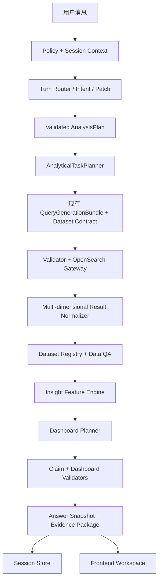
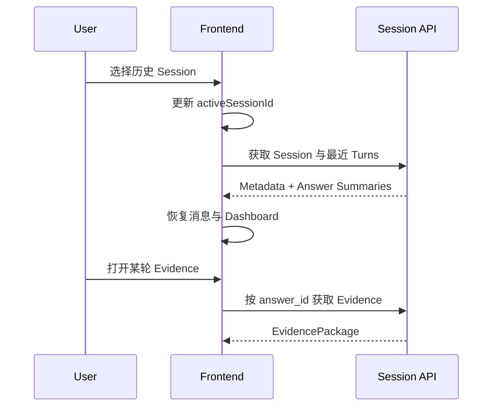

# OpenSearch ChatBI：Dashboard、Evidence 与 Session 工作区详细技术升级执行方案 V4

> 文档定位：在内网已完成的统一 I3 智能增强基础上，针对实际联调测试暴露出的“单图回答、二维结果丢失、分析文案死板、Evidence 不可核查、左侧仍是演示问题而非会话管理”等问题，进行一次增量修复和产品完善。
>
> 本文是给内网 AI/开发人员直接执行的增量技术规格。现有统一 I3 中已冻结的安全查询、一次生成候选 QueryPlan+DSL+ResultContract、确定性 Tool 选择、MCP Gateway、意图识别、多轮追问、Query Reuse、Metric、Grounding 和单一 Orchestrator 原则继续有效；本文只覆盖本次新增与需要替换的 Dashboard、Dataset、Evidence、Session 和前端工作区部分。除本文明确列出的兼容迁移外，不重做现有查询主链。

---

## 0. 给内网 AI 的最高优先级执行协议

### 0.1 第一轮必须先读项目，不得直接编码

开始任何修改前，必须完整阅读：

1. 项目根目录的 `project_memory.md`；
2. 当前 `README`、启动说明和配置说明；
3. 当前内网实际采用的统一 I3 执行方案和 I3 完成报告；
4. 本 V4 文档；
5. 当前 Session、Orchestrator、Query、ResultNormalizer、Metric、Insight、Chart、Evidence、API 和前端实现；
6. 当前所有 Unit、Integration、Golden、API 和前端手工测试；
7. 用户本轮测试中涉及的请求、DSL、OpenSearch 返回、NormalizedResult 和页面截图。

第一轮只允许完成“现状审计与改造映射”，不得立即编码。

必须回答：

- 当前是否仍限制一个 Answer 只能有一个 `ChartSpec`；
- 当前一个用户问题能否包含多个 Analytical Task；
- 当前 `NormalizedResult` 是否只允许一个 Dataset；
- “月份 × Channel”在哪一层丢失 Channel；
- 月度分桶是否显式使用 `Asia/Hong_Kong`；
- 多个月份索引是一次查询还是多 Step 查询，如何合并；
- 当前 Evidence 默认向用户展示什么；
- 当前 Session 是否持久化；
- 刷新页面和切换 Session 后能否恢复 Dashboard 和 Evidence；
- 左侧“可演示问题”由哪些文件和数据驱动；
- 当前 `/api/chat`、`/api/session/reset` 的真实请求和响应结构；
- 当前前端是 Vanilla JS、React，还是混合实现；
- 现有测试基线和失败项。

未经确认，不得进入编码。

### 0.2 必须复用现有工程

本次是增量升级，不得：

- 从零重建项目；
- 为匹配本文类名而大规模重命名现有代码；
- 新增一套平行的 Dashboard 后端；
- 新增拥有自由工具循环的 Dashboard Agent；
- 绕过现有 `ChatBIOrchestrator`；
- 绕过统一 `/api/chat` 主入口处理用户分析；
- 让前端直接请求 OpenSearch；
- 让 LLM 生成可执行 JavaScript、HTML 或完整 ECharts option；
- 为每张图默认执行一条独立查询；
- 仅修改前端图表库来掩盖后端二维数据丢失；
- 把内部 Agent JSON 继续当作普通用户 Evidence；
- 将用户会话仅保存在浏览器内存或 `localStorage`；
- 切换 Session 时只恢复聊天文字、不恢复回答快照。

### 0.3 本次升级的最终目标

将当前产品从：

```text
自然语言问题
→ 一份查询结果
→ 一张图
→ 一段模板化总结
→ 一串内部执行 JSON
```

升级为：

```text
自然语言问题
→ 分析任务规划
→ 一次或少量受控查询
→ 一个或多个完整 Dataset
→ 动态 Dashboard
→ 可核查的业务洞察
→ 分层 Evidence
→ 可恢复、可切换的多 Session 工作区
```

---

## 1. 当前实际问题与待验证根因

本节列出的根因是根据联调现象形成的高概率假设，不是脱离代码和失败证据即可认定的
最终结论。首轮审计必须保存同一请求在 QueryPlan、DSL、OpenSearch Raw Response、
Normalizer、API 和前端各层的实际结构；只有证据闭环后才修改对应层。

### 1.1 当前不是 BI Dashboard，而是“查询结果自动画一张图”

从当前测试效果看，系统已经具备：

- 自然语言理解；
- QueryPlan/DSL 生成；
- OpenSearch 查询；
- 基础结果标准化；
- 单一图表输出；
- 基础多轮追问；
- 技术执行 Evidence。

但仍缺少：

- 一个问题拆成多个分析视角；
- 同一个 Dataset 支撑多个可视化；
- 多 Dataset 的结果契约；
- KPI、图表、数据表和分析结论的组合布局；
- 对二维及多维结果的完整保留；
- 真正面向业务问题的洞察计算；
- 用户可理解、可对账的 Evidence；
- 可持久化并恢复完整分析状态的 Session 管理。

### 1.2 “三个月 × 每个 Channel”失败不是 ECharts 能力不足

用户问题：

> 查看 5 月、6 月、7 月每个 Channel 分别发送多少。

其逻辑粒度应为：

```text
month × channel
```

正确的标准化结果至少应包含：

```json
[
  {
    "row_id": "2026-05|SMS",
    "month": "2026-05",
    "channel": "SMS",
    "total_count": 123456
  },
  {
    "row_id": "2026-05|EMAIL",
    "month": "2026-05",
    "channel": "EMAIL",
    "total_count": 234567
  },
  {
    "row_id": "2026-06|SMS",
    "month": "2026-06",
    "channel": "SMS",
    "total_count": 135790
  }
]
```

当前页面最终只得到：

```text
month + total_count
```

说明问题更可能发生在以下链路之一：

1. QueryPlan 声明了两个维度，但 DSL 只生成外层月份；
2. DSL 包含 `date_histogram → terms(channel)`，但 `ResultNormalizer` 只展开外层 Bucket；
3. 多索引查询分别返回 Channel，但结果合并器按 Month 二次汇总时丢失 Channel；
4. Result Contract 未强制校验 `grain = [month, channel]`；
5. API 序列化只输出 Chart 使用到的字段；
6. 前端 Chart Adapter 把二维 Dataset 错误转换成单系列。

必须从 QueryPlan、DSL、原始聚合响应、Normalizer、Dataset、API 到 ECharts 逐层定位，不得只看最终页面。

### 1.3 月份出现偏移是查询时区问题

如果请求 5 月至 7 月却出现 `2026-04-01` 或类似错误 Bucket，应重点检查：

- Time Resolver 是否先把业务时间边界正确转换为 UTC instant；
- Range Query 是否原样使用已经冻结的 UTC `gte`/`lt`；
- `date_histogram` 是否使用业务时区；
- 是否错误使用 UTC 的 Bucket Key 再在前端截取月份；
- 多索引合并时是否以 UTC 时间戳重建 Month；
- 是否把索引月份直接等同于业务月份。

本项目业务时区冻结为：

```text
Asia/Hong_Kong
```

时间范围应采用左闭右开：

```text
[2026-05-01 00:00:00, 2026-08-01 00:00:00)
```

不能用 `2026-07-31 23:59:59` 作为默认上界。

本项目的统一规则是：

```text
用户业务时间：Asia/Hong_Kong [2026-05-01 00:00, 2026-08-01 00:00)
Time Resolver：转换为 [2026-04-30T16:00:00Z, 2026-07-31T16:00:00Z)
Range DSL：使用上述 UTC gte/lt，不再次解释 now 或本地时区
date_histogram：calendar_interval=1M 且 time_zone=Asia/Hong_Kong
前端 month：使用后端规范化后的 yyyy-MM，不从 UTC 时间戳自行截取
```

### 1.4 当前 Evidence 是“调试日志”，不是“数据依据”

普通用户真正需要核查的是：

- 查询了什么时间范围；
- 使用了哪些索引；
- 应用了什么过滤；
- 每个指标怎么计算；
- OpenSearch 聚合后得到了哪些行；
- 图表和结论用了哪些数据；
- 总计能否对上；
- 是否有截断、缺失、时区或部分失败。

普通用户不需要默认阅读：

- Intent Agent JSON；
- ResolvedAnalysis JSON；
- TurnDecision JSON；
- Query Repair 流程；
- Validator 每一步内部状态；
- 完整 LLM Prompt；
- Agent 调用链流水。

### 1.5 左侧“可演示问题”不是正式信息架构

当前左侧样例问题仅适合 Demo 初期，存在以下问题：

- 无法切换历史分析；
- 无法明确当前 Session；
- 页面刷新后上下文易丢失；
- 多轮分析没有可见边界；
- 用户无法新建、重命名、归档 Session；
- 历史回答不能恢复 Dashboard 和 Evidence；
- 左侧空间被低价值固定样例长期占用。

正式形态应改为：

```text
左侧：Session 管理
中间：当前 Session 的对话与 Dashboard
右侧抽屉/弹层：当前回答的数据依据与高级查询详情
```

“可演示问题”保留，但移动到：

- 新 Session 的空状态；
- 输入框上方的建议问题；
- 帮助入口；
- 首次使用引导。

不得继续作为常驻一级导航。

---

## 2. V4 范围、非目标与冻结决策

### 2.1 本次必须完成

1. 修复 `month × channel` 二维查询和结果标准化；
2. 修复 `Asia/Hong_Kong` 月份分桶；
3. 将单个 `NormalizedResult` 升级为 `datasets[]`；
4. 增加 `AnalyticalTaskPlan`；
5. 将单个 `ChartSpec` 升级为 `DashboardSpec.blocks[]`；
6. 同一个 Dataset 可复用到多个图表和表格；
7. 增加确定性 `InsightFeatureEngine`；
8. 重构 Summary、Insight 与 Claim Grounding；
9. 将 Evidence 重构为业务层、查询层、调试层；
10. 左侧改为真正的 Session 管理；
11. Session 持久化并支持刷新恢复；
12. 历史 Turn 恢复对应 Dashboard、Dataset 和 Evidence；
13. 新建会话、当前会话新问题、追问、重置上下文和归档会话语义分离；
14. 增加完整 Unit、Integration、API、Golden 和前端验收；
15. 更新 `README` 和 `project_memory.md`。

### 2.2 冻结决策

本次明确：

- 继续使用 ECharts；
- 本阶段不迁移 Plotly；
- 不固定“每个回答必须多图”；
- 不固定“每张图一条查询”；
- 一个 Answer 对应一个 Dashboard；
- 一个 Dashboard 可包含 0～4 个图表；
- 一个 Dashboard 可包含多个 KPI、表格和说明块；
- 一个 Answer 可包含 1～N 个 Dataset；
- 多数二维问题优先使用一个完整 Base Dataset；
- 现有 Query LLM 继续只生成候选 QueryPlan、DSL 和 ResultContract；
- 本次 Presentation LLM 只生成声明式分析/展示候选和自然语言，不获得查询或执行权；
- 程序负责数据计算、可行性校验、ECharts 编译和安全；
- Session 由后端持久化；
- 前端 `localStorage` 只能保存非权威 UI 偏好，不得作为 Session 数据源。

### 2.3 本次非目标

- 不建设通用拖拽式 BI 编辑器；
- 不允许用户自由编写 ECharts option；
- 不建设跨用户共享 Dashboard；
- 不建设多人实时协作；
- 不建设长期数据仓库；
- 不拉取数百万条原始消息文档到浏览器；
- 不做预测；
- 不做没有诊断维度支持的根因归因；
- 不建设复杂 RBAC 管理后台；
- 不迁移 React 或其他前端框架，除非项目当前已经使用该框架；
- 不因本文示例修改已冻结的业务指标口径。

本文示例中的 `document_count` 只表示“OpenSearch document count”这一冻结语义。实际
`metric_id` 使用内网当前 Metric Registry 已注册的 ID；不得为了匹配示例把
`record_count`、`document_count` 等现有 ID 直接重命名。若当前存在多个同义 ID，应在
首轮审计中统一说明并通过兼容 alias 迁移。

### 2.4 现有统一 I3 回归红线

本次新增 Dashboard/Evidence/Session 时，以下能力必须保持：

- AnalysisPlan 只表达业务意图，不含 Tool/DSL；
- ResolvedAnalysis 完成后，真实 LLM 一次生成候选
  QueryPlan + DSL + ResultContract；
- 候选查询仍通过现有确定性合同、语义、时间/Mapping、DSL 安全/成本和一致性校验；
- Tool 仍由程序选择，LLM 不选择、不调用 MCP Tool；
- 业务代码只通过 OpenSearch MCP Gateway 执行 Count/Search/Msearch；
- 不使用 PPL、Generic OpenSearch API、自由 Tool Loop 或 QueryPlanningTool；
- 不为 Dashboard 引入 LangGraph、多 Agent 编排或第二个 Orchestrator；
- `failure_rate.v1` 仍使用规范化 `status`，最终计算只在 Metric Engine；
- `statusCode` 仍只作为未来运营商码表输入，不替代 v1；
- `candidate_role` 和 blocked/review_required 字段继续在 Prompt、DSL、结果、Dashboard、
  CSV、Session 和 Evidence 全链路为零；
- 支持全部月份，默认 2026 年 7 月，时间继续使用 `Asia/Hong_Kong` 和 `[start,end)`；
- 现有 `/api/chat` 仍是所有分析 Golden 的统一入口；
- 前端不计算业务指标，不执行 LLM HTML/JavaScript/ECharts option；
- 继续复用当前 FastAPI/Jinja2/Vanilla JavaScript 形态，ECharts 从本地
  `static/vendor` 加载，不增加外部 CDN 或 Node 构建流程；若内网当前实际技术栈已经
  正式变化，先在审计中说明，不在本次顺带迁移框架。

以上任一回归都属于发布阻断，不能用新 Dashboard 的视觉效果抵消。

---

## 3. 统一总体架构



### 3.1 单一 Orchestrator 不变

仍由一个 `ChatBIOrchestrator` 控制主流程。建议在现有统一 I3 流程中插入或增强：

```text
Validated AnalysisPlan
→ AnalyticalTaskPlanner
→ 现有 Query Generation
→ Gateway
→ Multi-dimensional Result Normalizer
→ Dataset Registry
→ Data QA
→ InsightFeatureEngine
→ DashboardPlanner
→ ClaimGroundingValidator
→ DashboardFeasibilityValidator
→ ResponseAssembler
→ AnswerSnapshot
→ SessionStore
```

不得增加一个自由决定并执行查询的 “Dashboard Agent”。

现有查询合同保持不变：

```text
ResolvedAnalysis
→ 真实 LLM 一次生成候选 QueryPlan + DSL + ResultContract
→ 确定性校验
→ 程序 ToolSelector
→ MCP Gateway
```

本次新增的 `DatasetContract` 可以作为 `ResultContract` 的扩展或被其引用，但不得再增加
第二套 QueryPlan/DSL 生成链，不得让 Dashboard 模块直接生成或执行查询。

`AnalyticalTaskPlanner`、`InsightFeatureEngine`、`DashboardPlanner` 和两个 Validator
是逻辑职责，不代表必须创建四个 Agent、四次 LLM 调用或四套独立服务。优先归并为：

```text
Dataset & Metric Service
  = Result Contract + Normalizer + Derived Dataset + Metric + Data QA

Presentation Service
  = Analytical Task + Insight Facts + DashboardSpec + Grounding + Feasibility

Evidence Service
  = 面向业务的数据依据 + 高级查询详情 + 受控 Debug
```

其中：

- MCP Gateway 只负责与 OpenSearch MCP 通信，不计算指标、不分析报表、不画图；
- Dataset & Metric Service 负责后端数据报表计算和对账，不负责浏览器渲染；
- Presentation Service 生成受控 DashboardSpec 和结论候选，不生成 ECharts option；
- 前端固定 Adapter 才负责把已验证 DashboardSpec 渲染为 ECharts。

### 3.2 四个数量必须分开

实现时必须区分：

| 对象 | 含义 | 是否通常一一对应 |
|---|---|---|
| Analytical Task | 为回答问题需要完成的分析视角 | 否 |
| Query/Execution Step | 实际访问 OpenSearch 的查询步骤 | 否 |
| Dataset | 标准化后可供分析与展示的数据集 | 否 |
| Dashboard Block | KPI、Chart、Table、Insight 等展示组件 | 否 |

例如“三个月 × Channel”：

- Analytical Task：总览、月份比较、Channel 构成、Channel 变化；
- Query：通常 1 条跨索引二维聚合，或受工具限制拆成 3 个 Step；
- Base Dataset：1 个 `month × channel`；
- Derived Dataset：可选 2～3 个；
- Dashboard Block：KPI、堆叠柱状图、热力图、透视表、洞察。

不能因为有 4 个分析视角就默认执行 4 次 OpenSearch 查询。

---

## 4. 核心数据模型

所有模型使用严格 Schema，建议 Pydantic `extra="forbid"`。

### 4.1 AnalyticalTaskPlan

```python
class AnalyticalTask(BaseModel):
    task_id: str
    task_type: Literal[
        "single_value",
        "overview",
        "trend",
        "comparison",
        "composition",
        "ranking",
        "change",
        "distribution",
        "anomaly_screening",
        "detail_table"
    ]
    question: str
    required_metrics: list[str]
    required_dimensions: list[str]
    required_grain: list[str]
    preferred_views: list[str]
    priority: Literal["primary", "supporting"]


class AnalyticalTaskPlan(BaseModel):
    plan_id: str
    analysis_plan_id: str
    complexity: Literal["simple", "one_dimensional", "two_dimensional", "diagnostic"]
    tasks: list[AnalyticalTask]
    max_chart_blocks: int = 3
    requires_multiple_queries: bool = False
    query_split_reason: str | None = None
```

约束：

- `requires_multiple_queries` 只是建议，最终由 Query Planner 和程序验证；
- 不允许每个 Task 自动生成一条查询；
- `preferred_views` 不是最终图表决定；
- 不支持的诊断任务必须标记不可回答或降级；
- 一个简单问题不得强行扩展为无关 Dashboard。

### 4.2 DatasetContract

```python
class DatasetColumn(BaseModel):
    name: str
    data_type: Literal[
        "string", "integer", "number", "percentage", "date", "datetime", "boolean"
    ]
    semantic_role: Literal["dimension", "metric", "identifier", "label"]
    metric_id: str | None = None
    unit: str | None = None


class DatasetContract(BaseModel):
    contract_id: str
    dataset_id: str
    grain: list[str]
    dimensions: list[str]
    metrics: list[str]
    columns: list[DatasetColumn]
    primary_key: list[str]
    expected_complete_dimensions: list[str]
    source_task_ids: list[str]
```

`grain` 是强制契约，不是描述性文字。

如果 `grain = ["month", "channel"]`，则以下结果必须拒绝：

```json
[
  {"month": "2026-05", "total_count": 1000}
]
```

原因：缺少 `channel`，不满足 Result Contract。

### 4.3 Dataset

```python
class Dataset(BaseModel):
    dataset_id: str
    contract_id: str
    title: str
    kind: Literal["base", "derived", "evidence_sample"]
    grain: list[str]
    columns: list[DatasetColumn]
    rows: list[dict]
    row_count: int
    complete: bool
    truncated: bool
    source_dataset_ids: list[str] = Field(default_factory=list)
    derivation_id: str | None = None
    source_query_hashes: list[str] = Field(default_factory=list)
    warnings: list[str] = Field(default_factory=list)
```

每行必须有稳定 `row_id`。建议由规范化主键生成，不得使用页面数组下标。

### 4.4 DatasetBundle

```python
class DatasetBundle(BaseModel):
    bundle_id: str
    datasets: list[Dataset]
    data_qa: list["DataQACheck"]
    reconciliation: list["ReconciliationCheck"]
    complete: bool
    warnings: list[str]
```

替换现有统一 I3 的单个 `NormalizedResult`：

```text
NormalizedResult
→ DatasetBundle.datasets[]
```

兼容期可以保留旧字段：

```json
{
  "normalized_result": null,
  "datasets": []
}
```

但新前端不得依赖旧 `normalized_result`。

### 4.5 DashboardSpec

```python
class DashboardSpec(BaseModel):
    dashboard_id: str
    title: str
    subtitle: str | None
    layout: Literal["auto_grid"]
    blocks: list["DashboardBlock"]
    default_evidence_dataset_id: str | None
    warnings: list[str]
```

允许的 Block：

```text
answer_summary
context_summary
kpi_group
chart
data_table
pivot_table
insight_list
warning
empty_state
clarification
follow_up_suggestions
```

本次验收所需的图表白名单为：

```text
bar
stacked_bar
line
multi_line
heatmap
none
```

`area`、`stacked_area`、`pie`、`donut`、`scatter` 不作为本次必做能力。以后只有在真实
问题、数据语义、Feasibility Validator、前端 Adapter 和 Golden 测试全部补齐后，才按
白名单扩展，不能只在 Prompt 中增加图表名称。

本次不支持：

```text
任意 custom series
任意 formatter 函数
任意 graphic
任意 dataset transform 表达式
任意 JavaScript
任意 ECharts option 透传
```

### 4.6 ChartBlock

```python
class ChartEncoding(BaseModel):
    x: str | None = None
    y: str | None = None
    series: str | None = None
    value: str | None = None
    size: str | None = None


class ChartBlock(BaseModel):
    block_id: str
    type: Literal["chart"]
    title: str
    subtitle: str | None
    dataset_id: str
    chart_type: Literal[
        "bar", "stacked_bar", "line", "multi_line", "heatmap", "none"
    ]
    encoding: ChartEncoding
    orientation: Literal["vertical", "horizontal"] | None
    stacking: Literal["none", "normal", "percent"] = "none"
    top_n: int | None = None
    include_others: bool = False
    show_legend: bool = True
    show_labels: bool = False
    height: Literal["sm", "md", "lg"] = "md"
    evidence_refs: list[str]
```

`top_n` 如果改变数据完整性，必须由后端生成 Derived Dataset；前端不得自行删除数据后再让 Evidence 声称完整。

### 4.7 InsightClaim

```python
class InsightClaim(BaseModel):
    claim_id: str
    claim_type: Literal[
        "direct_answer",
        "total",
        "ranking",
        "comparison",
        "change",
        "share",
        "trend",
        "anomaly",
        "limitation"
    ]
    text: str
    importance: Literal["primary", "secondary"]
    evidence_refs: list["EvidenceRef"]
```

### 4.8 EvidencePackage

```python
class EvidencePackage(BaseModel):
    evidence_id: str
    business_summary: "BusinessEvidenceSummary"
    result_tables: list["EvidenceResultTable"]
    metric_definitions: list["MetricDefinitionView"]
    reconciliation: list["ReconciliationCheck"]
    data_quality: list["DataQualityView"]
    query_details: "QueryEvidence"
    debug_details: "DebugEvidence | None"
```

### 4.9 Session 与 AnswerSnapshot

```python
class ChatSession(BaseModel):
    session_id: str
    owner_id: str
    title: str
    title_source: Literal["auto", "user"]
    status: Literal["active", "archived"]
    active_answer_id: str | None
    pending_clarification: dict | None
    session_version: int
    created_at: str
    updated_at: str
    last_message_preview: str | None


class AnswerSnapshot(BaseModel):
    answer_id: str
    session_id: str
    chronological_parent_answer_id: str | None
    analytical_base_answer_id: str | None
    turn_kind: Literal["new_analysis", "clarification_answer", "follow_up"]
    analysis_plan: dict
    analytical_task_plan: AnalyticalTaskPlan
    query_plan: dict | None
    dataset_bundle: DatasetBundle | None
    dashboard_spec: DashboardSpec | None
    claims: list[InsightClaim]
    evidence_package: EvidencePackage
    semantic_model_version: str
    mapping_fingerprint: str
    metric_versions: dict[str, str]
    policy_version: str
    config_version: str
    reusable_until: str | None
    display_until: str | None
    created_at: str
```

必须区分：

- `chronological_parent_answer_id`：Session 内上一轮回答；
- `analytical_base_answer_id`：本轮真正继承数据或计划的回答。

新问题可以发生在同一个 Session，但：

```text
turn_kind = new_analysis
analytical_base_answer_id = null
```

不得因为它仍在同一个 Session 就偷偷继承上轮过滤条件。

---

## 5. AnalyticalTaskPlanner 设计

### 5.1 职责

`AnalyticalTaskPlanner` 回答：

> 为了完整回答这个问题，需要哪些分析视角？

它不负责：

- 生成 DSL；
- 执行查询；
- 正式计算指标；
- 选择最终 ECharts option；
- 自由扩展用户未问的业务范围。

### 5.2 推荐实现

采用：

```text
确定性复杂度识别
+ 确定性默认任务规则
+ 必要时使用现有 Presentation LLM 生成候选任务
+ Task Policy Validator
```

输入：

- 已确认 `AnalysisPlan`；
- 支持的指标和维度；
- 数据源能力；
- 允许的任务类型；
- 最大图表数；
- 用户是否明确要求特定视角。

输出严格 `AnalyticalTaskPlan`。

第一版不要求为 `AnalyticalTaskPlanner` 新增一次独立 LLM 调用。能由第 5.3 节规则确定的
任务直接由程序产生；只有诊断型或用户明确要求多个视角且规则无法覆盖时，才复用现有
Presentation LLM。

无论使用规则还是 LLM，Task 都不能：

- 增加 AnalysisPlan 未批准的新指标、过滤、时间或业务范围；
- 引用 Semantic Resolution 未批准的字段；
- 因为想多画图而要求新的 OpenSearch 查询；
- 把“构成、变化、排名”等 Derived Dataset 运算误写为生产新指标。

若某个展示视角确实需要新的 Grain，必须回到现有 AnalysisPlan Patch 和
QueryGenerationBundle 主链，不能由 Dashboard 模块旁路查询。

### 5.3 默认任务规则

| 问题结构 | 最低任务 | 推荐展示 |
|---|---|---|
| 单指标，无维度 | single_value | KPI + 简短回答 |
| 单指标，单类别维度 | ranking/comparison | KPI + Bar + Table |
| 单指标，时间维度 | trend | KPI + Line + Table |
| 单指标，时间 + 类别 | overview + composition + change | KPI + Stacked Bar + Heatmap/Pivot |
| 多指标，同一量纲 | comparison + trend | KPI + Grouped/Multi-line + Table |
| 多指标，不同量纲 | 分开比较 | 多 KPI + 分开的图，不默认共轴 |
| 失败率增加原因 | overview + driver screening | 仅在有支持维度时生成驱动分析 |

### 5.4 Dashboard 丰富度控制

不能固定每次生成多图。

建议：

```text
simple                    0～1 chart
one_dimensional           1 chart
two_dimensional           2 charts
diagnostic                2～3 charts
hard maximum              4 charts
```

若两个图表达完全相同的编码，应删除低价值重复图。

---

## 6. Query、二维聚合与结果标准化修复

### 6.1 QueryPlan 必须声明 Grain

```json
{
  "query_plan_id": "qp-001",
  "dimensions": ["month", "channel"],
  "metrics": ["document_count"],
  "grain": ["month", "channel"],
  "result_contract_id": "monthly_channel_volume.v1",
  "execution": {
    "steps": []
  }
}
```

`grain` 和 `DatasetContract` 应作为现有一次性 `QueryGenerationBundle` 的
`ResultContract` 扩展或引用随 QueryPlan、DSL 同次生成，然后由程序做跨层校验。不得
先让一个模型生成 QueryPlan，再让另一个模型脱离原语义重新生成 DatasetContract。

DSL Validator 必须验证：

- DSL 中存在 Month 聚合；
- DSL 中存在 Channel 聚合；
- 聚合层级能生成 `month × channel`；
- Result Contract 与 QueryPlan Grain 一致；
- 查询范围覆盖且只覆盖请求月份；
- 月份分桶使用业务时区；
- Channel 聚合不会静默截断。

### 6.2 推荐 DSL：低基数 Channel

当 Channel 基数已知且小于安全上限时：

```json
{
  "size": 0,
  "query": {
    "range": {
      "received_time": {
        "gte": "2026-04-30T16:00:00Z",
        "lt": "2026-07-31T16:00:00Z"
      }
    }
  },
  "aggs": {
    "by_month": {
      "date_histogram": {
        "field": "received_time",
        "calendar_interval": "1M",
        "time_zone": "Asia/Hong_Kong",
        "format": "yyyy-MM",
        "min_doc_count": 0,
        "extended_bounds": {
          "min": "2026-04-30T16:00:00Z",
          "max": "2026-06-30T16:00:00Z"
        }
      },
      "aggs": {
        "by_channel": {
          "terms": {
            "field": "channel.keyword",
            "size": 50,
            "missing": "__MISSING__"
          }
        }
      }
    }
  }
}
```

实际字段名必须来自 Semantic Layer 和 Mapping，不得机械复制示例。

上述 UTC 边界必须由现有 Time Resolver 生成，不得在 Query Builder 中手写。Range
Query 已使用绝对 UTC instant，因此不要再由 LLM增加另一套本地时间换算；只有
`date_histogram` 使用 `Asia/Hong_Kong` 来决定自然月 Bucket。

### 6.3 高基数或需要完整分页时

如果维度组合 Bucket 数可能超过安全上限，应使用受控 Composite Aggregation，并处理 `after_key` 分页。

Composite 是对现有 DSL 白名单的扩展，不是默认能力。只有真实 Channel 基数或
`sum_other_doc_count` 证明 Terms 结果不完整时才启用；启用前必须同时完成：

- Query Validator 节点白名单；
- source field/type 校验；
- 固定 page size、max pages、max buckets 和 timeout；
- `after_key` 循环与重复页保护；
- 所有页相同 semantic/query fingerprint；
- partial、timeout、truncated 测试；
- MCP Gateway 对 Composite 请求和响应的真实验证。

未完成以上条件时，返回明确 incomplete/truncated，不得让 LLM 临时生成 Composite，
也不得把第一页当作完整结果。

要求：

- 每页固定安全 size；
- 直到无 `after_key`；
- 设置最大页数和最大 Bucket 数；
- 超限时明确 `truncated=true`；
- 不得将第一页当成完整结果；
- 所有页使用同一个 Query Fingerprint；
- 结果合并后再进行 Data QA。

### 6.4 多个月份索引

若索引为：

```text
tbl_os_sub_message_2026_05
tbl_os_sub_message_2026_06
tbl_os_sub_message_2026_07
```

优先级：

1. Mapping 一致且 Gateway 支持多索引：一次跨索引查询；
2. Gateway 不支持：按月生成多个 Execution Step；
3. 所有 Step 输出同一 Result Contract；
4. 合并键必须为 `month + channel`；
5. 合并后检查重复；
6. 不得仅按 Month 合并；
7. 部分月份失败时不得声称三个月结果完整。

### 6.5 ResultNormalizer 必须递归展开

禁止只处理固定外层 Bucket。

推荐采用 Contract 驱动：

```python
def normalize_aggregation(
    raw_response: dict,
    contract: DatasetContract,
    aggregation_paths: dict[str, str]
) -> Dataset:
    ...
```

其中：

```json
{
  "aggregation_paths": {
    "month": "aggregations.by_month.buckets[].key_as_string",
    "channel": "aggregations.by_month.buckets[].by_channel.buckets[].key",
    "total_count": "aggregations.by_month.buckets[].by_channel.buckets[].doc_count"
  }
}
```

Normalizer 必须：

- 递归展开嵌套 Bucket；
- 将父层维度复制到子层每一行；
- 使用 `key_as_string` 或受控时间格式化；
- 生成稳定 `row_id`；
- 校验每个主键唯一；
- 校验 Contract 所有列存在；
- 校验 Grain 完整；
- 保留 `sum_other_doc_count` 等完整性信号；
- 将 missing Channel 映射为明确标签；
- 不从图表需求反向删列。

空月份需要单独处理。`date_histogram` 的空外层 Month Bucket 不会凭空产生 Channel
子 Bucket，因此不得为每个 Channel 伪造 0 行。推荐：

- Base Dataset 保持真实 `month × channel` 行；
- 同时从外层 Month Bucket 生成 `month × total_count` Dataset；
- 在 Dataset coverage metadata 中记录请求月份、实际月份和空月份；
- Dashboard 的月度 KPI/趋势使用 Month Dataset；
- 二维表明确显示该月“无 Channel 数据”，不把未知组合填成业务零值。

### 6.6 必须新增的对账

对 `month × channel`：

```text
每月各 Channel 合计 = 该月总量
所有 Month 合计 = 整体总量
Dataset 行主键唯一
请求月份集合 = 返回月份集合
Channel Bucket 未被静默截断
```

任何一项失败：

- `DataQA != pass`；
- 不生成“完整 Dashboard”；
- 返回警告或安全降级；
- 不得只在 Debug 日志记录。

---

## 7. Derived Dataset 与 Insight Feature Engine

### 7.1 为什么需要 Derived Dataset

一个完整 Base Dataset 可以派生：

- 每月总量；
- Channel 总量；
- 月环比；
- Channel 份额；
- Channel 变化；
- Top N + Others；
- Pivot Table。

这些计算应由确定性程序完成，而不是让 LLM 心算。

### 7.2 Derivation Registry

```python
class DerivationSpec(BaseModel):
    derivation_id: str
    operation: Literal[
        "group_sum",
        "share_of_total",
        "period_change",
        "rank",
        "top_n_with_others",
        "pivot"
    ]
    source_dataset_id: str
    group_by: list[str]
    metric: str
    output_dataset_id: str
    parameters: dict
```

仅允许白名单运算。

### 7.3 InsightFeatureEngine

输出可供 LLM 叙述的确定性事实：

```json
{
  "fact_id": "fact-001",
  "fact_type": "max_period",
  "text_hint": "2026-07 has the highest total count",
  "value": 2846138,
  "unit": "messages",
  "evidence_refs": [
    {
      "dataset_id": "monthly_total",
      "row_ids": ["2026-07"],
      "fields": ["total_count"]
    }
  ]
}
```

至少支持：

- 总量；
- 最大/最小；
- 排名；
- 环比；
- 份额；
- 最大增长/下降；
- 缺失月份；
- 小样本提醒；
- 截断提醒；
- 不能推出原因的限制。

### 7.4 LLM 的新职责

LLM 只负责：

- 选择最重要的 2～5 个事实；
- 生成自然、简洁的业务解释；
- 组织直接回答和关键发现；
- 提供不越界的后续分析建议。

不得：

- 自行重新计算数字；
- 从自然语言 Summary 取数；
- 把相关性写成因果；
- 看到上升就编造业务原因；
- 复述“查询耗时、QA Passed”作为主要业务答案。

---

## 8. DashboardPlanner 与动态多组件输出

### 8.1 一个回答对应一个 Dashboard

`DashboardSpec` 是回答的展示契约，不是固定页面模板。

典型结构：

```json
{
  "dashboard_id": "dashboard-001",
  "title": "2026年5月至7月各Channel发送情况",
  "subtitle": "统计口径：消息记录数；时区：Asia/Hong_Kong",
  "layout": "auto_grid",
  "blocks": [
    {
      "block_id": "summary",
      "type": "answer_summary"
    },
    {
      "block_id": "kpis",
      "type": "kpi_group",
      "dataset_id": "monthly_total"
    },
    {
      "block_id": "monthly-composition",
      "type": "chart",
      "chart_type": "stacked_bar",
      "dataset_id": "monthly_channel_volume",
      "encoding": {
        "x": "month",
        "y": "total_count",
        "series": "channel"
      },
      "evidence_refs": ["dataset:monthly_channel_volume"]
    },
    {
      "block_id": "channel-change",
      "type": "chart",
      "chart_type": "heatmap",
      "dataset_id": "monthly_channel_volume",
      "encoding": {
        "x": "month",
        "y": "channel",
        "value": "total_count"
      },
      "evidence_refs": ["dataset:monthly_channel_volume"]
    },
    {
      "block_id": "pivot",
      "type": "pivot_table",
      "dataset_id": "monthly_channel_pivot"
    },
    {
      "block_id": "insights",
      "type": "insight_list"
    }
  ],
  "default_evidence_dataset_id": "monthly_channel_volume",
  "warnings": []
}
```

### 8.2 Dashboard 选择规则

下面列出的是候选 Block 组合，不是每次必须全部生成。程序应根据用户问题、Dataset
Grain、类别数、完整性和重复性选择最小充分组合。

#### 单值

```text
Answer Summary
KPI
Metric Definition
```

通常不画图。

#### 单类别维度

```text
Answer Summary
KPI Group
Bar
Result Table
Insight List
```

#### 时间趋势

```text
Answer Summary
KPI Group
Line
Result Table
Insight List
```

#### 时间 × 类别

```text
Answer Summary
KPI Group
Stacked Bar
Heatmap 或 Multi-line
Pivot Table
Insight List
```

#### 诊断类

```text
Overview
Driver Ranking
Trend/Comparison
Evidence Table
Limitations
```

仅在实际数据支持时使用。

### 8.3 两个图不能只是换皮

例如以下组合价值低：

```text
Grouped Bar + Multi-line
```

如果二者都只是编码 `month × channel × total_count` 且没有不同分析目的，应优先保留：

- Stacked Bar：看总量与构成；
- Heatmap：看 Channel 跨月强弱；
- Pivot：核对精确数字。

### 8.4 Channel 过多

如果 Channel 数较多：

- KPI 使用完整数据；
- Evidence 表保留完整结果；
- 主图使用 Top N + Others；
- Heatmap 可分页或滚动；
- 图例不得挤压到不可读；
- 必须显示“图表已聚合 Top N + Others”；
- Top N Derived Dataset 必须可追踪到完整 Dataset；
- 不允许悄悄丢弃尾部 Channel。

### 8.5 DashboardFeasibilityValidator

逐 Block 检查：

- Dataset 存在；
- 字段存在；
- 编码字段类型正确；
- Grain 支持该图；
- Line 有真实有序时间；
- Heatmap 同时有两个维度和一个数值；
- 类别数在可读范围内；
- 不同量纲不错误共轴；
- Dataset 非空；
- 截断状态被披露；
- Block 数不超限；
- 多图没有明显重复；
- 每个事实型标题和副标题可 Ground；
- Block 的 Evidence Ref 有效。

失败时：

1. 尝试安全替代图；
2. 删除无效 Block；
3. 保留表格；
4. 向用户说明；
5. 不得生成空白或误导图。

---

## 9. ECharts 前端策略

### 9.1 继续使用 ECharts

本次问题不需要迁移 Plotly。ECharts 已支持：

- Dataset；
- 多 Series；
- Stacked Bar；
- Multi-line；
- Heatmap；
- 多图组合；
- Tooltip；
- Legend；
- Data Zoom；
- 响应式 Resize。

迁移 Plotly 无法修复：

- Query Grain 不完整；
- ResultNormalizer 丢维度；
- 单一 Dataset 契约；
- 单个 ChartSpec；
- Evidence 不合理；
- Session 不持久化。

### 9.2 每个 Chart Block 一个实例

推荐：

```text
Dashboard Grid
├─ Chart Block A → ECharts instance A
├─ Chart Block B → ECharts instance B
└─ Table Block
```

不要把整个 Dashboard 硬塞到一个超大 ECharts Canvas。

### 9.3 固定 Adapter

```text
Validated ChartBlock
→ Dataset Lookup
→ Safe Transformation
→ Whitelisted ECharts Option Builder
→ echarts.setOption
```

Adapter 应按图表类型分函数：

```text
buildBarOption
buildStackedBarOption
buildLineOption
buildMultiLineOption
buildPieOption
buildHeatmapOption
```

不得：

- `eval`；
- `new Function`；
- 执行后端传来的 formatter；
- 透传任意 `series`；
- 从 Summary 文本提取数据；
- 在前端正式计算业务指标；
- 在前端静默过滤证据数据；
- 将 HTML 插入 Tooltip。

### 9.4 Dataset 到 ECharts 的转换

例如 `month × channel` 长表：

```json
[
  {"month": "2026-05", "channel": "SMS", "total_count": 100},
  {"month": "2026-05", "channel": "EMAIL", "total_count": 80},
  {"month": "2026-06", "channel": "SMS", "total_count": 120}
]
```

前端 Adapter 可进行纯展示 Pivot：

```text
X categories = unique month
Series = unique channel
Value = total_count
```

但该转换必须：

- 不改变总量；
- 不删除行；
- 不生成正式新指标；
- 缺失组合显示 `null` 或后端指定值；
- 保持稳定排序；
- 使用安全字段白名单；
- 可由 Unit Test 验证。

如果 Top N、Others 或环比属于业务口径，必须由后端 Derived Dataset 提供。

---

## 10. Evidence 重新设计

### 10.1 三层 Evidence

#### Level 1：数据依据

默认面向普通业务用户。

显示：

- 本次问题的标准化理解；
- 时间范围；
- 业务时区；
- 索引范围；
- 过滤条件；
- 指标名称和简短口径；
- 聚合粒度；
- 用于回答的结果表；
- 对账结论；
- 数据质量提醒；
- CSV 下载；
- “本轮复用数据/重新查询”的简短说明。

#### Level 2：高级查询详情

用户主动展开时显示：

- 实际索引列表；
- 安全清理后的 DSL；
- Query ID/Hash；
- 查询耗时；
- 分片和超时状态；
- 原始 OpenSearch 聚合响应；
- Result Contract；
- 完整性检查；
- 分页/Top N/Other 信息。

#### Level 3：Debug

仅开发或受控 Debug 模式：

- TurnDecision；
- AnalysisPlan；
- AnalyticalTaskPlan；
- Semantic Resolution；
- QueryPlan；
- Validator/Repair；
- QueryReuseDecider；
- DashboardFeasibility；
- Grounding；
- 模型与 Prompt 版本摘要。

普通用户默认不可见。

### 10.2 “原始数据表”的准确定义

本项目默认展示：

> OpenSearch 根据本次 DSL 返回并经结构化展开的聚合结果表。

例如：

| Month | Channel | Total Count |
|---|---|---:|
| 2026-05 | SMS | 123456 |
| 2026-05 | EMAIL | 234567 |

这不是：

- 从 LLM 文案反向抽取的表；
- 全部源消息文档；
- 内部 Agent 的中间 JSON；
- 图表降采样后的少量数据。

### 10.3 原始聚合响应

Advanced Evidence 可以展示经过安全清理的 OpenSearch Aggregation JSON。

必须：

- 只允许本轮已验证 DSL 对应的 aggregation 节点；
- 使用结构化 allowlist sanitizer，不以字符串替换充当脱敏；
- 再次执行 blocked/review_required 字段和值扫描；
- 删除敏感字段；
- 删除 Endpoint 和凭据；
- 限制最大体积；
- 支持折叠；
- 提供复制；
- 标记是否截断；
- 不能代替业务结果表。

如果当前实现不能证明 sanitizer 覆盖所有响应分支，则 Advanced Evidence 只显示聚合摘要
和 Query Hash，不直接返回 Raw Aggregation。

### 10.4 源记录样例

如果业务确实需要检查少量源记录，单独设计：

```text
查看脱敏样例记录
```

要求：

- 独立权限；
- 字段白名单；
- 脱敏；
- 固定最大条数；
- 新查询；
- 明确不是完整数据；
- 不自动保存敏感内容到 Session；
- 不作为本期默认必做能力。

### 10.5 Evidence 与 Dashboard 联动

每个图表和洞察提供：

```text
查看依据
```

点击后：

- 打开 Evidence Drawer；
- 自动定位到对应 Dataset；
- 高亮 Evidence Ref 对应行；
- 显示使用字段；
- 对 Derived Fact 显示计算说明；
- 不要求用户手动在完整 DSL 中寻找数字。

### 10.6 CSV 下载

下载对象必须是：

- 当前 Evidence Dataset；
- 含完整安全聚合行；
- 包含列名和单位；
- 文件名包含 Session/Answer/Dataset 标识；
- 不包含 Debug 数据；
- 不包含用户无权查看字段；
- 下载接口重新校验 Session/Answer/Dataset 所有权；
- 增加 CSV 公式注入防护、最大行数、审计和响应体积限制；
- 如果结果截断，文件和页面均明确标注。

---

## 11. Session 产品模型

### 11.1 四个概念

| 概念 | 定义 |
|---|---|
| Session | 用户围绕一组分析进行的持续对话容器 |
| Turn | Session 中的一次用户输入和系统响应 |
| Answer Snapshot | 某轮回答的不可变分析、数据、Dashboard 和 Evidence |
| Active Analysis Context | 下一轮追问可继承的当前分析状态 |

### 11.2 新 Session 与新问题不同

#### 新 Session

用户点击“新建会话”：

- 创建新的 `session_id`；
- 无历史 Snapshot；
- 无 Active Context；
- 显示空状态和建议问题；
- 不影响旧 Session；
- 旧 Session 可从左侧恢复。

#### 当前 Session 中的新问题

Router 判断为 `new_analysis`：

- 仍保存到当前 Session；
- 不继承旧 AnalysisPlan；
- `analytical_base_answer_id = null`；
- 创建新的 AnswerSnapshot；
- Active Context 切换到新回答；
- 历史回答仍可查看。

#### 当前 Session 中的追问

Router 判断为 `follow_up`：

- 使用 `analytical_base_answer_id`；
- 应用白名单 Patch；
- QueryReuseDecider 决定复用或重查；
- 创建新 AnswerSnapshot；
- 不修改旧 Snapshot。

#### 重置当前分析上下文

只清除：

- Active Analysis Context；
- Pending Clarification；
- 可继承 Snapshot 指针。

不删除：

- Session；
- 历史消息；
- 历史 Dashboard；
- 历史 Evidence。

#### 归档 Session

- 从默认会话列表隐藏；
- 数据按保留策略保留；
- 可恢复；
- 本期默认不做硬删除。

### 11.3 不要自动创建新 Session

当用户在当前 Session 提出完整新问题时，不应擅自跳转到另一个 Session。

原因：

- 页面跳转会打断用户；
- “新问题”是语义继承判断，不等于产品层会话边界；
- 用户可能希望把相关但独立的分析保存在一个 Session。

系统可以显示：

```text
已作为新的独立分析处理，未沿用上一轮条件。
```

但不自动新建 Session。

---

## 12. 左侧 Session Sidebar 设计

### 12.1 信息架构

左侧固定区域：

1. 产品名称；
2. “新建会话”主按钮；
3. Session 搜索；
4. 当前/最近会话列表；
5. 可选的已归档入口；
6. 设置或帮助。

不再常驻显示全部“可演示问题”。

### 12.2 Session 列表项

每项显示：

- Session 标题；
- 最后更新时间；
- 最后一条问题或回答摘要；
- 当前选中状态；
- 可选状态标记：处理中、需澄清、有警告；
- 更多菜单：重命名、归档。

不要显示：

- 完整技术状态；
- Query Hash；
- 内部 Answer ID；
- 过长问题全文。

### 12.3 Session 自动命名

首次有效业务问题后生成标题。

优先使用确定性模板：

```text
时间 + 指标 + 维度
```

例如：

```text
5–7月各Channel发送情况
7月Channel失败率
SMS每日发送趋势
```

若模板无法生成，可使用受控 LLM：

- 最多 24 个中文字符；
- 不含敏感值；
- 不含 Markdown；
- 不含换行；
- 不影响分析逻辑；
- 失败时回退到用户首问截断。

用户手工重命名后：

```text
title_source = user
```

后续不得自动覆盖。

### 12.4 Session 搜索与分组

POC 最低要求：

- 标题搜索；
- 最后消息摘要搜索；
- 按更新时间倒序；
- 最近 7 天/更早分组；
- 默认只列 Active；
- Archived 单独入口。

搜索由后端执行或在小规模列表上执行，但数据源仍以后端为准。

### 12.5 样例问题的新位置

新 Session 空状态显示 3～5 个建议问题。

建议问题按能力覆盖，而不是随意罗列：

- 单值；
- 单维度；
- 时间趋势；
- 二维比较；
- 失败率。

点击后只填入输入框或直接提交，行为需一致并记录为正常用户消息。

---

## 13. 中间会话工作区

### 13.1 页面结构

| 区域 | 内容 |
|---|---|
| 顶部 | Session 标题、重命名、上下文状态、归档 |
| 消息区 | User Turn、Assistant Answer、Clarification |
| Answer 区 | Summary、KPI、Dashboard Grid、Insights、Warnings |
| 输入区 | 多轮输入、发送、停止/错误状态 |
| Evidence | 从 Answer 内打开右侧 Drawer |

### 13.2 历史 Answer 必须可恢复

切换 Session 或刷新页面后，每个历史回答应恢复：

- 用户问题；
- Assistant Summary；
- Context Delta；
- KPI；
- Dashboard Blocks；
- Dataset；
- Insights；
- Warnings；
- Evidence；
- Follow-up Suggestions。

不能只恢复：

```text
user_message + assistant_message
```

### 13.3 历史快照显示与查询复用寿命分离

必须区分：

- `reusable_until`：是否允许作为追问查询复用源；
- `display_until`：是否允许恢复并展示历史 Dashboard。

即使结果已不适合复用，也可以继续展示历史安全聚合快照。

如果用户从过期历史 Answer 发起追问：

- Context 可用于理解；
- QueryReuseDecider 返回 REQUERY；
- 不得静默复用过期数据。

### 13.4 Active Context 显示

页面顶部或输入框上方显示简洁 Chips：

```text
时间：2026-05 至 2026-07
指标：发送量
维度：Month × Channel
过滤：无
```

如果当前 Session 最近一轮是 `new_analysis`，Chips 应切换到新分析。

提供：

```text
重置当前分析上下文
```

但不要把它命名为“删除会话”。

---

## 14. Evidence Drawer 前端

### 14.1 默认 Tab

建议 Tabs：

1. 数据依据；
2. 指标口径；
3. 数据质量；
4. 高级查询；
5. Debug（仅开发模式）。

### 14.2 数据依据 Tab

顺序：

1. 查询范围与过滤；
2. 使用的数据集选择器；
3. 聚合结果表；
4. 对账；
5. 下载 CSV。

表格要求：

- 固定表头；
- 数字格式化；
- 服务端或安全客户端分页；
- 行高亮；
- 列排序；
- 显示总行数；
- 显示是否完整；
- 显示 Dataset Grain；
- 支持从图表/洞察跳转定位。

### 14.3 高级查询 Tab

显示：

- 索引；
- DSL；
- 原始聚合响应；
- Query Metadata。

默认折叠 DSL 和原始 JSON，避免喧宾夺主。

### 14.4 Answer 级绑定

Evidence Drawer 必须绑定：

```text
session_id + answer_id + evidence_id
```

用户点击历史 Answer 的“查看依据”时，不能错误显示当前最新 Answer 的 Evidence。

---

## 15. API 设计

### 15.1 保留统一 Chat API

```http
POST /api/chat
```

请求建议增加幂等和版本字段：

```json
{
  "session_id": "session-001",
  "message": "查看5、6、7月每个Channel分别发送多少",
  "client_request_id": "uuid",
  "expected_session_version": 7
}
```

兼容期内 `client_request_id` 和 `expected_session_version` 对旧客户端应为可选；新前端
切换后再通过 API version 或 capability 要求。不得因为旧前端未发送新字段就把所有请求
判为非法。

响应：

```json
{
  "session": {
    "session_id": "session-001",
    "title": "5–7月各Channel发送情况",
    "session_version": 8,
    "updated_at": "2026-07-30T12:00:00+08:00"
  },
  "turn": {
    "turn_id": "turn-008",
    "turn_kind": "new_analysis",
    "response_mode": "requery"
  },
  "answer": {
    "answer_id": "answer-008",
    "analytical_base_answer_id": null,
    "assistant_message": "……",
    "active_context": {},
    "context_delta": {},
    "claims": [],
    "dataset_bundle": {
      "bundle_id": "bundle-008",
      "datasets": []
    },
    "dashboard_spec": {
      "dashboard_id": "dashboard-008",
      "blocks": []
    },
    "warnings": [],
    "follow_up_questions": [],
    "evidence_summary": {
      "evidence_id": "evidence-008",
      "default_dataset_id": "monthly_channel_volume"
    }
  }
}
```

上面的嵌套响应是目标合同，不代表可以一次性删除现有顶层
`status/assistant_message/kpis/table/chart/warnings/evidence`。迁移期由同一个结果对象
生成旧字段和新字段，Metric/Dataset 只计算一次；通过 Feature Flag 和 API Contract
测试切换，不能维护两套独立公式。

### 15.2 Session API

建议：

```http
GET  /api/sessions
POST /api/sessions
GET  /api/sessions/{session_id}
PATCH /api/sessions/{session_id}
POST /api/sessions/{session_id}/archive
POST /api/sessions/{session_id}/restore
POST /api/sessions/{session_id}/context/reset
GET  /api/sessions/{session_id}/turns
GET  /api/answers/{answer_id}
GET  /api/answers/{answer_id}/evidence
GET  /api/answers/{answer_id}/datasets/{dataset_id}/csv
```

本期不要求硬删除。若现有 `/api/session/reset` 已被前端使用：

- 保留兼容；
- 先通过现有 API 测试确认它当前是“清空会话”还是“仅重置分析上下文”；
- 不得在原路径和请求合同不变的情况下静默改变现有语义；
- 新的“只重置分析上下文”统一使用
  `POST /api/sessions/{session_id}/context/reset`；
- 旧端点需要迁移时，先增加 deprecation 标记和兼容测试，再由前端切换；
- 如果必须改变行为，使用 API version 或项目负责人明确批准的迁移方案。

### 15.3 Session 列表响应

```json
{
  "items": [
    {
      "session_id": "session-001",
      "title": "5–7月各Channel发送情况",
      "status": "active",
      "updated_at": "2026-07-30T12:00:00+08:00",
      "last_message_preview": "查看5、6、7月……",
      "ui_status": "ready"
    }
  ],
  "next_cursor": null
}
```

### 15.4 加载 Session

`GET /api/sessions/{id}` 不应一次返回无限历史和全部大 JSON。

建议：

- Session Metadata；
- 最近 N 个 Turn；
- 每个 Answer 的轻量展示数据；
- Evidence Advanced/Debug 懒加载；
- 大 Dataset 分页或按需加载；
- 支持 cursor。

### 15.5 并发与幂等

必须处理：

- 重复点击发送；
- 浏览器重试；
- 同一 Session 多标签页；
- 慢查询后返回顺序错误；
- 用户切换 Session 时旧请求晚到。

要求：

- `client_request_id` 幂等；
- `session_version` 乐观并发；
- 前端按 `session_id + request_id` 接收结果；
- 旧 Session 响应不得渲染到新 Session；
- 同一 Session 默认串行处理分析请求；
- 冲突返回可理解错误并允许刷新。

---

## 16. Session Store 与持久化

### 16.1 Repository 抽象

```python
class SessionRepository(Protocol):
    async def create_session(self, session: ChatSession) -> ChatSession: ...
    async def list_sessions(
        self, owner_id: str, cursor: str | None, limit: int
    ) -> tuple[list[ChatSession], str | None]: ...
    async def get_session(
        self, owner_id: str, session_id: str
    ) -> ChatSession | None: ...
    async def update_session(
        self, owner_id: str, session: ChatSession, expected_version: int
    ) -> ChatSession: ...
    async def append_turn(
        self, owner_id: str, session_id: str, turn: dict
    ) -> None: ...
    async def save_answer_snapshot(
        self, owner_id: str, snapshot: AnswerSnapshot
    ) -> None: ...
    async def get_answer_snapshot(
        self, owner_id: str, answer_id: str
    ) -> AnswerSnapshot | None: ...
    async def archive_session(
        self, owner_id: str, session_id: str, expected_version: int
    ) -> ChatSession: ...
```

### 16.2 POC 推荐

如果当前仅单实例内网 POC：

- `InMemorySessionRepository`：仅测试；
- `SqliteSessionRepository`：单进程本地/POC 默认；
- 接口预留后续企业存储实现。

如果当前 Uvicorn/Gunicorn 使用多 Worker、存在多实例部署或共享存储要求，不得把本地
SQLite 当作跨实例数据库。此时必须使用内网已批准的共享持久化实现，或把 POC 明确限制
为单 Worker 并写入启动检查。

不能继续只用进程内字典作为唯一正式实现，否则：

- 服务重启后会话丢失；
- 页面刷新恢复不可靠；
- 多 Worker 不一致；
- 无法验收 Session 管理。

### 16.3 建议数据表

```text
chat_sessions
chat_turns
answer_snapshots
answer_datasets
answer_evidence
```

关键索引：

```text
chat_sessions(owner_id, status, updated_at)
chat_turns(session_id, created_at)
answer_snapshots(session_id, created_at)
answer_datasets(answer_id, dataset_id)
```

### 16.4 所有权

`owner_id` 必须来自可信认证上下文，不得直接信任请求 Body。

所有读取和修改检查：

```text
session.owner_id == authenticated_user_id
```

如果当前 POC 尚未接入统一认证：

- 不得接收客户端自报的 `owner_id`；
- 使用服务端配置的 deployment-scoped principal；
- 明确标记为单用户 POC 模式；
- 禁止在多人可访问环境声称已经实现用户级隔离；
- 接入真实认证后再切换到 authenticated principal，并补迁移和隔离测试。

### 16.5 存储边界

保存：

- 安全聚合 Dataset；
- DashboardSpec；
- Grounded Claims；
- 经过 Policy 清理的 Evidence；
- 安全 DSL；
- 原始聚合响应的受控版本（可选，必须经过 allowlist sanitizer 和体积限制）；
- Session 元数据。

不保存：

- 凭据；
- 未脱敏敏感源记录；
- 完整 Prompt；
- 完整模型原始输出；
- 内部堆栈；
- 被 Policy 阻止的字段和值。

持久化还必须定义：

- Session、Turn、Dataset、Evidence 和归档数据的保留期；
- 单 Session 最大 Turn/Answer 数；
- 单 Dataset 最大行数和字节数；
- 单 AnswerSnapshot 最大体积；
- 定期清理和失败重试；
- SQLite 文件权限、备份和损坏恢复策略；
- schema migration/version；
- metric、semantic、mapping、policy 和 config version。

历史快照允许展示不等于允许复用。只有 Snapshot 完整、未 partial/truncated、未超过
`reusable_until`，并且 metric/semantic/policy 版本仍兼容时才可 REUSE；否则必须
REQUERY。

`last_message_preview`、Session 搜索文本和自动标题也属于持久化内容，保存前必须经过
长度限制和敏感值清理，不能因为它们只是 UI 文本就绕过 Policy。

---

## 17. 前端状态管理

### 17.1 权威状态

后端是以下状态的唯一权威：

- Session 列表；
- Session 标题和状态；
- Turn；
- Active Context；
- AnswerSnapshot；
- DashboardSpec；
- Dataset；
- Evidence；
- Pending Clarification。

前端本地只保存：

- Sidebar 是否折叠；
- Evidence Drawer 是否打开；
- 用户选择的非业务显示偏好；
- 尚未发送的输入草稿。

### 17.2 推荐前端 Store

无论当前是 Vanilla JS 还是 React，至少拆分：

```text
sessionListState
activeSessionState
turnsState
answerArtifactsState
requestState
evidenceDrawerState
uiPreferenceState
```

不得将全部状态塞在一个全局对象并到处原地修改。

### 17.3 Session 切换流程



### 17.4 页面加载

1. 获取 Session 列表；
2. 若 URL 含合法 Session ID，打开该 Session；
3. 否则打开最近 Session；
4. 无 Session 时进入空状态；
5. 不自动创建空 Session，直到用户点击“新建会话”或首次发送问题；
6. 恢复完成前显示 Skeleton；
7. 失败时提供重试。

### 17.5 URL

建议：

```text
/?session=session-001
```

切换 Session 更新 URL，刷新可恢复。

不得把：

- Dataset；
- DSL；
- 用户敏感输入；
- 完整上下文

写入 URL。

---

## 18. 用户交互细节

### 18.1 新建会话

点击：

- 清空中间工作区；
- 显示建议问题；
- 输入框聚焦；
- 创建临时前端状态；
- 用户首次提交时创建后端 Session；
- 也可立即调用 `POST /api/sessions`，但要避免产生大量永久空 Session。

建议采用：

```text
首次提交时创建
```

### 18.2 重命名

- 行内或弹层编辑；
- 空标题拒绝；
- 长度限制；
- 乐观更新失败时回滚；
- 更新 `title_source=user`。

### 18.3 归档

- 需要二次确认；
- 默认可恢复；
- 当前 Session 归档后切换到最近 Active Session 或空状态；
- 不使用不可恢复删除。

### 18.4 Loading

前端显示业务阶段，不暴露内部 Agent 链：

```text
正在理解问题
正在查询数据
正在生成分析视图
```

不要默认显示：

```text
IntentAgent done
QueryValidator step 3
RepairAgent attempt 2
```

### 18.5 错误

分层提示：

- 问题需要澄清；
- 没有数据；
- 查询部分失败；
- 会话版本冲突；
- 服务暂时不可用；
- 权限不足。

错误发生时不得覆盖上一轮成功 Dashboard。

---

## 19. Summary 与业务分析输出

### 19.1 回答结构

默认：

1. 直接回答；
2. 关键发现；
3. Dashboard；
4. 数据边界或警告；
5. 推荐追问。

技术执行状态移入 Evidence。

### 19.2 三个月 × Channel 示例

示例结构，不得硬编码数字：

> 7 月的总发送量在三个月中最高，较 6 月增长 X%。SMS 在三个自然月中均为主要 Channel；EMAIL 在 7 月的增幅最大。下方堆叠柱状图用于比较每月总量与 Channel 构成，热力图用于观察各 Channel 在不同月份的强弱变化。
>
> 当前结果统计消息记录数，不代表发送成功率。所有数字可在“数据依据”中按 Month × Channel 核对。

要求：

- X% 由 Feature Engine 计算；
- “最高”有 Fact Evidence；
- “主要 Channel”有份额或排名证据；
- “增幅最大”有变化 Dataset；
- 图表说明不应替代结论；
- 不输出内部 QA Passed 等信息。

### 19.3 推荐追问

必须与当前数据能力一致，例如：

- “是否查看发送量最高的 Channel 的每日趋势？”
- “是否进一步比较各 Channel 的成功率和失败率？”
- “是否只保留发送量最高的前 5 个 Channel？”

不能推荐当前系统无法支持的预测或因果分析。

---

## 20. Query Reuse 与 Dashboard 追问

### 20.1 纯展示变化

例如：

> 把热力图换成多折线图。

如果 Base Dataset 已包含：

```text
month × channel × total_count
```

则：

```text
REUSE
```

创建新 AnswerSnapshot 和 DashboardSpec，不重新查询。

### 20.2 新展示需要缺失 Grain

例如上轮只有：

```text
channel × total_count
```

用户说：

> 改成每天的趋势图。

需要：

```text
REQUERY
```

因为缺少 Day Grain。

### 20.3 增加 Dashboard 视角

例如：

> 再加一个 Channel 占比视图。

如果完整数据已存在，可使用百分比堆叠柱状图或排序 Bar：

```text
REUSE + Derived Dataset
```

如果 Channel 过多：

- 建议 Top N + Others；
- 或使用 Bar；
- 不盲目开放或生成不可读 Pie/Donut。

### 20.4 Session 恢复后的追问

用户切换到历史 Session，再对历史最新 Answer 追问：

- Context Resolver 加载该 Session 的 Active Answer；
- 若 Reuse TTL 未过期且 Dataset 完整，可 REUSE；
- 否则 REQUERY；
- 绝不引用另一个 Session 的 Active Context。

---

## 21. 安全与性能

### 21.1 安全

- Session 所有权校验；
- Dataset 字段白名单；
- Evidence 脱敏；
- DSL 只读；
- CSV 公式注入防护；
- 标题和 Tooltip 安全文本渲染；
- 禁止任意 HTML；
- Debug 模式受控；
- 不在客户端保存凭据；
- 不跨 Session 复用 Dataset；
- 不把浏览器提供的 owner_id 当真。

### 21.2 性能预算

建议初始预算：

| 项目 | 建议 |
|---|---|
| Session 首屏列表 | 20～50 项 |
| 最近 Turn 首次加载 | 20 项 |
| Dashboard 图表数 | 默认不超过 3，硬上限 4 |
| KPI 数 | 默认不超过 4 |
| 单 Dataset 内联行数 | 根据现状定安全上限，超限分页 |
| Evidence 原始 JSON | 懒加载并限制体积 |
| ECharts 实例 | 离开 DOM 后 dispose |
| Resize | ResizeObserver + debounce |

### 21.3 大 Dataset

- 主回答只内联展示所需安全数据；
- Evidence Table 支持分页；
- CSV 由后端生成；
- 不将全部原始响应重复复制到每个 Chart Block；
- Chart Block 只引用 `dataset_id`；
- AnswerSnapshot 可对 Dataset 单独存储或压缩；
- Session 列表绝不包含 Dataset。

---

## 22. 推荐工程改造映射

实际文件名以审计为准。

| 职责 | 处理方式 |
|---|---|
| AnalysisPlan | 保留 |
| ConversationTurnRouter | 保留并接入 Session Active Context |
| QueryReuseDecider | 保留并支持 DatasetBundle |
| ResultNormalizer | 重点增强为 Contract 驱动二维/多维展开 |
| NormalizedResult | 兼容，主模型迁移为 DatasetBundle |
| InsightVisualizationAgent | 收窄为叙述与候选展示规格 |
| InsightFeatureEngine | 新增确定性模块 |
| AnalyticalTaskPlanner | 新增轻量规划模块 |
| DashboardPlanner | 新增或从现有 Visualization 模块增强 |
| ChartFeasibility | 升级为 DashboardFeasibility |
| ChartSpec | 兼容，迁移为 DashboardSpec.blocks[] |
| EvidenceBuilder | 重构为三层 EvidencePackage |
| SessionStore | 增强为可持久化 Repository |
| API | 保留 `/api/chat`，新增 Session/Answer 查询 API |
| Sidebar | 从 Sample Prompts 改为 Session List |
| Sample Prompts | 移至 Empty State |
| ECharts Adapter | 支持多实例和 Dataset 引用 |

推荐目录职责示例：

```text
app/
├── analysis/
│   ├── task_planner.py
│   ├── feature_engine.py
│   └── derivations.py
├── query/
│   ├── result_normalizer.py
│   └── dataset_contracts.py
├── dashboard/
│   ├── planner.py
│   ├── models.py
│   └── validators.py
├── evidence/
│   ├── builder.py
│   └── models.py
├── session/
│   ├── repository.py
│   ├── sqlite_repository.py
│   └── models.py
├── api/
│   ├── chat.py
│   ├── sessions.py
│   └── answers.py
└── frontend/
    ├── session-sidebar.*
    ├── dashboard-renderer.*
    ├── evidence-drawer.*
    └── chart-adapter.*
```

若现有文件已承担职责，应在原文件增强，不要机械创建重复模块。

---

## 23. 统一修复任务与内部检查点

本次是一个连续完成的 Dashboard/Evidence/Session 稳定化任务，不再拆成八个需要用户逐个
批准的 Phase。

第一轮只读审计获确认后，AI 在同一 Session 中连续实施。下面三个检查点用于组织 commit
和测试，不是新增的用户审批门。

### Checkpoint A：数据正确性

完成：

1. 复现并逐层保存 `5–7月 × Channel` 的 QueryPlan、DSL、Raw Response、
   Normalizer、API 和前端数据；
2. QueryPlan/ResultContract 增加并强校验 Grain；
3. Time Resolver 输出 UTC Range，Date Histogram 使用 `Asia/Hong_Kong`；
4. 修复嵌套 Bucket 展开和多索引合并键；
5. 建立 Base Dataset、Month Dataset、完整性 metadata 和对账；
6. Terms 截断 fail-closed；只有完成专项安全验证才启用 Composite；
7. 保证现有单值、一维、Failure Rate、Policy、Query Validator 和 ToolSelector 不回归。

验收：

- 只返回 5、6、7 月，不出现错误的 4 月 Bucket；
- Base Dataset 粒度为 `month × channel`；
- 每月 Channel 合计与 Month Total 对上；
- 主键唯一、月份覆盖和 Bucket 完整性可证明；
- partial/truncated 不生成完整结论；
- 现有 `/api/chat` 核心 Golden 全部通过。

### Checkpoint B：分析产物、Dashboard 与 Evidence

完成：

1. `DatasetBundle` 及可追踪的白名单 Derived Dataset；
2. 确定性总量、排名、份额、变化、Pivot 和 Data QA；
3. 轻量 Analytical Task 规则；
4. Grounded Insight 和最小充分 `DashboardSpec`；
5. KPI、Table/Pivot、Stacked Bar、Line/Multi-line、Heatmap Adapter；
6. DashboardFeasibility 和重复图检查；
7. 三层 Evidence、Dataset/Claim/Block 引用和安全 CSV；
8. 旧 chart/table API 的受控兼容。

验收：

- 简单问题不过度生成 Dashboard；
- 二维问题至少有一个真实编码两个维度的视图和完整结果表；
- 多视角优先复用同一 Base Dataset，不默认多查；
- 所有数字和事实都能回指 Dataset 行；
- 默认 Evidence 面向业务用户，高级/Debug 受控；
- Raw Aggregation 和 CSV 经过安全与体积校验。

### Checkpoint C：Session 工作区与统一回归

完成：

1. Session Repository、持久实现和 schema migration；
2. AnswerSnapshot 版本、保留期、体积上限和 REUSE 条件；
3. Session List/Get/Rename/Archive/Restore、幂等和并发控制；
4. 新 context reset API，并保持旧 reset 语义兼容；
5. Sidebar、空状态 Sample Prompts、历史 Dashboard/Evidence 恢复；
6. 多 ECharts 实例、Evidence Drawer、Active Context 和 URL 恢复；
7. Unit、Integration、API、Query/Conversation/Dashboard/Evidence Golden；
8. Session UX、安全、性能、README 和 `project_memory.md` 收口。

验收：

- 服务重启或页面刷新后按部署模式正确恢复；
- Session/Answer/Dataset/Evidence 不串联；
- 历史结果可展示，但过期或版本不兼容结果不会误复用；
- 重复请求不生成重复 Turn，晚到响应不渲染到错误 Session；
- 常见桌面分辨率、图表 Resize/Dispose 和可访问性通过；
- 第 24、25、28 节门槛全部通过；
- 文档、代码、配置、迁移和真实测试结果一致。

每个 Checkpoint 使用小而可回滚的 commit 并运行相关测试。除出现冻结指标变化、真实数据
安全/权限扩大、无法解释的 Catalog/Mapping 冲突、MCP 能力缺失或破坏性 API 变化外，
不要暂停等待新一轮批准，也不要生成大量 Phase Report。

---

## 24. 测试矩阵

测试修复纪律：

- 先保存原始失败命令、用例、堆栈、expected/actual 和最小复现；
- 区分产品缺陷、测试合同过时、Mock 与真实 MCP 差异、环境/权限和偶发失败；
- 不通过删除断言、扩大容差、跳过用例、改成 `xfail` 或硬编码 Golden 数据制造通过；
- 修复代码时补回归测试；确需修改旧测试合同时说明业务合同为何已经正式变化；
- Golden 仍通过统一 `/api/chat`，Dashboard/Evidence Builder 的 Unit 不能替代端到端；
- 报告完整命令、passed/failed/skipped 数量，不能把“未安装/未运行”写成通过。

### 24.0 现有 I3 回归

- 原有全部 Unit/Integration/API/Conversation Golden；
- AnalysisPlan 不含 Tool/DSL；
- 一次生成 QueryPlan+DSL+ResultContract；
- Query Validator allowlist/denylist 和成本限制；
- 程序 ToolSelector 与 MCP Gateway；
- `failure_rate.v1` 的 status normalization、OtherCount、空分母和 ROUND_HALF_UP；
- statusCode 不参与 v1；
- `candidate_role`、blocked、review_required 和 Prompt Injection；
- 多月 Index、默认 7 月、UTC Range 和香港业务时区；
- 澄清、Query Reuse、partial/timeout 和 Evidence 清理。

新增测试不得绕过 `/api/chat`，也不能只调用新 Dashboard Builder 制造“通过”。

### 24.1 Query 与 Dataset

| 场景 | 预期 |
|---|---|
| 7月总发送量 | 单 KPI，Dataset Grain 为空或 overall |
| 7月各 Channel | channel × total_count |
| 5–7月总发送量 | month × total_count |
| 5–7月各 Channel | month × channel × total_count |
| 5–7月各 Channel，某月无数据 | Month 保留，缺失策略明确 |
| Channel 超过 Terms Size | Composite 或明确截断 |
| 一个索引失败 | partial，不能声称完整 |
| 时区边界 | 不产生上月错误 Bucket |
| 重复主键 | QA 失败 |
| Inner Bucket 丢失 | Contract 拒绝 |

### 24.2 Dashboard

| 场景 | 预期 |
|---|---|
| 单值 | KPI，无强制图 |
| 单类别 | Bar + Table |
| 单趋势 | Line + Table |
| Month × Channel | Stacked Bar + Heatmap/Pivot |
| Channel 很多 | Top N + Others + 完整 Evidence |
| 负数要求 Pie | 拒绝 Pie，提供 Bar |
| 无时间 Grain 要求 Line | 澄清或重查 |
| 两个同义图 | 去重 |
| 空结果 | Empty State，不画图 |
| Partial | 明确 Warning |

### 24.3 Evidence

| 场景 | 预期 |
|---|---|
| 默认打开 | 数据范围、过滤、结果表、口径 |
| 展开高级 | DSL、索引、原始聚合 |
| 非 Debug 用户 | 看不到 Agent JSON |
| 点击图表查看依据 | 定位正确 Dataset |
| 点击历史 Answer | 不显示最新 Answer Evidence |
| CSV | 行数、列和总计一致 |
| 截断数据 | 页面和 CSV 均有标记 |

### 24.4 Session

| 场景 | 预期 |
|---|---|
| 新建会话 | 无继承 |
| 当前会话新问题 | 同 Session、无分析继承 |
| 当前会话追问 | 正确继承 |
| 刷新页面 | 恢复 Session 和 Dashboard |
| 切换 A→B→A | A 完整恢复 |
| 重置上下文 | 历史保留，下一问不继承 |
| 归档 | 默认列表隐藏，可恢复 |
| 用户 A 访问用户 B Session | 拒绝 |
| 重复请求 | 不生成重复 Turn |
| 多标签页冲突 | 版本冲突可恢复 |

### 24.5 前端

- 1280、1440、1920 宽度检查；
- Sidebar 收起/展开；
- 长标题截断；
- 长 Channel 名；
- 20+ Channel 图例；
- Evidence Drawer 大表；
- 多 Chart Resize；
- Session 快速切换；
- 慢请求晚到；
- 错误不覆盖旧 Dashboard；
- Loading 禁止重复提交；
- Keyboard Focus；
- 基础可访问性标签；
- XSS 安全。

---

## 25. 核心 Golden：5、6、7 月每个 Channel 的发送情况

### 25.1 输入

```text
查看5月、6月、7月每个Channel分别发送多少
```

### 25.2 AnalysisPlan

必须包含：

```text
metric = document_count
dimensions = month, channel
grain = month, channel
time_range = [2026-05-01, 2026-08-01)
timezone = Asia/Hong_Kong
```

### 25.3 Dataset

必须：

- 只含 5、6、7 月；
- 至少有 `month`、`channel`、`total_count`；
- 一行一个 Month × Channel；
- 主键唯一；
- 每月对账；
- 完整性明确；
- 不得只输出 3 行 Month Total 代替二维结果。

### 25.4 Dashboard

最低：

1. 三个月总量或月度 KPI；
2. 至少一个真正编码 `Month × Channel × Total Count` 的视图：
   - Stacked Bar，或
   - Heatmap，或
   - Channel 数较少时的 Multi-line；
3. 完整结果表或 Pivot Table；
4. 2～5 条 Grounded Insight。

第二张图只有在表达不同分析目的且通过重复性检查时才增加。例如 Stacked Bar 用于总量
与构成，Heatmap 用于跨月强弱；不能为了满足“Dashboard”名称强制每次多图。

### 25.5 Evidence

默认显示：

- 时间范围；
- 时区；
- 索引；
- 粒度；
- 指标口径；
- 完整 Month × Channel 表；
- 对账；
- CSV。

高级显示：

- DSL；
- 原始 Aggregation；
- Query Hash；
- 执行状态。

### 25.6 Session

- 首次问题后 Session 自动命名；
- 刷新后恢复；
- 追问“换成多折线图”复用 Dataset；
- 追问“改成每天”重新查询；
- 新建 Session 后不继承。

---

## 26. 迁移与兼容

### 26.1 Feature Flags

建议：

```text
ENABLE_DATASET_BUNDLE
ENABLE_DASHBOARD_SPEC
ENABLE_BUSINESS_EVIDENCE
ENABLE_PERSISTENT_SESSIONS
ENABLE_SESSION_SIDEBAR
```

### 26.2 API 兼容

过渡期：

- 保留旧 `chart`；
- 新增 `dashboard_spec`；
- 保留旧 `table`；
- 新增 `dataset_bundle`；
- 旧前端读取旧字段；
- 新前端优先读取新字段；
- 稳定后再移除旧字段。

不得长期双写两套不一致计算。

### 26.3 历史 Session

如果旧 Session 只有聊天文字：

- 仍可显示文字；
- 标记为 Legacy；
- 不伪造 Dataset、Dashboard 或 Evidence；
- 追问时默认 REQUERY；
- 不尝试从旧 Summary 反向提取数据。

---

## 27. 可观测性

至少记录：

- session_id；
- turn_id；
- answer_id；
- analytical_base_answer_id；
- analysis complexity；
- task count；
- query count；
- dataset count；
- dataset grain；
- row count；
- dashboard block count；
- chart count；
- reuse decision；
- query latency；
- normalize latency；
- dashboard planning latency；
- grounding status；
- evidence build latency；
- session load latency；
- API response size；
- frontend render error。

不得记录敏感原始值和凭据。

建议指标：

```text
two_dimensional_contract_pass_rate
dimension_loss_rejection_count
timezone_bucket_mismatch_count
dashboard_generation_success_rate
average_chart_blocks_per_answer
duplicate_chart_rejection_count
evidence_open_rate
csv_download_success_rate
session_restore_success_rate
cross_session_isolation_failure_count
query_reuse_rate
invalid_reuse_prevented_count
```

---

## 28. Definition of Done

只有全部满足才完成：

1. `month × channel` 不再丢维度；
2. 5–7 月不会出现 4 月 Bucket；
3. 一个 Answer 可包含动态 Dashboard；
4. 简单问题不会被迫多图；
5. 二维问题至少有一个真正编码两个维度的视图；
6. 多图不默认多查；
7. DatasetBundle 支持 Base 和 Derived Dataset；
8. 所有 Insight 数字 Grounded；
9. 默认回答不再以技术执行状态为主；
10. 默认 Evidence 展示可核查的聚合数据表；
11. DSL 在高级详情可查；
12. 内部 Agent JSON 只在 Debug；
13. 左侧改为 Session 管理；
14. Sample Prompts 移至空状态；
15. Session 可新建、切换、搜索、重命名和归档；
16. 刷新后可恢复历史 Dashboard；
17. 历史 Answer Evidence 绑定正确；
18. Session 之间无上下文和数据串联；
19. 新问题与追问语义正确；
20. Context Reset 不删除历史；
21. 过期历史可展示但不误复用；
22. `/api/chat` 仍为统一分析入口；
23. 前端不执行 LLM 代码；
24. ECharts Adapter 只接受白名单 DashboardSpec；
25. Unit、Integration、API、Golden、UX 和安全测试通过；
26. 原统一 I3 QueryGenerationBundle、Validator、ToolSelector、MCP Gateway 无回归；
27. `failure_rate.v1`、status/statusCode、candidate_role 和 blocked 字段规则无回归；
28. Session 持久化有可信身份模式、版本、保留期、容量和迁移策略；
29. 旧 `/api/session/reset` 未被静默改义；
30. `README` 与 `project_memory.md` 更新。

---

## 29. 内网 AI 第一轮必须回复的模板

```markdown
# OpenSearch ChatBI V4 现状审计与改造映射

## 1. 已阅读文件

## 2. project_memory.md 中与本次升级相关的事实

## 3. 当前端到端主流程

## 4. 当前单图限制的位置

## 5. “5–7月 × Channel”逐层数据追踪

| 层级 | 实际结构 | Month 是否存在 | Channel 是否存在 | 结论 |
|---|---|---:|---:|---|
| AnalysisPlan | | | | |
| QueryPlan | | | | |
| DSL | | | | |
| OpenSearch Raw Response | | | | |
| ResultNormalizer Output | | | | |
| API Response | | | | |
| Frontend Dataset | | | | |
| ECharts Option | | | | |

## 6. 月份时区审计

## 7. 当前 Insight 与 Grounding

## 8. 当前 Evidence 分层

## 9. 当前 Session 数据模型、存储和 API

## 10. 当前左侧 Sample Prompt 实现

## 11. V4 模块映射

| V4 职责 | 当前文件/类 | 当前状态 | 复用/增强/新增 | 修改文件 | 风险 |
|---|---|---|---|---|---|

## 12. API 兼容方案

## 13. 数据迁移和 Feature Flag

## 14. 当前测试基线与失败项

## 15. Checkpoint A 详细计划与验收

## 16. 需要用户确认的阻塞问题
```

第一轮不得开始编码。用户确认后在同一 Session 中按 Checkpoint A～C 连续实施。每个
Checkpoint 使用小 commit、运行相关测试并保留简洁记录，不需要逐个等待确认。全部完成
后更新 `project_memory.md`，只提交一份最终报告：

- 修改文件；
- 复用内容；
- 新增能力；
- 测试命令；
- 测试结果；
- 截图或 API 示例；
- 已知限制；
- 未完成事项和回滚方法。

---

## 30. 最终执行摘要

本次升级的本质不是“多加几张图”，而是修复以下完整产品链：

```text
分析问题
→ 分析任务
→ 查询与 Dataset Contract
→ 完整多维数据
→ 确定性特征计算
→ 动态 Dashboard
→ Grounded Insight
→ 业务 Evidence
→ Answer Snapshot
→ 可恢复 Session 工作区
```

最终产品应做到：

- 单值问题简洁；
- 一维问题清晰；
- 二维问题丰富且可核查；
- 多轮追问能复用完整 Dataset；
- 展示变化不重复查；
- 数据需求变化安全重查；
- 用户能在左侧管理不同分析 Session；
- 刷新和切换后不会丢失 Dashboard；
- 用户先看到业务结论与数据依据；
- 开发人员仍可在高级或 Debug 模式审查 DSL 和内部链路。

---

## 31. 官方技术参考

- Apache ECharts Dataset：<https://echarts.apache.org/handbook/en/concepts/dataset/>
- Apache ECharts Features：<https://echarts.apache.org/en/feature.html>
- OpenSearch Date Histogram：<https://docs.opensearch.org/latest/aggregations/bucket/date-histogram/>
- OpenSearch Composite Aggregation：<https://docs.opensearch.org/latest/aggregations/bucket/composite/>
- OpenSearch Range Query Time Zone：<https://docs.opensearch.org/latest/query-dsl/term/range/>

