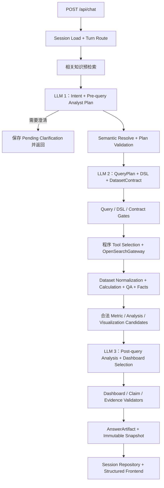

# OpenSearch ChatBI 统一分析工作区综合技术升级执行方案

> 文档用途：直接交给内网 AI，在当前已经完成的统一 I3 代码基础上，一次性完成多维数据集、受治理的分析规划、指标与统计计算、动态 Dashboard、Grounded Insights、分层 Evidence、可持久化 Session 和前端分析工作区升级。
>
> 本文是本次任务的唯一执行规格。不要把本次工作理解为“先执行某一旧版方案，再执行另一版方案”，也不要在工程中保留两套 Planner、两套 Dashboard 或两套数据合同。旧文档只可用于追溯需求来源；实际实施以当前内网代码、冻结业务口径和本文为准。

---

## 0. 给内网 AI 的执行指令

### 0.1 任务目标

你需要在同一个开发 Session 中连续完成：

1. 审计当前真实代码和测试基线；
2. 修复多月份、多维聚合、时区和结果 Grain；
3. 将单一结果升级为不可变 `QueryResultBundle` 和可复用分析 `DatasetBundle`；
4. 让系统先判断“为了回答问题应分析什么”，但不增加自由 Agent；
5. 将分析任务合并为一次或少量安全查询；
6. 用确定性程序完成正式指标、派生指标、探索统计、对账和 Data QA；
7. 根据真实结果动态选择最小充分 Dashboard；
8. 让每条数字结论都能定位到数据依据；
9. 将 Evidence 重构为业务、查询和 Debug 三层；
10. 将左侧演示问题区升级为可持久化 Session 工作区；
11. 保持现有统一 I3 的查询安全、LLM、MCP、API 和多轮主链不回归；
12. 完成全部自动化测试、前端验收、README 和 `project_memory.md` 更新。

第一轮必须先完成只读审计，但不需要为了内部检查点逐次等待用户批准。除第 0.5 节列出的真实阻塞外，审计完成后继续编码、测试和收口，最后只提交一份完整报告。

### 0.2 开始前必须完整阅读

按以下顺序阅读，不得跳过：

1. 项目根目录 `project_memory.md`；
2. 当前 `README`、启动方式、配置说明和数据库迁移说明；
3. 当前内网实际采用的统一 I3 执行方案及完成报告；
4. 本文；
5. 当前 Orchestrator、Session、Intent/AnalysisPlan、Semantic、Query、DSL、Validator、ToolSelector、OpenSearchGateway、ResultNormalizer、Metric、Insight、Chart、Evidence、API 和前端代码；
6. 当前 Catalog、Mapping 快照、指标配置、状态配置、时间配置、Mock/真实 MCP 配置；
7. 当前全部 Unit、Integration、Golden、API、前端和手工验收测试；
8. 当前真实失败用例及其 QueryPlan、DSL、OpenSearch Raw Response、Normalized Result、API Response 和页面结果。

若文档描述与当前代码不一致：

- 先保存证据；
- 判断是代码未完成、合同已迁移还是文档过时；
- 冻结业务规则以本文第 2 节为准；
- 文件名、类名和目录结构以当前工程为准；
- 不为匹配本文示例而从零重构或复制平行实现。

### 0.3 首轮审计必须回答

至少核对：

- 当前一个 Answer 是否仍只能返回一个 `ChartSpec`；
- 当前是否已经存在 `DatasetBundle`、`DashboardSpec`、`AnswerSnapshot`；
- 当前 `AnalyticalTaskPlanner`、指标检索和图表选择实际在哪里完成；
- 当前一次 LLM 调用是否仍同时生成候选 `QueryPlan + DSL + ResultContract`；
- 当前每个用户问题实际调用几次 LLM，是否存在 repair loop；
- “5–7 月 × Channel”在哪一层丢失 Channel；
- 月度分桶是否显式使用 `Asia/Hong_Kong`；
- Range Query 是否使用 Time Resolver 冻结后的 UTC `[gte, lt)`；
- 多月份索引是一次查询还是多 Step，合并键是什么；
- Terms 是否可能截断，是否错误把第一页或 Top 10 当作完整结果；
- `failure_rate.v1` 当前分母、状态字段、舍入规则是否正确；
- `statusCode` 是否错误参与当前失败率；
- Evidence 默认层是否仍显示内部 Agent JSON；
- Session 是否持久化，刷新和切换后能否恢复 Dashboard、Dataset 和 Evidence；
- 当前身份模式、Session 所有权、容量、TTL 和 schema migration；
- 当前所有测试命令、passed/failed/skipped 数量和失败证据。

### 0.4 实施纪律

- 先复现，再修改；
- 每个缺陷保存最小复现、expected、actual 和根因层级；
- 复用现有模块，不机械创建本文中的示例类名；
- 不通过删除断言、扩大容差、跳过测试、改成 `xfail` 或硬编码 Golden 数据制造通过；
- 不改动冻结指标来迎合页面结果；
- 不将 Mock、测试替身或静态前端结果冒充真实 MCP 结果；
- 每个内部检查点使用小而可回滚的 commit；
- 每个检查点运行相关测试，但不生成大量阶段报告；
- 全部完成后只输出一份最终报告。

### 0.5 只有以下情况才停止并询问

- 需要改变 `failure_rate.v1` 等冻结业务指标；
- 真实字段含义会导致两种实质不同的业务答案，且 Catalog 无法判定；
- 需要扩大字段、Index 或源记录访问权限；
- 发现未分类敏感字段而现有 Policy 无法 fail-closed；
- 真实 MCP 不支持必要的只读查询形态；
- 需要破坏性数据库迁移或不兼容 API 删除；
- 当前代码与完成报告存在无法解释的重大分叉；
- 测试要求依赖当前不可获得的外部系统或认证。

以下不属于阻塞：

- 生产 Policy/RBAC 管理体系尚未建设；
- 尚未确认运营商 `statusCode` 码表；
- 可选图表或探索统计因数据条件不足而降级；
- 个别旧文件名与本文示例不同；
- 可通过现有安全接口替代的实现细节差异。

---

## 1. 本次升级后的产品目标

最终产品不是“自然语言转一条查询再自动画一张图”，而是一个受治理的数据分析工作区：

```text
用户问题
→ 多轮语境与澄清
→ 用户意图识别 + 查询前分析师规划
→ 指标适用性 + 语义、字段、时间和 Index 解析
→ QueryPlan + DSL + DatasetContract 候选
→ 确定性校验、查询合并、Tool 选择
→ OpenSearch MCP 执行
→ 未分析 QueryResultBundle
→ 正式指标、派生指标、探索统计和 Data QA
→ 确定性 Facts 与合法可视化候选
→ 根据真实结果选择最终指标、分析和图表
→ 动态 Dashboard、Grounded Insights 和分层 Evidence
→ 不可变 AnswerSnapshot
→ 可恢复 Session 工作区
```

系统需要像数据分析师一样决定：

- 用户真正要理解或判断什么；
- 哪些指标直接回答问题；
- 哪些诊断或护栏指标有额外价值；
- 需要什么 Grain；
- 哪些任务可以复用一个 Dataset；
- 真实结果值得用什么图、表和结论表达；
- 当前数据不能证明什么。

系统同时必须像受治理的数据平台一样保证：

- 指标口径不可被 LLM 改写；
- 字段、Index、时间和权限不可被 LLM 扩大；
- 查询只使用安全 DSL；
- Tool 由程序选择；
- 统计计算可复算；
- 多维 Grain 不丢失；
- 图表不误导；
- 数字结论均有 Evidence；
- 历史回答按当时版本恢复。

---

## 2. 冻结规则与非目标

### 2.1 数据范围和时间

- 支持全部可用月份，不只支持 `tbl_os_sub_message_2026_07`；
- 物理 Index 根据用户时间范围和 Index Resolver 选择；
- 用户未给时间时，当前默认仍是 2026 年 7 月完整自然月；
- 业务时区固定为 `Asia/Hong_Kong`；
- 时间区间固定为左闭右开 `[start_time, end_time)`；
- Time Resolver 将业务时间转换为 UTC instant；
- Range DSL 使用冻结后的 UTC `gte/lt`，不再次解释本地时区；
- `date_histogram` 显式设置 `time_zone: Asia/Hong_Kong`；
- 前端使用后端规范化后的日期/月，不从 UTC Bucket 自行截取；
- 默认时间、时区、日期解析和 Index 命名规则必须集中配置。

示例：

```text
业务区间：
[2026-05-01T00:00:00+08:00, 2026-08-01T00:00:00+08:00)

UTC Range：
[2026-04-30T16:00:00Z, 2026-07-31T16:00:00Z)

date_histogram：
calendar_interval = 1M
time_zone = Asia/Hong_Kong
```

### 2.2 记录数量

当前正式解释：

```text
一条 OpenSearch document = 一条记录
record_count = document count
```

- 不按 `messageId` 或其他业务 ID 去重；
- Retry、重复 document 和空字段 document 仍计数；
- 不得默认把记录数量解释成唯一消息数量；
- 页面优先显示“消息记录数”或“记录数量”；
- 当用户说“发送量”时，回答必须注明“当前按消息记录数口径统计”；
- 若未来确认去重口径，新增版本化指标，不修改当前记录数量。

### 2.3 `failure_rate.v1`

内网已经更新 `failure_rate.v1` 的具体计算。本次任务必须以内网当前已经落地并通过测试的 Metric Registry、Metric Engine 实现和业务确认记录为唯一权威，不得用外网旧方案中的示例公式反向覆盖内网实现。

首轮审计必须从当前代码、配置和测试中提取并记录：

```text
metric_id / version
业务定义
技术公式
分子
分母
状态来源字段
状态标准化
成功/失败/其他状态集合
Null / Unknown / Pending / Retry / 重复记录处理
时间字段和时区
支持维度
零分母
舍入方式
最小样本或 Warning 规则
Owner 或待确认 Owner
生效日期
Golden 对账样例
```

实施要求：

- Query 和 DatasetContract 只采集该指标计算所需的原始聚合原料；
- 最终指标只由确定性 Analytics/Metric 计算完成；
- LLM、DSL 和前端不得自行改变分子、分母、状态规则或舍入；
- Dashboard、Claim、CSV、Evidence 和历史 Snapshot 必须记录真实指标版本；
- 内网已有 Golden 和真实报表对账必须继续通过；
- 若当前代码、配置和测试三者不一致，先保存证据并以已确认的内网业务口径收敛；
- 若本次需要实质改变业务定义，应新增版本，除非内网已有正式迁移决定明确要求沿用原版本号；
- 本文后续出现的 `failure_rate.v1` 只表示“调用内网当前注册版本”，不代表任何外网示例公式。

### 2.4 `status` 与 `statusCode`

- 当前通用 `failure_rate.v1` 使用哪个字段、状态集合和标准化规则，以第 2.3 节审计出的内网实现为准；
- `statusCode` 是运营商返回码，不得仅因本次升级自动替代当前已确认的指标来源；
- 中国移动、中国电信、中国联通的失败率需要后续获得运营商码表、Carrier 字段和业务 Owner 确认；
- 后续应新增 Carrier-specific 指标版本或码表配置；
- 本次只保留扩展点、Schema 和文档，不猜码表、不硬编码运营商规则。

### 2.5 Catalog、Mapping 与字段能力

- `field_catalog_enrich.csv` 是业务语义、别名、可查询能力和安全分类的主要来源；
- OpenSearch Mapping 是每个物理 Index 的字段存在性、类型、keyword/date/aggregatable 等技术事实；
- 两者不能相互替代；
- 运行时使用二者编译出的安全 Field Capability View；
- Mapping 漂移、缺字段或类型冲突必须 fail-closed 或拆分查询；
- `candidate_role` 必须从模型、Prompt、缓存、Hash、DSL、结果、Dashboard、CSV、Session 和 Evidence 全链路彻底消失；
- blocked 字段不得进入候选、Prompt、DSL、结果、图表、总结或 Evidence；
- 未完成分类的字段按 `review_required` fail-closed。

本次不建设生产 Policy/RBAC 管理后台，也不等待生产 Policy Owner。保留并加强现有字段级 Policy 强制机制；Session 所有权使用当前内网可信身份上下文。若当前仍是单用户 POC，使用服务端 deployment-scoped principal，并明确其不等于生产用户隔离。

### 2.6 查询与 Tool 边界

继续禁止：

- PPL、PPL fallback；
- Generic OpenSearch API；
- 通用 Tool Registry；
- LLM 自由 Tool Loop；
- LLM 选择或直接调用 MCP Tool；
- LangGraph 或多 Agent 编排；
- OpenSearch `QueryPlanningTool` 作为运行时依赖；
- 任意脚本、任意 `_source`、任意 raw hits；
- 查询失败后回退到 `match_all`；
- 前端直连 OpenSearch。

业务代码只调用 `OpenSearchGateway`：

```python
class OpenSearchGateway(Protocol):
    async def list_indices(self) -> list[str]: ...
    async def get_mapping(self, index: str) -> dict: ...
    async def count(self, indices: list[str], query: dict) -> dict: ...
    async def search(self, indices: list[str], body: dict) -> dict: ...
    async def msearch(self, requests: list[dict]) -> list[dict]: ...
```

程序选择能力：

| 查询形态 | 能力 |
|---|---|
| 纯 document count | `CountTool` |
| 过滤、聚合、分组、趋势、Top N | `SearchIndexTool` |
| 多个独立查询 | `MsearchTool` |
| 启动、编译或 drift 检查 | `ListIndexTool`、`IndexMappingTool` |
| 任意通用调用 | 禁止 |

### 2.7 前端与工程边界

- 保留当前 FastAPI + Jinja2 + Vanilla JavaScript + 本地 ECharts 形态；
- Jinja2 只渲染初始页面骨架；
- JavaScript 调用结构化 API 并更新界面；
- ECharts 固定 Adapter 渲染受控 ChartSpec；
- 不增加外部 CDN 或 Node 构建流程；
- 不让 LLM 输出可执行 HTML、JavaScript、formatter 或任意 ECharts option；
- 前端不计算正式指标；
- 当前升级不迁移 React/Vue/Streamlit；
- 代码契约应允许未来替换前端而不重写核心业务。

### 2.8 本次非目标

- 通用拖拽式 BI 编辑器；
- 自由 SQL/PPL/DSL 控制台；
- 预测和自动因果推断；
- 没有诊断字段支持的“根因分析”；
- 行业 Benchmark；
- 生产 RBAC 管理后台；
- 跨用户 Dashboard 分享；
- 多人实时协作；
- 拉取大量原始消息文档到浏览器；
- 将 AI 建议的派生指标自动写入正式指标库；
- 为展示更多图而扩大查询范围。

---

## 3. 架构收敛原则

### 3.1 不按概念数量创建模块

以下名称代表必要职责，但不代表独立 Agent、独立服务或独立 LLM 调用：

```text
AnalyticalTaskPlanner
MetricRegistry
MetricResolver
AnalysisRecipeRegistry
FieldCapabilityService
StatisticalMethodRegistry
QueryConsolidator
DatasetContractBuilder
MetricEngine
StatisticEngine
InsightFeatureEngine
VisualizationResolver
VisualizationReviewer
DashboardPlanner
ClaimGroundingValidator
EvidenceAssembler
```

将这些名字逐个实现为运行时模块会产生：

- 多份相互重叠的计划；
- 重复 Registry 查询；
- 相同数据被多次序列化；
- 每个步骤各调一次 LLM；
- repair 和 fallback 互相嵌套；
- QueryPlan、Dataset 和 Dashboard 契约难以保持一致；
- 延迟、Token 和排障成本上升。

### 3.2 最终只保留一个 Orchestrator 和六个后端职责域

| 职责域 | 包含职责 | 不包含 |
|---|---|---|
| Conversation & Session | Turn 路由、澄清、Patch、上下文、幂等、Snapshot 持久化 | 查询和指标计算 |
| Semantic & Planning | 用户意图、查询前分析任务、AnalysisPlan、Catalog/Mapping 编译、指标/Recipe/字段能力检索 | DSL 生成和执行 |
| Query | QueryPlan、DSL、DatasetContract、查询合并、Validator、ToolSelector | 查询前业务任务规划和指标最终计算 |
| OpenSearchGateway | MCP 参数转换、只读执行、错误归一化 | 分析、画图、Session |
| Analytics | 多维 Normalizer、Dataset、Metric/Statistic、Data QA、Reconciliation、Facts | 自由自然语言推理 |
| Presentation & Evidence | 图表候选、查询后选择、Dashboard、Claims、Grounding、Evidence | 查询执行、任意图表代码 |

`ChatBIOrchestrator` 串联上述职责域并控制终态。API/UI 是产品边界，Repository、LLM、MCP、SQLite 是适配器，不再被描述为新的业务 Agent。

### 3.3 旧名称到最终归属

| 旧职责名 | 最终归属 |
|---|---|
| DataAnalystPlanner 查询前规划 | Semantic & Planning 域中的第一次 LLM 结构化输出 |
| Metric/Recipe/Field/Statistic Registry | Semantic & Planning 域中的统一 `AnalyticsKnowledgeCatalog` |
| MetricResolver | Semantic & Planning 域内部函数 |
| QueryConsolidator | Query 域内部确定性步骤 |
| DatasetContractBuilder | Query 域的 ResultContract 扩展 |
| MetricEngine + StatisticEngine | Analytics 域同一个白名单 `CalculationEngine` |
| InsightFeatureEngine | Analytics 域确定性 Fact 生成 |
| VisualizationResolver | Presentation 域确定性候选生成 |
| VisualizationReviewer + DashboardPlanner | 同一次查询后 Presentation LLM 选择与排序 |
| 多个 Validator | 各域入口的确定性 Gate，不创建 Validator Agent |
| EvidenceAssembler | Presentation & Evidence 域 |

允许按可维护性拆文件，但不允许形成平行主链或互相循环调用。

---

## 4. 唯一运行时主链



### 4.1 分步行为

#### Step 1：Session 和 Turn

- 根据可信身份和 `session_id` 加载 Session；
- 读取 Pending Clarification、Active Analysis Context 和必要 Snapshot；
- 判断 `new_analysis`、`follow_up`、`clarification_answer`、`presentation_only`、`reset`；
- 不把全部历史消息塞入 Prompt；
- 同 Session 的完整新问题不继承旧过滤；
- 纯展示变化先检查 Dataset Reuse。

#### Step 2：相关知识预检索

在第一次 LLM 调用前，程序根据：

- 当前用户问题；
- Pending Clarification；
- Active Analysis Context；
- 明确的指标词、维度词、时间词和业务实体；

从安全知识目录检索小型候选集。该步骤可以使用关键词、别名、受控向量检索或现有语义检索，但不调用 MCP 查询数据，不把全量 Schema 放入 Prompt。

#### Step 3：LLM 1——用户意图识别 + 查询前分析师规划

第一次 structured-output 同时返回：

- `AnalysisPlan`；
- 指标候选和选择/拒绝原因；
- `AnalyticalTaskPlan`；
- 澄清决定；
- 查询和 Dashboard 预算建议。

它只决定“用户要分析什么、专业回答应考虑什么”，不生成 DSL。

AnalysisPlan 只表达业务意图：

- 分析目标；
- 指标意图；
- 维度；
- 过滤；
- 时间；
- 粒度；
- 比较或 Top N；
- 用户明确的展示意图；
- 需要澄清的歧义。

AnalysisPlan 不含：

- Tool；
- DSL；
- 物理 Index；
- 物理字段；
- 新指标公式；
- Dashboard Blocks。

信息缺失且会改变查询时返回澄清，不进入后续查询。

#### Step 4：Semantic Resolve 和计划校验

- 根据 AnalysisPlan 和 AnalyticalTaskPlan 先计算“字段需求闭包”，而不是从用户文本直接猜物理字段；
- LLM 1 只在预检索的安全候选中选择 `capability_id`，不输出物理字段名；
- Metric Registry 直接声明每个已选指标所需的输入 capability、Query Component 和时间语义；
- 程序再把 capability 确定性绑定到目标月份各 Index 的真实物理字段；
- `business_description` 只用于候选召回和语义消歧，不能单独决定最终字段；
- 解析指标、维度、过滤值、时间、Group/Sort/Top N 和 Index scope；
- 回查并补充本轮需要的 Metric、Recipe、Field Capability、Calculation 和 Visualization Rule；
- 校验 LLM 1 只能引用输入候选中的 ID；
- 校验 Analytical Tasks 没有扩大用户业务范围；
- 校验字段类型、可聚合能力、keyword multifield、跨月覆盖和 Mapping 一致性；
- 屏蔽 blocked/review_required/candidate_role；
- 生成 `ResolvedAnalysis` 和不可变 fingerprint；
- LLM 2 只能看到已绑定且已批准的字段集合；
- 物理 Index 由程序通过 `index_scope_ref` 保存，不交给 LLM 编造。

#### Step 5：LLM 2——一次生成查询候选

保留现有“一次生成 QueryPlan + DSL + ResultContract”的设计。同一次 structured-output 返回：

- 查询复用/合并说明；
- QueryPlan；
- 每个 Query Step 的 DSL 或受控依赖模板；
- DatasetContract。

这不是让 LLM 获得执行权。所有内容都是候选，随后由程序逐层校验。

#### Step 6：确定性 Gates

依次校验：

1. 严格 Schema；
2. AnalysisPlan 与 fingerprint；
3. Metric ID/version；
4. 字段能力、安全和权限；
5. 时间、Index、Mapping；
6. QueryPlan 与 DSL 一致性；
7. Dataset Grain；
8. DSL allowlist、成本和 Bucket 预算；
9. 任务是否越过用户问题；
10. 依赖查询模板是否合法。

任何 Gate 失败都不能执行。

#### Step 7：Tool 和执行

- ToolSelector 根据已验证查询形态选择 Count/Search/Msearch；
- Gateway 只负责 MCP 通信；
- 独立查询可以 Msearch；
- 依赖查询按第 9.6 节受控执行；
- partial、timeout、shard failure 和 truncated 保留为 typed status；
- 不把失败补零；
- 不回退 `match_all`。

#### Step 8：Dataset 和 Analytics

- 按 DatasetContract 递归展开所有嵌套 Bucket；
- 先保存不可变 `QueryResultBundle`，此时不得包含任何正式指标、占比、排名、环比或异常计算；
- 保留完整 Grain 和稳定 `row_id`；
- 再由 QueryResultBundle 生成 Metric/Derived/Exploratory Dataset；
- 由 CalculationEngine 计算正式、治理派生和探索统计；
- 执行 Data QA、Reconciliation、完整性和样本检查；
- 生成有稳定 `fact_id` 的确定性 Facts；
- LLM 不重新计算数值。

#### Step 9：LLM 3——查询后分析和展示决策

- 程序先根据 Dataset Shape、已计算指标、统计 Fact、完整性和白名单生成合法的分析与 Visualization Candidates；
- 查询后 LLM 只能从已计算 Metric、Fact、Dataset 和 Visualization Candidate ID 中选择；
- 同一次调用决定最终展示哪些指标、哪些分析发现、哪些图表和表格；
- 同一次调用返回任务完成情况、候选选择、叙事顺序、Claim 草稿、Dashboard 候选和后续建议；
- 它不能新增尚未查询或尚未由确定性 Engine 计算的指标；如发现需要新 Grain，只能给出后续分析建议；
- 程序编译最终 DashboardSpec；
- Validator 删除无效、重复或误导 Block；
- 简单问题可以没有图。

#### Step 10：Evidence、Snapshot 和响应

- 所有数字 Claim 必须有 `EvidenceRef`；
- Evidence 分为业务、查询、Debug 三层；
- 保存不可变 AnswerSnapshot；
- 更新 Active Context；
- `/api/chat` 返回结构化 AnswerArtifact；
- 前端只渲染合同，不解析 LLM HTML。

### 4.2 LLM 调用预算

一个需要新查询的完整回答正常最多使用三次 LLM 调用：

| 调用 | 用途 |
|---|---|
| 1 | 用户意图识别 + 查询前分析师规划：生成 `AnalysisPlan + AnalyticalTaskPlan` |
| 2 | 查询生成：一次生成 `QueryPlan + DSL + DatasetContract` |
| 3 | 查询后分析：从真实 Dataset、已计算指标、Fact 和合法图表候选中选择最终分析与 Dashboard |

规则：

- 所有 repair 都计入三次总预算；
- Query Bundle 若使用一次 repair，则查询后展示必须使用确定性模板或现有剩余预算；
- 第一次调用若可由确定性 Patch/规则安全完成，可以跳过；
- 不按指标、任务、Query Step、图表或 Claim 分别调用 LLM；
- 不允许 while-loop 式 repair；
- 每个可选 LLM 步骤必须有确定性 fallback；
- clarification 在查询前结束，不调用 Query/Presentation；
- presentation-only 追问复用 Dataset，通常只需一次 Presentation 调用；
- 记录每阶段模型、Prompt 版本、Token、延迟和是否 fallback。

### 4.3 终态

所有路径必须结束于：

```text
answered
needs_clarification
blocked
not_answerable
error
```

空结果属于可回答状态：

```text
answered + empty_state
```

不得用伪造 0 值或空图替代。

---

## 5. 统一分析知识目录

### 5.1 一个目录，五类配置

实现一个版本化 `AnalyticsKnowledgeCatalog`，内部包含：

```text
metrics
analysis_recipes
field_capabilities
calculations
visualization_rules
```

它是配置和检索边界，不是五个在线服务。

建议目录：

```text
config/analytics/
├── metrics/
│   ├── failure_rate.v1.yaml
│   └── message_record_count.v1.yaml
├── recipes/
│   ├── messaging_operational_overview.v1.yaml
│   └── messaging_failure_diagnosis.v1.yaml
├── calculations/
│   └── calculation_registry.v1.yaml
├── visualization/
│   └── visualization_rules.v1.yaml
└── compiled/
    └── field_capabilities.json
```

如果当前已有等价配置目录，直接增强，不复制第二套。

### 5.2 Field Capability 编译

编译输入：

```text
真实 field_catalog_enrich.csv
+ 目标 Index Mapping
+ 枚举/状态配置
+ 可选数据 Profiling
+ 现有字段 Policy
```

编译输出至少包含：

```python
class FieldCapability(BaseModel):
    capability_id: str
    canonical_name: str
    physical_fields_by_index: dict[str, str]
    semantic_type: Literal[
        "categorical_dimension",
        "time_dimension",
        "status_dimension",
        "identifier",
        "deduplication_key",
        "duration_measure",
        "numeric_measure",
        "failure_reason_dimension"
    ]
    business_definition: str
    allowed_operations: set[str]
    data_types_by_index: dict[str, str]
    aggregatable: bool
    cardinality_estimate: int | None
    null_rate: float | None
    security_classification: str
    supported_index_patterns: list[str]
    version: str
```

编译时必须：

- 忽略任何 `candidate_role` 列和值；
- 检查 Catalog 引用字段在 Mapping 中存在；
- 检查 keyword/date/numeric 等类型；
- 检查跨月 Mapping 兼容；
- 对 Mapping-only 且无安全分类字段标记 `review_required`；
- 生成稳定版本和 fingerprint；
- 输出冲突报告；
- 启动时加载缓存；
- Mapping fingerprint 变化时触发 drift 检查；
- 运行时不每轮自由调用 Mapping Tool。

### 5.3 字段需求闭包与 Semantic Resolution

#### 5.3.1 不只看 `business_description`

字段选择不能采用：

```text
用户问题
→ 对 business_description 做一次相似度
→ 取最高分物理字段
```

原因：

- 描述可能相似但业务事件时间不同；
- `channel`、`route`、`vendor` 等概念可能同时出现；
- 同一业务字段在不同月份可能有不同物理名或类型；
- text 字段和 keyword multifield 的查询能力不同；
- 指标输入字段应由 Metric Registry 约束；
- blocked/review_required 字段即使语义最相似也不能使用；
- 用户过滤值可能比字段描述更能证明字段；
- 仅凭相似度无法保证支持 group/filter/sort。

`business_description` 是重要的软信号之一，但不是最终权威。

#### 5.3.2 字段需求闭包

程序从已经验证的 AnalysisPlan、AnalyticalTaskPlan 和 MetricApplicability 计算：

```text
RequiredCapabilities
= explicit dimension capabilities
∪ filter capabilities
∪ time capability
∪ selected metric query component capabilities
∪ calculation input capabilities
∪ group/grain capabilities
∪ sort/top_n capabilities
∪ required QA/reconciliation capabilities
```

示意模型：

```python
class FieldRequirement(BaseModel):
    requirement_id: str
    semantic_concept: str
    role: Literal[
        "metric_input",
        "dimension",
        "filter",
        "time",
        "group_by",
        "sort",
        "quality"
    ]
    required_operations: set[str]
    required_semantic_types: set[str]
    required_by_refs: list[str]
    selected_capability_id: str | None
    candidate_capability_ids: list[str]
    resolution_status: Literal[
        "resolved", "ambiguous", "not_found", "blocked", "incompatible"
    ]
```

其中：

- 指标输入字段来自 Metric Registry，不由 LLM 自由选择；
- 用户明确维度/过滤/时间的语义 capability 可以由 LLM 1 在候选中选择；
- `group_by`、`sort` 和 `top_n` 通常复用已选维度；
- QA 需要的完整性字段由 Contract 或 Metric 配置补齐；
- 不因想画更多图而增加不必要字段。

#### 5.3.3 安全候选召回

在 LLM 1 前，程序只从已通过 Policy 的 Field Capability Index 召回 Top K 语义候选。综合信号：

| 信号 | 用途 |
|---|---|
| canonical name 精确匹配 | 识别明确业务概念 |
| alias/中文名/缩写 | 处理用户自然语言 |
| `business_description` | 理解业务语义 |
| Metric Registry binding | 指标输入的硬绑定 |
| Analysis Recipe | 识别常见维度和分析任务 |
| semantic type | 时间、类别、状态、数值等 |
| allowed operations | filter/group/sort/aggregate |
| filter value dictionary hit | 由 SMS/EMAIL 等值反推候选语义字段 |
| index family coverage | 是否覆盖目标月份 |
| Mapping type/aggregatable | 技术可执行性 |
| profiling/cardinality/null rate | 成本和质量 |
| security classification | hard gate |

排序前先执行硬过滤：

```text
Policy allowed
AND target index coverage
AND data type compatible
AND required operation supported
AND not candidate_role
```

再对剩余候选排序。不能让一个语义分数覆盖硬门槛。

#### 5.3.4 LLM 的语义职责

LLM 1 可以：

- 识别用户说的“Channel”“Route”“日期”“失败原因”等语义概念；
- 在输入的候选 `capability_id` 中选择；
- 说明选择理由；
- 输出候选冲突；
- 在歧义会改变业务结果时要求澄清。

LLM 1 不可以：

- 输出任意物理字段字符串；
- 从全量 Mapping 自由挑字段；
- 覆盖 Metric Registry 的必需输入；
- 把相似字段视为等价；
- 选择 blocked/review_required；
- 决定 `.keyword`、date format 等技术细节。

第一次调用的输出可增加：

```python
class SemanticRequirementDecision(BaseModel):
    requirement_id: str
    semantic_concept: str
    selected_capability_id: str | None
    alternative_capability_ids: list[str]
    confidence: Literal["high", "medium", "low"]
    reason: str
    clarification_required: bool
```

#### 5.3.5 程序绑定物理字段

Semantic Resolver 根据选定 capability 和目标 Index Mapping 产生：

```python
class ResolvedFieldBinding(BaseModel):
    requirement_id: str
    capability_id: str
    semantic_role: str
    physical_fields_by_index: dict[str, str]
    query_field_by_index: dict[str, str]
    data_types_by_index: dict[str, str]
    operations: set[str]
    binding_source: Literal[
        "metric_registry",
        "catalog_exact",
        "llm_capability_selection",
        "time_semantics",
        "deterministic_multifield"
    ]
    mapping_fingerprint: str
    warnings: list[str]
```

程序负责：

- 对 group/filter 选择可聚合 keyword 字段；
- 对 time 选择 Metric/业务语义要求的 date 字段；
- 检查所有目标月份；
- 检查 physical field、multifield 和 type；
- 生成 query-safe field allowlist；
- 生成可审计 binding source；
- 将最终 binding 纳入 semantic fingerprint。

LLM 2 只能使用 `query_field_by_index` 中已批准字段，Validator 拒绝任何新字段。

#### 5.3.6 歧义策略

不需要询问用户：

- 同一 semantic capability 的 `field` 与 `field.keyword` 技术选择；
- 多月份同一 capability 的受控物理字段映射；
- Mapping 已明确的 date 类型或 keyword multifield。

必须澄清或停止：

- `createdTime` 与 `receivedTime` 代表不同业务事件，Metric/Recipe/Catalog 未说明应使用哪个；
- “Channel”可能指消息渠道或运营商，候选业务含义不同；
- 同一个过滤值存在于多个不等价字段；
- 目标月份字段类型冲突且无法安全拆分；
- 指标需要的 capability 不存在；
- 唯一候选为 blocked/review_required。

不能用 LLM confidence 掩盖业务歧义。

#### 5.3.7 示例：7 月各 Channel Failure Rate

用户问题：

```text
2026 年 7 月各 Channel 的 Failure Rate 是多少？
```

LLM 1 只输出语义：

```text
metric need = failure quality
selected metric ref = 内网当前 failure_rate.v1
dimension concept = message channel
time range = 2026-07
task = quality comparison by channel
```

字段需求闭包由程序得到：

```text
时间 capability
+ Channel dimension capability
+ 内网 failure_rate.v1 的 Query Component capabilities
+ Contract/Data QA 所需能力
```

然后：

1. Metric Registry 提供 Failure Rate 必需 capability 和时间语义；
2. LLM 1 在安全候选中将用户的 Channel 绑定到 semantic capability；
3. Semantic Resolver 根据 7 月 Index Mapping 选择真实 date、Channel keyword 和指标输入字段；
4. 如果跨月，则逐 Index 验证；
5. LLM 2 只拿到这组已批准字段并生成 QueryPlan/DSL/Contract；
6. Metric Engine 仍按内网当前版本计算；
7. Evidence 展示 capability → physical field 的安全摘要，不向普通用户暴露无关 Schema。

### 5.4 Metric 定义

每个正式或治理派生指标至少包含：

- `metric_id` 和不可变版本；
- 中文显示名；
- 等级：`certified`、`governed_derived`；
- 业务定义和技术定义；
- 计算操作；
- 分子、分母和单位；
- 源字段 capability ID；
- 支持维度和时间语义；
- Null、Unknown、Pending、Retry、重复记录处理；
- 去重规则；
- 最低数据要求或仅展示 Warning 的阈值；
- Owner 占位；
- 生效/失效日期；
- 可比较性限制；
- 计算函数 ID；
- Golden 用例。

`failure_rate.v1` 的配置必须从第 2.3 节要求的内网当前实现中提取。本文不预填分子、分母和状态集合，建议使用下列结构固化真实值：

```yaml
metric_id: failure_rate
version: failure_rate.v1
level: certified
display_name_zh: 失败率
source_capability_refs: []           # 从内网当前实现填写
business_definition: ""             # 从内网确认资料填写
technical_definition: ""            # 从代码和配置提取
numerator: {}                        # 不照抄外网旧公式
denominator: {}
status_normalization: {}
status_groups: {}
null_unknown_pending_retry_policy: {}
zero_denominator: ""                 # 从内网当前实现填写
output_unit: percent
rounding: {}                         # 从内网当前实现填写
calculation_id: failure_rate_v1
owner: ""
effective_from: ""
golden_case_refs: []
```

当前可以认证的基础指标：

```text
message_record_count.v1 = document count
failure_rate.v1
```

以下能力只有字段和口径获得确认后才能启用：

- `distinct_message_count`；
- 成功率、送达率、到达率；
- 点击率、转化率；
- 延迟分位数；
- SLA 达标率；
- 用户触达人数；
- Carrier-specific failure rate；
- 供应商或错误码根因指标。

### 5.5 Analysis Recipe

Recipe 只提供“值得考虑的分析视角”，不是固定 Dashboard。

示意：

```yaml
recipe_id: messaging_operational_overview
version: v1
goals:
  - operational_overview
  - category_comparison
candidate_tasks:
  - analysis_type: scale
    metric_ids: [message_record_count]
  - analysis_type: composition
    calculation_ids: [share_of_total]
  - analysis_type: quality_comparison
    metric_ids: [failure_rate]
  - analysis_type: trend
    calculation_ids: [daily_record_count]
  - analysis_type: data_quality
    calculation_ids: [unknown_status_count]
selection_rules:
  max_primary_metrics: 3
  max_tasks: 5
  trend_requires_time_grain: true
```

Recipe 必须允许：

- 只选一部分；
- 因数据或预算拒绝候选；
- 组合相关 Recipe；
- 将探索统计明确标记；
- 记录未选择原因。

Recipe 不得：

- 自动生成全部任务；
- 自动新增 OpenSearch 查询；
- 覆盖正式 Metric；
- 因关键词匹配固定生成三张图；
- 将行业通用指标提升为本项目正式指标。

### 5.6 Calculation Registry

统一 `CalculationEngine` 使用白名单 Operation：

```text
document_count
filtered_count
distinct_count
ratio
share_of_total
period_change
rank
top_n_with_others
group_sum
mean
median
percentile
standard_deviation
coefficient_of_variation
moving_average
robust_zscore
hhi
contribution
pivot
```

每项声明：

- 等级；
- 输入 Grain；
- 输入字段类型；
- 最低数据量；
- 固定算法和参数；
- 输出字段；
- Null/零分母；
- 完整性要求；
- 近似性；
- Warning；
- 测试。

未满足数据条件的 Operation 返回 typed rejection，不执行任意 LLM 代码。

### 5.7 Visualization Rules

Registry 只保存：

- 分析意图；
- 可接受 Dataset Shape；
- 候选图表；
- 类别/系列上限；
- 完整性要求；
- 编码规则；
- 禁用条件；
- 风险；
- 对应固定 ECharts Adapter。

没有 Adapter、Validator 和测试的图表类型不得仅通过 Prompt 开启。

---

## 6. 核心数据合同

所有合同使用严格 Pydantic/JSON Schema：

```python
model_config = ConfigDict(extra="forbid")
```

合同 ID、Dataset ID、Row ID、Fact ID、Claim ID 和 Answer ID 必须稳定且可追踪。

### 6.1 AnalysisPlan

```python
class AnalysisPlan(BaseModel):
    analysis_plan_id: str
    analysis_goal: str
    question_archetype: Literal[
        "single_value",
        "overview",
        "comparison",
        "trend",
        "ranking",
        "composition",
        "distribution",
        "diagnostic",
        "anomaly"
    ]
    metric_intents: list[str]
    dimensions: list[str]
    filters: list[dict]
    semantic_requirements: list[dict]
    time_range: dict
    granularity: str | None
    top_n: int | None
    comparison_basis: str | None
    presentation_request: str | None
    assumptions: list[str]
    ambiguity_codes: list[str]
```

禁止 Tool、DSL、物理 Index 和物理字段。

### 6.2 AnalysisPlanningBundleCandidate

第一次 LLM 调用输出用户意图和查询前分析师计划，但不输出 DSL：

```python
class MetricDecision(BaseModel):
    metric_need_id: str
    analytical_need: str
    metric_ref: str | None
    metric_level: Literal[
        "certified", "governed_derived", "exploratory", "unsupported"
    ]
    role: Literal["primary", "diagnostic", "guardrail", "context"]
    candidate_decision: Literal[
        "required", "recommended", "optional", "rejected"
    ]
    reason_code: str
    explanation: str
    caveats: list[str]


class AnalyticalTask(BaseModel):
    task_id: str
    analytical_question: str
    analysis_type: Literal[
        "single_value",
        "scale",
        "ranking",
        "composition",
        "status_mix",
        "trend",
        "change",
        "distribution",
        "quality_comparison",
        "contribution",
        "concentration",
        "anomaly_screening",
        "driver_screening",
        "detail_table"
    ]
    priority: Literal["required", "recommended", "optional"]
    metric_refs: list[str]
    dimension_capability_ids: list[str]
    requested_grain: list[str]
    calculation_refs: list[str]
    visualization_intents: list[str]
    business_value: str
    drop_conditions: list[str]


class AnalyticalTaskPlan(BaseModel):
    plan_id: str
    analysis_goal: str
    question_archetype: str
    metric_decisions: list[MetricDecision]
    tasks: list[AnalyticalTask]
    clarification_required: bool
    clarification_question: str | None
    query_budget: dict
    dashboard_budget: dict
    assumptions: list[str]
    limitations: list[str]


class AnalysisPlanningBundleCandidate(BaseModel):
    analysis_plan: AnalysisPlan
    analytical_task_plan: AnalyticalTaskPlan
    semantic_requirement_decisions: list[SemanticRequirementDecision]
```

该合同禁止 Tool、DSL、物理 Index、物理字段、最终计算结果和 ECharts option。

### 6.3 ResolvedAnalysis

```python
class ResolvedAnalysis(BaseModel):
    analysis_plan_id: str
    analytical_task_plan_id: str
    approved_task_ids: list[str]
    metric_applicability_results: list[dict]
    resolved_field_bindings: list[ResolvedFieldBinding]
    resolved_metric_refs: list[str]
    resolved_dimension_capability_ids: list[str]
    resolved_filter_refs: list[dict]
    time_capability_id: str
    time_range_utc: dict
    timezone: str
    index_scope_ref: str
    relevant_metric_refs: list[str]
    relevant_recipe_refs: list[str]
    relevant_calculation_refs: list[str]
    relevant_visualization_rule_refs: list[str]
    query_budget: dict
    dashboard_budget: dict
    semantic_fingerprint: str
    warnings: list[str]
```

只保存安全引用；真实 Index 和物理字段由服务端上下文解析。

### 6.4 QueryGenerationBundleCandidate

第二次 LLM 调用输出 QueryPlan、DSL 和 DatasetContract，不再重复生成 Analytical Tasks：

```python

class DatasetContract(BaseModel):
    contract_id: str
    dataset_id: str
    grain: list[str]
    dimensions: list[str]
    metrics: list[str]
    columns: list[dict]
    primary_key: list[str]
    expected_complete_dimensions: list[str]
    source_task_ids: list[str]
    completeness_strategy: str


class QueryStep(BaseModel):
    step_id: str
    purpose_task_ids: list[str]
    index_scope_ref: str
    query_kind: Literal["count", "search"]
    body: dict | None
    dependent_template: dict | None
    result_contract: DatasetContract
    depends_on_step_ids: list[str]
    dependency_bindings: list[dict]
    estimated_bucket_count: int
    timeout_ms: int


class QueryGenerationBundleCandidate(BaseModel):
    analysis_plan_id: str
    analytical_task_plan_id: str
    semantic_fingerprint: str
    query_plan_id: str
    query_steps: list[QueryStep]
    consolidation_notes: list[str]
    query_budget: dict
```

硬上限建议：

```text
selected metrics <= 5
analytical tasks <= 5
query steps <= 2，特殊诊断最多 3
dependent query depth <= 1
dashboard charts <= 4
```

### 6.5 QueryResultBundle

`QueryResultBundle` 是 OpenSearch 返回后、业务指标和统计分析前的不可变表格化结果，也是默认 Evidence 的第一手数据表。

它允许做的处理只有：

- 按已验证 ResultContract 递归展开 Bucket；
- 复制父 Bucket 维度；
- 类型转换；
- 规范日期显示；
- 生成稳定 Row ID；
- 记录完整性、partial、timeout 和 truncation。

它不得计算：

- Failure Rate 或其他正式比率；
- Share、Rank、Top N + Others；
- 环比、贡献、HHI；
- 异常；
- LLM 结论。

```python
class QueryResultDataset(BaseModel):
    dataset_id: str
    query_step_id: str
    contract_id: str
    title: str
    grain: list[str]
    columns: list[dict]
    rows: list[dict]
    row_count: int
    complete: bool
    partial: bool
    timed_out: bool
    truncated: bool
    query_hash: str
    raw_aggregation_ref: str | None
    coverage: dict
    warnings: list[str]


class QueryResultBundle(BaseModel):
    bundle_id: str
    datasets: list[QueryResultDataset]
    complete: bool
    warnings: list[str]
```

这张表是“纯 OpenSearch 聚合查询结果的合同化表格”，不是源消息 document，也不是原始 JSON。安全清理后的原始 Aggregation JSON 位于高级 Evidence。

### 6.6 DatasetBundle

```python
class DatasetColumn(BaseModel):
    name: str
    data_type: Literal[
        "string", "integer", "number", "percentage", "date", "datetime", "boolean"
    ]
    semantic_role: Literal["dimension", "metric", "identifier", "label", "quality"]
    metric_ref: str | None
    unit: str | None


class Dataset(BaseModel):
    dataset_id: str
    contract_id: str
    title: str
    kind: Literal["metric", "derived", "exploratory", "evidence_sample"]
    grain: list[str]
    columns: list[DatasetColumn]
    rows: list[dict]
    row_count: int
    complete: bool
    partial: bool
    truncated: bool
    source_dataset_ids: list[str]
    calculation_ref: str | None
    source_query_hashes: list[str]
    coverage: dict
    warnings: list[str]


class DatasetBundle(BaseModel):
    bundle_id: str
    datasets: list[Dataset]
    data_qa: list[dict]
    reconciliation: list[dict]
    complete: bool
    warnings: list[str]
```

每行必须包含基于主键生成的稳定 `row_id`，不能使用数组下标。所有 Metric/Derived/Exploratory Dataset 必须通过 `source_dataset_ids` 追踪到 `QueryResultBundle`。

### 6.7 AnalysisResultBundle

```python
class AnalysisFact(BaseModel):
    fact_id: str
    fact_type: str
    metric_ref: str | None
    value: int | float | str | None
    unit: str | None
    evidence_refs: list[dict]
    exploratory: bool
    warnings: list[str]


class VisualizationCandidate(BaseModel):
    candidate_id: str
    intent: str
    dataset_id: str
    chart_type: str
    encoding: dict
    analytical_question: str
    data_conditions_passed: list[str]
    risks: list[str]
    information_signature: str


class AnalysisResultBundle(BaseModel):
    query_result_bundle: QueryResultBundle
    dataset_bundle: DatasetBundle
    metric_results: list[dict]
    statistical_results: list[dict]
    facts: list[AnalysisFact]
    visualization_candidates: list[VisualizationCandidate]
    answered_task_ids: list[str]
    unanswerable_task_ids: list[str]
    warnings: list[str]
```

### 6.8 PostQueryAnalysisCandidate 与 DashboardSpec

第三次 LLM 调用基于真实查询结果决定最终分析重点和展示，不直接输出任意 ECharts option：

```python
class PostQueryAnalysisCandidate(BaseModel):
    selected_metric_result_ids: list[str]
    selected_fact_ids: list[str]
    selected_visual_candidate_ids: list[str]
    answered_task_ids: list[str]
    dropped_task_decisions: list[dict]
    narrative_order: list[str]
    claim_drafts: list[dict]
    dashboard_blocks: list[dict]
    follow_up_suggestions: list[dict]
    limitations: list[str]
```

`dashboard_blocks` 只能引用后端提供的 Dataset、Metric Result、Fact 和 Visualization Candidate ID。后端据此编译：

```python
class DashboardSpec(BaseModel):
    dashboard_id: str
    title: str
    subtitle: str | None
    analysis_goal: str
    layout: Literal["auto_grid"]
    blocks: list[dict]
    default_evidence_dataset_id: str | None
    warnings: list[str]
```

Block 白名单：

```text
answer_summary
context_summary
kpi_group
chart
data_table
pivot_table
insight_list
warning
empty_state
clarification
follow_up_suggestions
```

### 6.9 Claim、Evidence 与 Snapshot

```python
class EvidenceRef(BaseModel):
    dataset_id: str
    row_ids: list[str]
    fields: list[str]
    calculation_ref: str | None
    metric_ref: str | None


class AnalystClaim(BaseModel):
    claim_id: str
    text: str
    claim_type: str
    importance: Literal["primary", "secondary"]
    evidence_refs: list[EvidenceRef]
    confidence: Literal["high", "medium", "low"]
    limitations: list[str]


class AnswerSnapshot(BaseModel):
    answer_id: str
    session_id: str
    chronological_parent_answer_id: str | None
    analytical_base_answer_id: str | None
    turn_kind: str
    analysis_plan: AnalysisPlan
    analytical_task_plan: AnalyticalTaskPlan
    resolved_analysis: ResolvedAnalysis
    query_generation_bundle: QueryGenerationBundleCandidate | None
    query_result_bundle: QueryResultBundle | None
    analysis_result: AnalysisResultBundle | None
    dashboard_spec: DashboardSpec | None
    claims: list[AnalystClaim]
    evidence_package: dict
    semantic_model_version: str
    knowledge_catalog_version: str
    mapping_fingerprint: str
    metric_versions: dict[str, str]
    policy_version: str
    prompt_versions: dict[str, str]
    model_versions: dict[str, str]
    reusable_until: str | None
    display_until: str | None
    created_at: str
```

历史 Snapshot 不可变。重新计算必须创建新 Answer。

---

## 7. 受治理的分析规划

### 7.1 规划目标

系统需要回答：

> 为了正确、充分但不过度地回答当前问题，需要哪些分析视角和数据？

规划不是：

- 按关键词套固定 Dashboard；
- 罗列十几个行业指标；
- 为每个任务创建一条查询；
- 自动扩大时间、字段或敏感数据范围；
- 让 LLM 创造正式指标；
- 让 LLM 在查询后重新解释用户没有问的业务问题。

### 7.2 分析问题类型

至少识别：

```text
single_value
overview
comparison
ranking
composition
trend
change
distribution
quality_comparison
diagnostic
anomaly_screening
detail_table
```

用户明确要求优先；隐含分析只能作为有限补充。

### 7.3 先审计已注册指标是否真的适用

注册在 Metric Registry 中不等于适合所有问题。首轮审计必须生成真实指标适用性清单：

| 项目 | 必须核对 |
|---|---|
| ID/版本 | 是否唯一、是否 active |
| 业务定义 | 是否能回答当前业务问题 |
| 技术公式 | 是否与代码和测试一致 |
| 数据 Grain | 一条记录代表什么 |
| 必需字段 | 在目标月份是否存在、类型是否兼容 |
| 时间语义 | 时间字段、时区和窗口 |
| 支持维度 | 能否按 Channel/Route/Day/Month 等分组 |
| 分子/分母 | 是否完整、能否对账 |
| Null/Unknown/Retry | 处理是否明确 |
| 去重 | 是否与用户问题一致 |
| 样本要求 | 是否足够展示、排名或比较 |
| Policy | 是否允许聚合和展示 |
| Owner/生效 | 是否可作为正式口径 |
| 测试 | Unit、Golden、真实报表对账状态 |

对每个候选输出确定性 `MetricApplicabilityResult`：

```python
class MetricApplicabilityResult(BaseModel):
    metric_need_id: str
    metric_ref: str | None
    status: Literal[
        "applicable",
        "applicable_with_warning",
        "not_relevant",
        "not_computable",
        "needs_clarification",
        "blocked",
        "unsupported"
    ]
    required_capability_ids: list[str]
    required_grain: list[str]
    query_component_requirements: list[dict]
    warnings: list[str]
    reason_codes: list[str]
```

职责分工：

- LLM 1 以分析师视角提出 `analytical_need`，例如规模、质量、构成、趋势或数据质量；
- 如果 Registry 有合适指标，引用 `metric_ref`；
- 如果分析需要合理但尚无已注册指标，允许 `metric_ref = null` 并标记 `unsupported`；
- Semantic & Planning 域逐项做适用性校验；
- 只有 `applicable` 或 `applicable_with_warning` 进入 LLM 2；
- 不适用指标保留拒绝原因，可用于 Debug 和后续能力建议；
- 不得因为一个指标已经注册就自动查询或展示；
- 不得因为 LLM 认为某指标有价值就跳过 Registry 和确定性计算。

### 7.4 候选生成与裁剪

一次候选集最多包含：

- 1～3 个主指标；
- 每个主指标 0～2 个诊断/上下文指标；
- 必要的数据质量护栏；
- 0～2 个探索统计；
- 明确拒绝的高相关但不可计算候选。

每个候选评估：

| 维度 | 判断 |
|---|---|
| Relevance | 是否直接回答用户问题 |
| Decision Value | 是否可能改变业务判断 |
| Definition Confidence | 口径是否确定 |
| Computability | 字段、Grain 和权限是否支持 |
| Statistical Fitness | 样本和时间点是否足够 |
| Non-Redundancy | 是否提供不同信息 |
| Cost Fitness | 是否在查询预算内 |
| Misleading Risk | 是否可能因小样本、截断或分母误导 |

程序执行硬门槛：

- 不可计算 → rejected；
- 指标定义不存在 → rejected 或 clarification；
- 不支持所选维度 → rejected；
- blocked/review_required → blocked；
- 未认证业务率指标 → 不得作为 certified；
- 需要源记录但只允许聚合 → 改成聚合或 rejected；
- Query/Dashboard 预算超限 → 降级或 rejected；
- 与用户问题无关 → rejected。

不要求把评分压缩成一个总分。必须保留 reason code。

### 7.5 澄清边界

应澄清：

- “发送量”存在多个已认证且结果实质不同的口径；
- 用户要求成功率，但当前没有正式定义；
- 用户要求延迟，但开始/结束时间字段未确认；
- 用户要求根因，但多个候选诊断维度会导致完全不同分析；
- 用户给出的业务值映射到多个 canonical value；
- 时间表达无法可靠解析；
- 字段歧义会改变查询。

不应过度澄清：

- 用户说“7 月各 Channel 发送情况”，当前可明确使用消息记录数并披露口径；
- 用户时间、维度和已认证指标已经明确；
- 补充一个无需新增敏感范围的结果表或数据质量 Warning；
- 仅缺少可选图表条件。

### 7.6 “发送情况”的默认行为

对于：

```text
查询 2026 年 7 月每个 Channel 的发送情况
```

候选可以包含：

1. 各 Channel 消息记录数；
2. 各 Channel 占比；
3. 各 Channel `failure_rate.v1` 及失败记录数；
4. Unknown/Other 状态提醒；
5. Channel 结果表；
6. 可选每日趋势或异常筛查。

但不是每项都必须执行。每日趋势只有在以下任一条件满足时才保留：

- 用户明确要求趋势或异常；
- 已有查询 Dataset 已包含安全、完整的日粒度；
- Recipe、决策价值和 Bucket 预算同时通过，且额外查询不会不合理扩大范围。

不得为了“显得像分析师”默认增加第二条 Top Channel 日趋势查询。

### 7.7 Planner 输出规则

LLM 只能引用输入中存在的：

```text
metric_ref
recipe_ref
capability_id
calculation_ref
visualization_intent
```

LLM 不得：

- 引用物理 Index；
- 引用未提供字段；
- 输出 Tool；
- 生成指标公式；
- 生成 Python/JavaScript；
- 生成 ECharts option；
- 把 `doc_count` 无说明地称为去重消息数；
- 假设 `success_rate = 1 - failure_rate`；
- 把异常写成故障；
- 把相关写成因果。

---

## 8. 第二次 LLM：一次生成 QueryPlan、DSL 和 DatasetContract

### 8.1 调用边界

现有统一 I3 已经使用一次 structured-output 同时生成：

```text
QueryPlan + DSL + ResultContract
```

本次继续保留该调用边界：

- LLM 1 已经完成用户意图和查询前分析任务；
- Semantic & Planning 已经完成指标适用性、字段、时间和 Index 解析；
- LLM 2 只负责把已批准 Analytical Tasks 转成少量 Query Steps；
- QueryPlan、DSL 和 DatasetContract 必须在同次输出中对齐；
- LLM 2 不重新定义分析目标，不增加未批准指标；
- 后端仍保留全部确定性校验和执行控制。

### 8.2 Query Generation Context

只传入本轮所需最小上下文：

```text
AnalysisPlan
AnalyticalTaskPlan
MetricApplicabilityResult 中已批准的指标
ResolvedAnalysis
相关 Metric 定义
相关 Field Capability
允许的 Calculation
目标 Mapping 安全摘要
固定 Query 预算
DSL allowlist
固定 aggregation alias
DatasetContract Schema
少量经审核示例
```

不得传入：

- 全量 Catalog；
- 全量 Mapping；
- blocked/review_required；
- `candidate_role`；
- 客户敏感值；
- MCP Tool Registry；
- 凭证和内部 URL；
- 全部 Session 历史；
- 任意可执行代码。

### 8.3 Prompt 核心要求

```text
你要输出一份候选 QueryGenerationBundle。

AnalysisPlan、AnalyticalTaskPlan 和可用指标已经确定。
你只能把已批准任务合并为最少且可信的查询。
QueryPlan、DSL 和 DatasetContract 必须一致。

你只能使用输入提供的 metric_ref、capability_id、calculation_ref、
index_scope_ref、DSL 节点和固定 aggregation alias。

你不得选择 MCP Tool，不得执行查询，不得计算最终业务指标，
不得创建输入中不存在的字段、Index、公式、状态、原因或 Benchmark。

输出必须符合 strict Schema，不得有额外字段。
```

### 8.4 查询任务合并

Query 域确定性复核 LLM 的合并方案。

允许合并：

- 时间、Index 和过滤相同；
- Grain 相同或兼容；
- 多个指标可由同一聚合原料计算；
- Derived Dataset 可从同一个 Query Result/Metric Dataset 产生；
- Bucket 估算在预算内；
- 安全级别相同。

必须拆分：

- 需要先获得 Top N 才能安全下钻；
- Grain 笛卡尔积导致 Bucket 爆炸；
- 指标使用不同时间语义；
- Index Mapping 不兼容；
- 一个任务需要完整分页，另一个只需轻量总计；
- 安全权限不同；
- 合并会导致截断、近似或无法对账。

任务、Query、Dataset 和 Dashboard Block 不一一对应。

### 8.5 Bucket 预算

估算：

```text
estimated_buckets
= time_bucket_count
× dimension_cardinality_product
× nested_status_cardinality
```

超限时依次：

1. 删除 optional 任务；
2. 复用已有 Query Result 或 Analysis Dataset；
3. 降低时间粒度；
4. 对展示采用 Top N + Others；
5. 必要时使用受控依赖查询；
6. 已验证 Composite 能力后分页；
7. 仍超限则 `not_answerable` 或明确降级。

不得静默截断后声称完整。

建议配置：

```text
max_query_steps
max_total_buckets
max_terms_size
max_composite_pages
max_composite_buckets
max_time_range
max_msearch_items
query_timeout_ms
```

### 8.6 受控依赖查询

只有 Top N 在执行前未知且第二个任务确有价值时，允许：

```text
Step 1：获得排名所需完整聚合
→ 程序计算 Top N
→ 绑定到 Step 2 的安全 terms 参数
→ 从 Gate 1 重新校验 Step 2
→ 执行 Step 2
```

约束：

- 最大依赖深度 1；
- 依赖值只能来自 Step 1 已验证 Dataset 的维度 Bucket Key；
- 只允许绑定在严格定义的 `terms` value 位置；
- N 有固定上限；
- 值再次通过 canonical、安全和类型校验；
- 不允许字符串模板拼接 DSL；
- 不再次调用 LLM 生成 Step 2；
- 绑定后重新执行所有 DSL Gate；
- Evidence 记录来源 Dataset、排序指标、N 和实际值；
- Step 1 partial/truncated 时不得执行声称完整的 Step 2。

### 8.7 Query Service Gates

#### Gate 1：合同

- strict JSON/Pydantic；
- extra fields 拒绝；
- ID 唯一；
- 必填字段完整；
- fingerprint 原样返回；
- Task、Step 和 Contract 引用存在。

#### Gate 2：分析范围

- 任务与用户问题相关；
- 未扩大时间、过滤、维度或业务对象；
- 可选任务数量和优先级合理；
- 不可计算候选被拒绝；
- 正式指标版本存在。

#### Gate 3：语义与 Policy

- 所有 capability 来自 ResolvedAnalysis；
- 字段通过 Catalog + Mapping；
- blocked/review_required/candidate_role 为零；
- status/statusCode 使用正确；
- canonical filter value 有来源；
- 无敏感输出字段。

#### Gate 4：时间、Index 和 Mapping

- UTC `gte/lt` 与 Time Resolver 完全一致；
- `date_histogram.time_zone = Asia/Hong_Kong`；
- `index_scope_ref` 来自程序；
- 字段在目标月份存在且类型兼容；
- LLM 未输出物理 Index；
- 粒度和时间跨度匹配。

#### Gate 5：DSL 安全和成本

允许的基础节点：

```text
bool.filter
term / terms
range
exists
terms aggregation
date_histogram
filter / filters aggregation
批准的简单 metric aggregation
受限 bucket_sort
经过专项启用的 composite
经过专项启用的 percentiles / pipeline subset
```

默认禁止：

```text
match_all
script / script_score
runtime_mappings
query_string
wildcard / regexp / fuzzy
neural / k-NN
任意 pipeline aggregation
raw _source / hits
profile / explain
未列入白名单节点
```

#### Gate 6：Grain 和跨层一致性

- Task 的 required Grain 被 DatasetContract 覆盖；
- QueryPlan 维度在 DSL 中真实存在；
- 嵌套聚合层级可产出目标 Grain；
- ResultContract 路径存在；
- QueryPlan/DSL 的 filter、group、time、sort、Top N 等价；
- DSL 不含 QueryPlan 外条件；
- Failure Rate 原料满足内网当前 Metric Registry 声明的全部 Query Component Requirements；
- Tool 与查询形态兼容。

任何 Gate 失败都不能执行。若仍有一次 repair 预算，只允许修复：

- JSON/Schema；
- 固定 alias；
- Contract 路径；
- 明确局部类型错误。

不能 repair：

- 未知字段、指标、Index；
- Policy；
- Mapping drift；
- 时间和用户意图歧义；
- fingerprint 改变。

### 8.8 多月份索引

优先：

1. Mapping 一致且 Gateway 支持多 Index：一次跨 Index 查询；
2. 不支持时按月生成多个同 Contract Step；
3. 合并键包含完整 Grain，例如 `month + channel`；
4. 合并后检查重复、覆盖和总计；
5. 部分月份失败则标记 partial；
6. 不允许只按 Month 合并而丢失 Channel。

### 8.9 Terms 与 Composite

低基数维度可使用 `terms`，但必须检查：

```text
sum_other_doc_count
doc_count_error_upper_bound
configured size
cardinality profile
```

需要完整枚举或分页时才启用 Composite。启用前必须完成：

- DSL 白名单；
- source field/type 校验；
- 固定 page size/max pages/max buckets/timeout；
- `after_key` 循环；
- 重复页保护；
- 每页 query fingerprint 一致；
- partial/timeout/truncated 测试；
- 真实 MCP 请求和响应验证。

未完成专项验证时 fail-closed 或返回 incomplete，不把第一页当完整结果。

---

## 9. QueryResult、分析 Dataset、指标、统计和 Data QA

### 9.1 Contract-driven Normalizer

Normalizer 不按图表需求删列，也不只展开第一层 Bucket。

必须：

- 递归展开嵌套 Bucket；
- 把父层维度复制到子行；
- 使用 Contract 映射聚合路径；
- 保留完整 Grain；
- 生成稳定 Row ID；
- 校验主键唯一；
- 校验所有列和类型；
- 保存 `sum_other_doc_count` 等完整性信号；
- 保存 source query hash 和 aggregation path；
- 区分 empty、partial、timeout、truncated；
- 屏蔽 Mock 与真实 MCP 外壳差异。

完成这些合同化展开后立即形成不可变 `QueryResultBundle`。在此步骤与 CalculationEngine 之间设置明确边界，禁止 Normalizer 顺便计算业务指标。

若 Contract 为：

```text
grain = month × channel
```

以下结果必须拒绝：

```json
[{"month": "2026-05", "total_count": 1000}]
```

### 9.2 空月份和缺失组合

空 Month Bucket 不会自动生成 Channel 子 Bucket。

规则：

- Query Result Dataset 保留真实 `month × channel` 行；
- 同时可生成 `month × total_count` Dataset；
- Coverage 记录请求月份、实际月份和空月份；
- 不为未知 Channel 组合伪造业务 0；
- 图表缺失组合使用 `null` 或 Contract 指定策略；
- 如果明确知道某组合是 0，必须有查询证据；
- 空结果返回 Empty State。

### 9.3 Query Result 和分析 Dataset

一个 `month × channel` Query Result Dataset 可以派生：

- 月总计；
- Channel 总计；
- Channel Share；
- 环比；
- 排名；
- Top N + Others；
- HHI；
- Pivot Table；
- 确定性 Insight Facts。

Derived Dataset 必须：

- 引用 source Query Result/Metric Dataset ID；
- 引用 calculation ID/version；
- 保留计算参数；
- 有稳定行 ID；
- 可复算；
- 不修改 QueryResultBundle；
- 不由前端承担业务运算。

### 9.4 统一 CalculationEngine

不创建彼此调用的 Metric Engine 和 Statistic Engine 服务。使用同一白名单 Engine，根据等级分流：

```text
certified
governed_derived
exploratory
```

正式指标只能调用注册函数；探索统计必须显式标记：

```text
探索性统计，不属于正式业务 KPI。
```

### 9.5 比率输出

所有比率结果保留：

```text
numerator
denominator
ratio
excluded_or_other_count
calculation_status
warnings
```

`failure_rate.v1` 的 numerator、denominator、excluded/other 语义和状态必须来自内网当前 Metric Registry；页面标签和 Evidence 不得使用本文或旧文档中的另一套解释。

小样本：

- 显示数量和分母；
- 添加 Warning；
- 不改变公式；
- 是否禁止排名由独立展示规则控制，不写入 Metric 公式。

### 9.6 变化、贡献与集中度

环比：

```text
prior > 0:
  (current - prior) / prior

prior = 0 and current = 0:
  status = no_activity

prior = 0 and current > 0:
  ratio = null
  status = new_activity
```

贡献：

```text
dimension_change = current_dimension - prior_dimension
total_change = current_total - prior_total
contribution = dimension_change / total_change
```

当总变化接近 0 或正负贡献抵消时标记不稳定。

HHI、Top N Share 和 Pareto 只有完整份额 Dataset 时执行；截断结果不得声称完整集中度。

### 9.7 异常筛查

当前只允许“异常筛查”，不声称故障诊断。

白名单可包括：

- Median/MAD Robust Z-score；
- 移动中位数基线；
- 绝对变化 + 相对变化双阈值；
- 同星期几基线，仅在历史长度足够时。

约束：

- 默认至少 14 个有效时间点；
- 单月数据不得声称季节性；
- 低流量序列提高阈值或不展示；
- 缺失日期处理写入 Contract；
- 异常 Fact 明确为统计偏离；
- 没有原因字段不得生成根因 Claim。

### 9.8 Data QA 和 Reconciliation

至少检查：

- 主键唯一；
- Grain 完整；
- 列和类型完整；
- count 非负；
- 内网当前 `failure_rate.v1` 的分子、分母、状态组和总计恒等式；
- 内网当前 `failure_rate.v1` 的公式、零分母和舍入规则；
- 每月 Channel 合计 = 月总计；
- 所有 Month 合计 = 整体总计；
- 请求月份覆盖；
- Channel Bucket 完整；
- Top N 有 Others；
- partial/timeout/truncated；
- 跨 Index Mapping 兼容；
- Derived Dataset 可追溯；
- 环比相邻月份完整；
- 小样本和近似计算被标记。

关键对账失败：

- `DataQA != pass`；
- 不生成完整性 Claim；
- 删除依赖完整数据的图表；
- 返回明确 Warning 或 `not_answerable`；
- 不只记录在 Debug。

### 9.9 确定性 Facts

至少生成：

- 总量；
- 最大/最小；
- 排名；
- 份额；
- 环比；
- 最大增长/下降；
- 集中度；
- 异常筛查结果；
- 空月份；
- 小样本；
- 截断/partial；
- 无法推出原因的限制。

每个 Fact 保存：

```text
fact_id
typed value
unit
metric/calculation ref
dataset/row/field refs
exploratory flag
warnings
```

Presentation LLM 只选择 Fact，不自行心算。

---

## 10. 动态 Dashboard 和 Grounded Insights

### 10.1 先由程序生成合法候选

Visualization Candidate 根据：

- Analytical Task；
- Dataset Grain；
- 字段类型；
- 类别和系列数；
- 完整性；
- Rate 分母；
- 时间点数量；
- 图表 Adapter 白名单；
- Dashboard 预算。

候选生成不调用 LLM。

### 10.2 支持的核心展示

本次必须支持：

```text
KPI
data_table
pivot_table
bar
stacked_bar
line
multi_line
heatmap
empty_state
warning
insight_list
```

可在已有 Adapter、Validator 和测试后启用：

```text
donut
line_with_markers
pareto
area
scatter
boxplot
```

启用原则：

- Donut 只用于完整、互斥、类别较少的构成；
- `line_with_markers` 只用于已验证异常 Fact；
- Pareto 只在原因维度完整时；
- Scatter 需要同 Grain 的两个数值指标和稳定点标签；
- Boxplot 需要合格分布原料或正式分位数；
- Area 不与 Line 重复；
- 没有真实用例时不为扩充类型而实现。

### 10.3 图表选择规则

| 目的 | 数据条件 | 首选 |
|---|---|---|
| 单值 | 一个指标 | KPI |
| 类别比较/排名 | 2～30 类别 | 排序 Bar |
| 时间趋势 | 至少 2 个有序时间点 | Line |
| 多系列趋势 | 系列不超过阈值 | Multi-line |
| 时间 × 类别 | 完整二维 Dataset | Stacked Bar / Heatmap / Pivot |
| 构成 | 完整互斥类别 | 100% Stacked Bar，符合条件可 Donut |
| 量与率 | 同类别不同量纲 | 两张协调图或 Table |
| 异常 | 足够时间点 | Line + Marker |
| 精确核对 | 任意聚合 | Data/Pivot Table |

默认不使用误导性双轴。

### 10.4 查询后 Presentation

输入只包含：

- 原始问题；
- AnalysisPlan；
- 有限任务；
- 小型聚合 Dataset/Profile；
- 确定性 Metric/Statistic Result；
- Fact；
- Data QA/Reconciliation；
- 合法 Visualization Candidates；
- Dashboard 预算。

不发送大量原始数据或敏感值。

LLM 只负责：

- 判断任务是否被回答；
- 删除无价值或重复候选；
- 选择 2～5 个重要 Fact；
- 选择 Visualization Candidate ID；
- 组织叙事顺序；
- 生成引用 Fact ID 的 Claim 草稿；
- 给出能力范围内的后续建议。

LLM 不得：

- 重算数字；
- 从图像读数；
- 修改指标口径；
- 生成新图表类型；
- 生成 ECharts option；
- 把异常写成故障；
- 把相关写成因果；
- 引用不存在的数据。

### 10.5 最小充分 Dashboard

预算：

```text
simple                    0～1 chart
one_dimensional          1～2 charts
two_dimensional          1～3 charts
diagnostic               2～4 charts
hard maximum             4 charts
```

图表不是越多越好。

自动删除：

- 只有一个时间点的折线图；
- 只有一个类别的构成图；
- 全部值相同且无比较价值的重复图；
- `information_signature` 重复；
- 依赖完整 Dataset 但结果被截断；
- 类别/系列超限且无 Top N 策略；
- 只显示 Rate 而无法查看分子分母；
- Grain 不支持编码；
- 用户点名的维度未在轴、系列、颜色或标签中可见；
- 空图。

删除图表时保留数据表和说明。

### 10.6 DashboardSpec 编译

最终 Chart Block 只引用 Dataset：

```json
{
  "block_id": "channel-volume",
  "type": "chart",
  "title": "2026 年 7 月各 Channel 消息记录数",
  "dataset_id": "channel_overview",
  "chart_type": "bar",
  "encoding": {
    "x": "message_record_count",
    "y": "channel"
  },
  "evidence_refs": ["dataset:channel_overview"]
}
```

标题必须中性说明“画了什么”，不把洞察写成夸张标题。

### 10.7 Dashboard Validator

逐 Block 检查：

- Dataset 和字段存在；
- 类型和编码兼容；
- Grain 支持；
- 标题与编码一致；
- 图例可见；
- 类别、系列和 Block 数不超限；
- 时间有序；
- Rate 可查看分母；
- 构成 Dataset 完整；
- 不误用双轴；
- 不重复；
- Evidence Ref 有效；
- 不含任意代码；
- blocked/review_required 为零。

失败顺序：

1. 安全替代图；
2. 删除无效 Block；
3. 保留 Table/KPI；
4. 添加 Warning；
5. 不输出空白或误导图。

### 10.8 Claim Grounding

所有数字、排名、最高/最低、变化率和异常 Claim 必须：

- 引用 Fact ID 或 Dataset row/field；
- 可由程序复算；
- 使用同一 Metric 版本；
- 与 Data QA/Warning 一致；
- 探索统计明确标记；
- 因果语句被拒绝或降级。

无 EvidenceRef 的数字 Claim 直接拒绝。若 LLM Grounding 失败，使用确定性模板回答，不影响可信数据组件。

---

## 11. Evidence

### 11.1 Level 1：数据依据

普通用户默认看到：

- 标准化问题和分析目标；
- 时间范围和时区；
- 实际 Index 范围；
- 过滤条件；
- 指标名称、版本和简短口径；
- 聚合 Grain；
- **OpenSearch 查询返回表**：尚未进行指标和统计分析的 `QueryResultBundle`；
- **分析结果表**：从查询返回表确定性派生的 Metric/Derived/Exploratory Dataset；
- Rate 的分子、分母和 Other/Excluded；
- 派生指标和探索统计标记；
- 对账；
- 空、缺失、Unknown、partial、truncated、小样本和近似 Warning；
- 每条洞察的“查看依据”；
- CSV 下载；
- 本轮 REUSE/REQUERY 说明。

默认顺序必须先显示 OpenSearch 查询返回表，再显示分析结果表。两类表不能混为同一个“原始数据”标签。

### 11.2 OpenSearch 查询返回表与分析结果表

#### OpenSearch 查询返回表

定义：

> OpenSearch 根据本轮已验证 DSL 返回的 aggregation，经 ResultContract 做无业务计算的结构化展开结果。

允许：

- 展开嵌套 Bucket；
- 复制父维度；
- 安全类型转换；
- 日期格式规范化；
- 添加 Row ID 和完整性元数据。

禁止：

- 计算正式指标；
- 计算占比、排名、环比、贡献或异常；
- 用 LLM 补数字；
- 用图表降采样结果冒充；
- 称为全部源 document。

每个 Query Step 都应有对应表。纯 Count 查询也保存一行 Query Result。

#### 分析结果表

定义：

> CalculationEngine 从 QueryResultBundle 计算得到的正式指标、治理派生指标或探索统计表。

必须：

- 标明 Dataset 类型；
- 标明 Metric/Calculation ID 和版本；
- 逐行保存 `source_dataset_ids` 和源 Row Ref；
- 显示公式所需分子、分母或中间量；
- 显示 Warning 和完整性；
- 可从任一分析行跳回 OpenSearch 查询返回行。

#### Failure Rate 示例原则

查询返回表展示内网当前指标所需的 OpenSearch 原始聚合原料，例如目标维度 Bucket、状态/码值 Bucket 和 `doc_count`；分析结果表才展示内网 Metric Engine 算出的 `failure_rate.v1` 及其真实分子、分母和质量状态。具体列完全以内网当前指标定义为准。

### 11.3 Level 2：高级查询

用户主动展开：

- Query ID/Hash；
- QueryPlan；
- DatasetContract；
- 实际 Index 列表；
- 安全清理后的 DSL；
- 查询耗时；
- shard/timeout/partial；
- Composite 分页状态；
- Query Reuse；
- 受控原始聚合响应或摘要。

### 11.4 Level 3：Debug

仅开发环境或授权开关：

- TurnDecision；
- AnalysisPlan/ResolvedAnalysis；
- Metric/Recipe/Capability 命中；
- 候选指标及拒绝原因；
- AnalysisPlanningBundle；
- MetricApplicabilityResult；
- QueryGenerationBundle；
- Validator/Repair；
- 图表候选及删除原因；
- Grounding；
- 模型和 Prompt 版本；
- LLM 原始 structured output 的安全受控版本。

普通用户默认不得看到内部 Agent JSON。

### 11.5 原始聚合响应

只有能够证明 sanitizer 覆盖时才返回：

- 只允许本轮已验证 aggregation 节点；
- 结构化 allowlist，不使用字符串替换；
- 再扫描 blocked/review_required 字段和值；
- 删除凭证、Endpoint、堆栈和敏感元数据；
- 限制体积；
- 标记截断；
- 默认折叠。

否则只显示聚合摘要和 Query Hash。

### 11.6 CSV

- 用户可选择下载 OpenSearch 查询返回表或分析结果表；
- 包含安全完整聚合行、列名、单位和完整性标记；
- 文件名含 Session/Answer/Dataset ID；
- 不含 Debug；
- 重新校验所有权；
- 防 CSV 公式注入；
- 限制行数和体积；
- 记录审计；
- partial/truncated 时页面和文件同时标记。

### 11.7 Evidence 联动

每个 Chart 和 Claim 可点击“查看依据”：

- 使用 `session_id + answer_id + evidence_id`；
- 自动打开对应 Dataset；
- 高亮 row ID；
- 显示字段和 Calculation；
- 不让用户在完整 DSL 中手工寻找数字；
- 历史 Answer 不得误显示最新 Answer 的 Evidence。

---

## 12. Session、AnswerSnapshot 和 Query Reuse

### 12.1 四个概念

| 概念 | 含义 |
|---|---|
| Session | 一组持续对话的产品容器 |
| Turn | 一次用户输入和系统响应 |
| AnswerSnapshot | 某轮不可变的分析、数据、Dashboard 和 Evidence |
| Active Analysis Context | 下一轮可以继承的当前分析状态 |

### 12.2 Turn 行为

#### 新 Session

- 新 `session_id`；
- 无历史和 Active Context；
- 显示空状态与建议问题；
- 不影响旧 Session。

#### 同 Session 的新分析

- `turn_kind = new_analysis`；
- 不继承旧 AnalysisPlan；
- `analytical_base_answer_id = null`；
- 新 Snapshot；
- 不自动新建另一个 Session。

#### 追问

- 引用 `analytical_base_answer_id`；
- 生成白名单 typed patch；
- QueryReuseDecider 决定 REUSE 或 REQUERY；
- 不修改旧 Snapshot。

#### 澄清回复

- 读取 Pending Clarification；
- 只补齐待确认字段；
- 继续原 AnalysisPlan；
- 不把“按 Channel”当作独立问题。

#### 重置分析上下文

只清除 Active Context、Pending Clarification 和可继承指针；不删除 Session、Turn、历史 Dashboard 或 Evidence。

#### 归档

从默认列表隐藏，可恢复，本期不要求硬删除。

### 12.3 Query Reuse

可以 REUSE：

- 只换图；
- 只调整 Block 顺序；
- 已有完整 Dataset 可派生新 Share/Rank/Pivot；
- Metric/version、时间、Index、过滤、Grain 未改变；
- Snapshot 未过期、未 partial/truncated；
- semantic/metric/policy 版本兼容。

必须 REQUERY：

- 改时间、指标、过滤、维度、粒度；
- 新图需要缺失 Grain；
- Top N 数据需求改变且现有 Query Result/Analysis Dataset 不完整；
- Snapshot 过期或版本不兼容；
- 历史 Snapshot partial/truncated；
- 从其他 Session 继承。

历史 Snapshot 可以继续展示，但展示寿命与复用寿命分开：

```text
display_until
reusable_until
```

### 12.4 Repository

定义抽象 Repository，至少支持：

- create/list/get/update/archive/restore Session；
- append Turn；
- save/get AnswerSnapshot；
- get Dataset/Evidence；
- expected version 更新；
- cursor 分页。

POC：

- InMemory 仅用于测试；
- SQLite 可作为单进程/单 Worker 默认；
- 多 Worker 或多实例必须使用内网批准共享存储，或启动时拒绝错误部署。

### 12.5 持久化模型

建议：

```text
chat_sessions
chat_turns
answer_snapshots
answer_datasets
answer_evidence
schema_migrations
```

保存：

- 安全聚合 Dataset；
- DashboardSpec；
- Grounded Claims；
- 清理后的 Evidence；
- 安全 DSL；
- 版本和 fingerprint；
- Session 元数据。

不保存：

- 凭据；
- 未脱敏源记录；
- 完整 Prompt；
- 未清理模型输出；
- 内部堆栈；
- blocked 字段和值。

定义：

- Retention；
- 单 Session 最大 Turn/Answer；
- 单 Dataset 行数/字节；
- 单 Snapshot 体积；
- 清理任务；
- 失败重试；
- SQLite 权限、备份和损坏恢复；
- schema migration/version。

### 12.6 身份、并发和幂等

- `owner_id` 来自可信服务端身份，不信任请求 Body；
- 当前单用户 POC 可以 deployment principal，但必须明确；
- `client_request_id` 幂等；
- `session_version` 乐观并发；
- 同 Session 默认串行分析；
- 晚到响应按 `session_id + request_id` 丢弃；
- Session A 的响应不得渲染到 Session B；
- 重复提交不生成重复 Turn；
- 冲突返回可理解错误；
- 生产 RBAC 后续接入，不在本任务建设管理后台。

---

## 13. API 和前端工作区

### 13.1 `/api/chat`

请求：

```json
{
  "session_id": "session-001",
  "message": "查看 2026 年 5、6、7 月每个 Channel 的记录数量",
  "client_request_id": "uuid",
  "expected_session_version": 7
}
```

兼容期新字段可选，新前端切换后再设为必需。

目标响应：

```json
{
  "status": "answered",
  "session": {
    "session_id": "session-001",
    "title": "5–7月各Channel记录数量",
    "session_version": 8,
    "updated_at": "2026-07-30T12:00:00+08:00"
  },
  "turn": {
    "turn_id": "turn-008",
    "turn_kind": "new_analysis",
    "response_mode": "requery"
  },
  "answer": {
    "answer_id": "answer-008",
    "analytical_base_answer_id": null,
    "assistant_message": "……",
    "active_context": {},
    "claims": [],
    "dataset_bundle": {
      "bundle_id": "bundle-008",
      "datasets": []
    },
    "dashboard_spec": {
      "dashboard_id": "dashboard-008",
      "blocks": []
    },
    "warnings": [],
    "follow_up_questions": [],
    "evidence_summary": {
      "evidence_id": "evidence-008",
      "default_dataset_id": "monthly_channel_records"
    }
  }
}
```

状态至少支持：

```text
answered
needs_clarification
blocked
not_answerable
error
```

迁移期由同一个 AnswerArtifact 生成旧顶层 `kpis/table/chart/evidence` 和新合同，不能双算两套指标。

### 13.2 Session/Answer API

```text
GET  /api/sessions
POST /api/sessions
GET  /api/sessions/{session_id}
PATCH /api/sessions/{session_id}
POST /api/sessions/{session_id}/archive
POST /api/sessions/{session_id}/restore
POST /api/sessions/{session_id}/context/reset
GET  /api/sessions/{session_id}/turns
GET  /api/answers/{answer_id}
GET  /api/answers/{answer_id}/evidence
GET  /api/answers/{answer_id}/datasets/{dataset_id}
GET  /api/answers/{answer_id}/datasets/{dataset_id}/csv
GET  /api/metrics
GET  /api/metrics/{metric_id}/versions/{version}
GET  /api/answers/{answer_id}/metric-evidence
```

可选 Debug：

```text
GET /api/answers/{answer_id}/debug
```

必须受环境和身份开关控制。

Metric API 只读，本阶段不建设指标管理后台。它返回的定义必须来自当前 `AnalyticsKnowledgeCatalog`，不能维护第二份展示专用口径。

旧 `/api/session/reset` 不得静默改义。先审计当前语义，通过兼容或 API version 迁移。

### 13.3 页面信息架构

```text
左侧：Session Sidebar
中间：当前 Session 的消息 + Answer Dashboard
右侧：当前 Answer 的 Evidence Drawer
底部：多轮输入
```

顶部继续显示：

- 项目名称；
- 当前数据源；
- Mock/Connected；
- Index 范围；
- 默认时间；
- Semantic/Knowledge 版本。

### 13.4 Session Sidebar

包含：

- 新建会话；
- 标题/摘要搜索；
- Active Session；
- 最近 7 天/更早分组；
- 归档入口；
- 重命名和归档；
- 选中、Loading、Warning 状态。

Sample Prompts 移到新 Session 空状态，不再长期占据一级导航。

### 13.5 中间工作区

每个历史 Answer 恢复：

- 用户问题；
- Assistant Summary；
- Active Context Delta；
- KPI；
- Dashboard Blocks；
- Dataset；
- Insights；
- Warnings；
- Evidence 入口；
- Follow-up。

页面顶部或输入框上方显示 Active Context Chips：

```text
时间
指标
维度
过滤
```

### 13.6 ECharts Adapter

流程：

```text
Validated ChartBlock
→ Dataset Lookup
→ Safe Display Transformation
→ Whitelisted Option Builder
→ echarts.setOption
```

每个 Chart Block 一个 ECharts 实例；离开 DOM 后 dispose；使用 ResizeObserver + debounce。

禁止：

- `eval`；
- `new Function`；
- 后端 formatter；
- 任意 series/option 透传；
- 从 Summary 文本取数；
- 前端正式计算业务指标；
- 静默过滤证据数据；
- Tooltip 注入 HTML。

前端允许为了展示将长表 pivot 成系列，但不得改变总量、删除行或生成正式新指标。

### 13.7 前端状态

后端权威：

```text
sessions
turns
active context
answer snapshots
dashboard
datasets
evidence
pending clarification
```

前端本地只保存：

- Sidebar 折叠；
- Drawer 状态；
- 非业务显示偏好；
- 未发送草稿。

Vanilla JS 至少按职责拆分：

```text
session list state
active session state
turns state
answer artifacts state
request state
evidence drawer state
ui preference state
```

### 13.8 用户交互

- Enter 发送、Shift+Enter 换行；
- Loading 时防重复；
- 显示“正在理解问题/查询数据/生成分析视图”，不展示内部 Agent 流水；
- 错误不覆盖上一轮成功 Dashboard；
- 空结果显示“当前条件下没有数据”；
- 页面刷新通过 URL `?session=...` 恢复；
- URL 不含 DSL、Dataset 或敏感输入；
- Evidence 和大 Dataset 按需加载；
- 常见桌面分辨率不横向滚动。

---

## 14. 降级、性能和可观测性

### 14.1 降级

| 问题 | 行为 |
|---|---|
| 没有正式“发送量” | 使用“消息记录数”并披露 |
| 失败率原料不足 | 删除质量任务，说明不可计算 |
| 时间点不足 | 删除趋势/异常 |
| 一个类别 | 删除构成图 |
| Channel 过多 | Top N + Others；完整表按需加载 |
| Terms 截断 | Composite 或 incomplete |
| Composite 未完成 | 不计算完整份额 |
| Mapping 冲突 | 拆查询或停止相关任务 |
| 小分母 | 显示数量/分母和 Warning |
| 图表无价值 | KPI + Table + Summary |
| Presentation LLM 失败 | 确定性 Dashboard/Claim 模板 |
| Query Bundle Schema 失败 | 预算内 repair；否则明确失败 |
| MCP partial/timeout | partial/error，不补零 |
| Evidence Raw sanitizer 不可信 | 只展示摘要和 Query Hash |
| Session 版本冲突 | 返回冲突并刷新 |

### 14.2 性能预算

集中配置：

| 项目 | 初始约束 |
|---|---|
| LLM calls | 每 Answer 最多 3，含 repair |
| Query Steps | 默认最多 2，特殊诊断 3 |
| Dashboard Charts | 默认 ≤3，硬上限 4 |
| KPI | 默认 ≤4 |
| Session 首屏 | 20～50 |
| 首次加载 Turn | 20 |
| Evidence JSON | 懒加载、限体积 |
| Dataset | 内联安全上限，超限分页 |
| Composite | page/bucket/time 上限 |
| ECharts | 离开 DOM dispose |

不得把同一个 Dataset 复制到每个 Block；Block 只保存 `dataset_id`。

### 14.3 Trace

每个 Answer 记录：

```text
session_id / turn_id / answer_id
turn_kind / response_mode
analysis_plan_id / semantic_fingerprint
knowledge_catalog_version
metric_versions / recipe_refs
candidate/selected/rejected metric count
metric_applicability_status_counts
task count
query step count / reuse count
estimated/actual bucket count
dataset count / grain / row count
data_qa / reconciliation
visual candidate / selected chart count
dropped chart reason
claim count / grounding pass rate
LLM call count / repair count
latency and token by stage
API response size
session load latency
frontend render error
```

不得记录敏感原始值、凭证或未清理 Prompt。

业务质量指标：

```text
first_answer_success_rate
clarification_rate
query_failure_rate
two_dimensional_contract_pass_rate
dimension_loss_rejection_count
timezone_bucket_mismatch_count
metric_reconciliation_failure_rate
grounding_rejection_rate
duplicate_chart_rejection_count
query_reuse_rate
invalid_reuse_prevented_count
session_restore_success_rate
cross_session_isolation_failure_count
```

---

## 15. 一次性实施清单

本节是同一个连续任务，不是需要用户逐项批准的 Phase。按依赖顺序实施，使用三个内部 commit/test 检查点组织工作；除真实阻塞外不中断，最终只提交一次完整报告。

### 15.1 先建立真实基线

完成：

1. 运行当前全部测试并保存命令和结果；
2. 记录当前每个完整回答的 LLM 调用次数和输入/输出合同；
3. 记录当前所有已注册 Metric；
4. 提取内网 `failure_rate.v1` 的真实定义、实现和 Golden；
5. 追踪“7 月各 Channel”和“5–7 月 × Channel”全链路；
6. 记录当前 OpenSearch Raw Aggregation、Normalizer Output 和 Evidence 表；
7. 记录当前 Session/Answer 持久化和页面恢复；
8. 建立本文职责到真实文件/类/测试的映射。

不得在基线未保存时直接用新实现覆盖失败证据。

### 15.2 收敛知识和合同

完成：

- 将 Metric、Recipe、Field Capability、Calculation 和 Visualization Rule 收敛为统一知识目录；
- 编译真实 Catalog + Mapping；
- 增加版本/fingerprint/drift；
- 增加 Field Requirement Closure、Semantic Candidate Retrieval 和 ResolvedFieldBinding；
- 完整审计已注册指标的适用性；
- 将内网当前 `failure_rate.v1` 固化到配置、Evidence 和测试；
- 增加 `AnalysisPlanningBundleCandidate`；
- 增加 `MetricApplicabilityResult`；
- 保留/增强 `ResolvedAnalysis`；
- 将现有 Query Bundle 明确为 `QueryGenerationBundleCandidate`；
- 增加 `QueryResultBundle`；
- 增加分析 `DatasetBundle`、`AnalysisResultBundle`；
- 增加 Post-query Analysis、Dashboard、Claim、Evidence 和 Snapshot 合同；
- strict Schema、unknown field reject；
- 添加合同迁移和旧 API 兼容测试。

### 15.3 实现三次 LLM 主链

#### LLM 1

输入：

- 用户问题；
- 必要 Session Context；
- Pending Clarification；
- 预检索的相关 Metric/Recipe/Field Capability/Calculation/Visualization；
- 业务时区和默认规则；
- 查询/Dashboard 预算。

输出：

```text
AnalysisPlan
AnalyticalTaskPlan
Metric Need / Registry Candidate Decisions
Semantic Requirement Decisions（只含 capability ID）
Clarification Decision
```

实现：

- typed structured output；
- Prompt 版本；
- 引用 ID 校验；
- 禁止物理字段输出；
- 范围和 Policy 校验；
- 指标适用性硬门槛；
- 确定性规则/Patch fallback；
- 不含 DSL、Tool 和物理 Index。

#### LLM 2

输入：

- 已验证 AnalysisPlan/AnalyticalTaskPlan；
- `applicable` 指标；
- ResolvedAnalysis；
- ResolvedFieldBindings；
- 安全 Mapping 摘要；
- Query Components；
- DSL allowlist、alias、成本和 DatasetContract。

输出：

```text
QueryPlan
DSL / dependent DSL template
DatasetContract
Consolidation Notes
```

实现：

- 一次生成；
- strict Schema；
- 六道 Query Gate；
- 最多一次局部 repair，且计入总调用预算；
- ToolSelector 和 Gateway 保持程序控制；
- 无安全 fallback 时明确失败。

#### LLM 3

输入：

- 原始问题和已验证任务；
- QueryResult/Data Analysis 的小型 Profile；
- 已计算 Metric/Statistic Result；
- Fact；
- Data QA/Reconciliation；
- 合法 Visualization Candidates；
- Dashboard 预算。

输出：

```text
最终选择的指标结果
最终分析重点
选中的 Fact
选中的 Visualization Candidate
Dashboard Block 候选
Claim 草稿
Limitations
Follow-up Suggestions
```

实现：

- 只能引用输入 ID；
- 不新增查询；
- 不新增未计算指标；
- 不重算数字；
- Post-query validator；
- 确定性 fallback。

### 15.4 修复 Query 和多维数据

完成：

- QueryPlan/Contract 强制 Grain；
- UTC Range 与 Hong Kong Histogram；
- 跨月 Index Resolver；
- 多 Index 一次查询或同 Contract 分 Step；
- 合并键使用完整 Grain；
- 递归展开嵌套 Bucket；
- Terms 完整性；
- Composite 专项 Gate；
- Bucket 预算；
- 受控依赖查询；
- partial/timeout/truncated；
- Query hash；
- QueryResultBundle 在业务分析前冻结；
- 不从图表需求反向删字段。

### 15.5 实现指标适用性和 Analytics

完成：

- Metric Registry 全量审计；
- MetricApplicabilityEvaluator；
- 统一 CalculationEngine；
- 内网当前 `failure_rate.v1` adapter/function；
- message record count；
- 按数据条件启用 Share、Rank、Top N + Others、Period Change、Contribution、HHI、Pivot；
- 按数据条件启用 Mean/Median/Std/CV/Moving Average/MAD；
- Exploratory 标签；
- Data QA；
- Reconciliation；
- QueryResult → Metric/Derived/Exploratory 行级血缘；
- Deterministic Facts；
- 小样本、近似、缺失和完整性 Warning。

正式指标不得由通用字符串公式 `eval`。使用注册 Python 函数或现有等价安全实现。

### 15.6 实现 Dashboard 和 Evidence

完成：

- 程序生成 Visualization Candidates；
- Post-query LLM 选择；
- 最小充分 Dashboard；
- Block/Chart/Grounding Validator；
- KPI、Table、Pivot、Bar、Stacked Bar、Line、Multi-line、Heatmap；
- 有真实能力时启用扩展图表；
- 固定 ECharts Adapter；
- Query Result Table；
- Analysis Result Table；
- 两类表的行级跳转；
- 三层 Evidence；
- Metric Evidence；
- Claim EvidenceRef；
- 安全 Raw Aggregation；
- 双类型 CSV；
- 旧 `chart/table/evidence` 兼容。

### 15.7 实现持久 Session 工作区

完成：

- Repository 和 migration；
- Session/Turn/AnswerSnapshot/Dataset/Evidence；
- `chronological_parent_answer_id` 与 `analytical_base_answer_id`；
- Active Context 和 Pending Clarification；
- REUSE/REQUERY；
- display/reuse TTL；
- 幂等和乐观并发；
- 可信身份或明确的单用户模式；
- 容量和 Retention；
- Sidebar；
- 空状态 Sample Prompts；
- 历史 Answer/Dashboard/Evidence 恢复；
- Evidence Drawer；
- URL 恢复；
- 多 Chart Resize/Dispose；
- 错误和晚到响应隔离。

### 15.8 收口

- 删除或停用被替代的平行 Planner/Dashboard 路径；
- 不删除旧兼容字段，先由同一 AnswerArtifact 生成；
- 确认没有重复指标计算；
- 确认没有前端计算；
- 确认没有 LLM Tool/DSL 越权；
- 更新所有配置示例；
- 更新 README、架构图、API 和 `project_memory.md`；
- 输出真实限制和回滚方法。

---

## 16. 工程映射和最小目录原则

先映射当前工程，已有同职责文件就增强。

建议逻辑归属，不要求机械创建：

```text
app/
├── orchestration/
│   └── chatbi_orchestrator.*
├── conversation/
│   ├── turn_router.*
│   └── context_service.*
├── semantic/
│   ├── knowledge_catalog.*
│   ├── field_capability_compiler.*
│   ├── metric_applicability.*
│   └── resolver.*
├── query/
│   ├── generator.*
│   ├── models.*
│   ├── validator.*
│   ├── consolidator.*
│   └── result_contract.*
├── analytics/
│   ├── query_result_normalizer.*
│   ├── calculation_engine.*
│   ├── data_qa.*
│   └── facts.*
├── presentation/
│   ├── candidate_builder.*
│   ├── post_query_analysis.*
│   ├── dashboard.*
│   ├── grounding.*
│   └── evidence.*
├── sessions/
│   ├── models.*
│   ├── repository.*
│   └── migrations/
├── gateways/
│   └── opensearch_gateway.*
├── api/
│   ├── chat.*
│   ├── sessions.*
│   └── answers.*
├── templates/
└── static/
```

规则：

- `metric_applicability` 可以是现有 Semantic Service 内部文件；
- `consolidator` 可以是 Query Planner 内部函数；
- `calculation_engine` 可以复用现有 Metric Engine 并加入等级；
- `candidate_builder` 和 `dashboard` 可以属于现有 Visualization 模块；
- 不为了目录美观大搬家；
- 不同时保留旧/新两套 Orchestrator；
- 不创建 `*Agent` 文件来包装确定性函数；
- 依赖方向单向：

```text
Conversation
→ Semantic & Planning
→ Query
→ Gateway
→ Analytics
→ Presentation & Evidence
→ Session Snapshot/API
```

禁止反向调用，例如 Dashboard 不得直接调用 Query，Gateway 不得调用 Metric。

---

## 17. 内部检查点与回滚

### 检查点 A：可信查询原料

包含：

- 真实 Metric 审计；
- 三次 LLM 合同骨架；
- Analysis/Task/Query/Contract Gate；
- 多月、时区、Grain、Normalizer；
- QueryResultBundle；
- 第一张 Evidence 表；
- 现有 I3 安全回归。

通过条件：

- 5–7 月不出现错误 4 月 Bucket；
- `month × channel` 不丢维度；
- OpenSearch 查询返回表与 Raw Aggregation/Contract 对得上；
- 表中没有任何后分析计算字段；
- 内网 `failure_rate.v1` 原料满足当前 Registry；
- Query Tool、MCP 和 Policy 无回归。

### 检查点 B：分析产物

包含：

- MetricApplicability；
- CalculationEngine；
- DatasetBundle；
- Facts；
- Post-query LLM；
- Dashboard；
- Grounding；
- 两类 Evidence 表；
- CSV；
- API 兼容。

通过条件：

- 已注册但不适合当前问题的 Metric 不会被使用；
- 有价值但不可计算的 Metric 只作为能力缺口；
- 计算全部可复算；
- Dashboard 动态裁剪；
- 所有 Claim 有 Evidence；
- Analysis Result 能跳回 Query Result。

### 检查点 C：工作区和统一回归

包含：

- Session Repository；
- Snapshot；
- Sidebar；
- 历史恢复；
- Evidence Drawer；
- 幂等、并发、TTL、容量；
- 完整 Golden、前端、安全和性能；
- README 和 project memory。

通过条件：

- 刷新和 A→B→A 切换完整恢复；
- Session 不串数据；
- 过期结果不误复用；
- 三次 LLM 预算可观测；
- 全套测试通过；
- 最终文档与代码一致。

每个检查点一个或多个小 commit。Feature Flag 推荐收敛为：

```text
ENABLE_ANALYST_PLANNING
ENABLE_QUERY_RESULT_EVIDENCE
ENABLE_ANALYSIS_ARTIFACTS
ENABLE_DYNAMIC_DASHBOARD
ENABLE_PERSISTENT_SESSIONS
```

回滚时：

- 不删除新 Snapshot；
- 指标版本不可覆盖写；
- 旧前端继续读取兼容字段；
- 新功能可按入口关闭；
- 数据 migration 必须有向前兼容或明确恢复方案。

---

## 18. 测试策略

### 18.1 测试纪律

- Golden 必须通过统一 `/api/chat`；
- Builder/Engine Unit 不能替代端到端；
- Mock、真实 MCP 合同测试分开标记；
- 未运行、未安装或因环境失败不得报告为通过；
- 报告命令、passed/failed/skipped；
- 对真实环境敏感测试提供可重复操作清单；
- 任何修复补回归用例。

### 18.2 现有统一 I3 回归

必须继续通过：

- AnalysisPlan 不含 Tool/DSL；
- QueryPlan + DSL + ResultContract 同次生成；
- Query Validator allowlist/denylist/cost；
- 程序 ToolSelector；
- MCP Gateway；
- 内网当前 `failure_rate.v1` 全部 Unit/Golden/报表对账；
- `status`/`statusCode` 当前内网规则；
- `candidate_role` 全链路为零；
- blocked/review_required/Prompt Injection；
- 全月份、默认 7 月、UTC Range、Hong Kong 时区；
- 澄清、多轮、Query Reuse；
- empty/partial/timeout/truncated；
- 前端不计算和不执行 LLM 代码。

### 18.3 LLM 合同测试

#### LLM 1

- 同时输出 AnalysisPlan 和 AnalyticalTaskPlan；
- 不输出 DSL/Tool/物理 Index；
- 能提出分析需要，不局限于机械列举 Registry；
- 只引用输入中的 ID；
- Registry 无合适指标时输出 unsupported need；
- 不可计算指标不标 required；
- 模糊问题触发澄清；
- 明确问题不过度澄清；
- 任务数和指标数不超预算。

#### LLM 2

- 只实现已批准 Task；
- QueryPlan/DSL/Contract 一致；
- 不新增指标或字段；
- 不输出 Tool；
- 多维 Grain 完整；
- dependent template 只能使用安全引用；
- repair 计入总预算；
- 失败不回退 match_all。

#### LLM 3

- 只选择已计算 Metric Result；
- 只引用真实 Fact/Dataset/Viz Candidate；
- 不新增 Query；
- 不心算新数字；
- 无价值图表被删除；
- 无 EvidenceRef Claim 被拒绝；
- 因果和故障结论被降级；
- 输出失败使用确定性 fallback。

### 18.4 Metric 和知识目录测试

- Catalog CSV Schema；
- Mapping 对齐；
- keyword/date/numeric 类型；
- 跨月 drift；
- Field Requirement Closure 覆盖指标、维度、过滤、时间、排序和 QA；
- `business_description` 相似但 semantic type/operation 不兼容时不得命中；
- LLM 1 只能选择候选 capability ID，物理字段字符串被拒绝；
- Metric Registry 必需 capability 不被 LLM 覆盖；
- capability 到每月 physical field 的确定性绑定；
- text → keyword multifield 的程序选择；
- created/received 等业务时间歧义触发澄清；
- 同值命中多个不等价字段时触发歧义；
- `candidate_role` 不进入编译产物/hash/Prompt；
- blocked/review_required fail-closed；
- Metric version load；
- 内网 `failure_rate.v1` 真实定义；
- Metric 配置/函数/Golden 一致；
- MetricApplicability 全状态；
- 支持维度；
- 时间语义；
- Query Component Requirements；
- 注册但不相关；
- 注册但字段缺失；
- 注册但样本不足；
- 未注册但合理的分析需要；
- deprecated/invalid Metric。

### 18.5 Query 和 QueryResult 测试

| 场景 | 预期 |
|---|---|
| 7 月总记录数 | Count 或轻量 Search；一行 Query Result |
| 7 月各 Channel | `channel` Grain |
| 5–7 月总记录数 | `month` Grain |
| 5–7 月各 Channel | `month × channel` Grain |
| 某月无数据 | Coverage 明确，不伪造 Channel 0 |
| 错误时区边界 | 不出现上月 Bucket |
| Channel 超 Terms size | Composite 或 incomplete |
| Composite 部分页 | truncated/partial |
| 一个 Index 失败 | partial，不补零 |
| nested bucket | 父维度完整复制 |
| 主键重复 | QA fail |
| Inner Bucket 丢失 | Contract reject |
| dependent Top N | 值来源、N、重新 Gate |
| Mapping drift | 拆分或拒绝 |

QueryResult 专项：

- 只含 DSL 返回和合同化展开字段；
- 不含 failure rate、share、rank、change、anomaly 等分析字段；
- 每行可定位 query step/path；
- Raw Aggregation 与 QueryResult 数量对账；
- QueryResult 在 Metric Engine 前冻结；
- Snapshot 恢复后内容不变。

### 18.6 Calculation 和 Data QA 测试

- 内网当前 `failure_rate.v1` 正常、空分母、Null/Unknown、舍入和所有状态用例；
- record count；
- ratio 通用零分母；
- share 总和；
- period change 的 prior=0；
- contribution 不稳定；
- rank；
- Top N + Others；
- HHI 需要完整份额；
- Pivot；
- Mean/Median/Std/CV；
- Moving Average；
- MAD 点数不足/正常/异常；
- 探索统计标签；
- 小样本 Warning；
- Query Result → Analysis Dataset 血缘；
- 每月 Channel 合计；
- 整体总计；
- partial/truncated 阻断完整结论。

### 18.7 Dashboard 和 Grounding 测试

| 场景 | 预期 |
|---|---|
| 单值 | KPI，可无图 |
| 单类别 | Bar + Table |
| 单趋势 | Line + Table |
| Month × Channel | 至少一个二维视图 + Pivot/Table |
| Channel 很多 | Top N + Others，完整表按需 |
| 一个类别 | 不画构成图 |
| 一个时间点 | 不画 Line |
| 全零/相同值 | 删除无价值重复图 |
| 不同量纲 | 不默认双轴 |
| Rate | 可查看内网真实分子/分母 |
| Empty | Empty State |
| Partial | Warning，删除依赖完整性的图 |
| 重复签名 | 去重 |
| 无 Adapter 类型 | 拒绝 |
| Claim 数字错误 | Grounding reject |
| 因果文案 | reject/degrade |

### 18.8 Evidence 测试

- 默认第一张表是 OpenSearch 查询返回表；
- 查询返回表不含后分析字段；
- 第二张表是分析结果；
- 分析行可跳回查询行；
- Metric Evidence 使用内网当前版本；
- 默认不显示 Agent JSON；
- 高级层显示安全 DSL 和 Raw Summary；
- Raw Aggregation sanitizer；
- blocked/review_required 扫描；
- 历史 Answer Evidence 绑定；
- Query Result CSV 与页面一致；
- Analysis Result CSV 与页面一致；
- CSV 公式注入；
- partial/truncated 双端标记；
- Answer/Dataset 所有权。

### 18.9 Session/API 测试

- 新建 Session 不继承；
- 同 Session 新分析不继承旧条件；
- 追问继承正确 Answer；
- 澄清回复继续原计划；
- Reset 保留历史；
- 归档/恢复；
- 刷新恢复 Dashboard、两类表和 Evidence；
- A→B→A；
- 过期 Snapshot 展示但 REQUERY；
- presentation-only REUSE；
- 新 Grain REQUERY；
- duplicate request；
- multi-tab version conflict；
- late response；
- cross-session isolation；
- 旧 `/api/session/reset` 兼容；
- `/api/chat` 旧顶层字段兼容；
- Metric 只读 API 与 Registry 版本一致；
- Answer Metric Evidence 与 Snapshot 版本一致；
- Evidence/Dataset lazy load。

### 18.10 前端、安全和性能

- 1280/1440/1920；
- Sidebar 折叠和长标题；
- 长 Channel 名、20+ Channel；
- Evidence Drawer 大表；
- 两类 Dataset 切换；
- 多 Chart Resize/Dispose；
- Session 快速切换；
- Loading 防重复；
- 错误不覆盖成功回答；
- Keyboard/Focus/ARIA；
- XSS；
- Tooltip 安全；
- 无 CDN；
- 无 `eval/new Function`；
- LLM calls ≤3；
- Query steps 和 Buckets 不超限；
- Snapshot/API 体积；
- Session 首屏延迟；
- 大表分页和 CSV。

---

## 19. 核心 Golden

### 19.1 Golden A：2026 年 7 月每个 Channel 的发送情况

输入：

```text
查询 2026 年 7 月每个 Channel 的发送情况。
```

LLM 1：

- 识别 `operational_overview`；
- 明确当前“发送情况”采用消息记录数口径；
- 从真实 Registry 检查可用指标；
- 至少考虑规模、构成、质量和数据质量；
- 只保留适用指标；
- 趋势不是强制；
- 不可用指标记录拒绝原因。

LLM 2：

- 只为批准任务生成查询；
- 优先复用同一个 Channel 聚合原料；
- 需要当前 `failure_rate.v1` 时按其 Query Component Requirements 取原料；
- Query/DSL/Contract Grain 一致；
- Query 数不随图表数增长。

OpenSearch 查询返回表：

- 展示实际 Channel Bucket 和 OpenSearch 原始聚合计数；
- 如果有指标组件，展示相应原料 Bucket；
- 不含 Failure Rate、Share、Rank、Insight；
- 完整性可核对。

Analytics：

- 只使用适用指标；
- 当前 `failure_rate.v1` 按内网实现计算；
- Share/Rank 等由确定性 Engine 计算；
- Facts 有 Row Ref；
- Data QA 通过或明确 Warning。

LLM 3：

- 根据真实差异选择值得展示的指标和图；
- 不固定三张图；
- 不突出无差异或小样本结果；
- 不新增每日趋势查询；
- 所有结论引用 Fact。

最低产品结果：

- 直接回答；
- KPI 或核心数字；
- 至少一个适合 Channel 比较的视图；
- OpenSearch 查询返回表；
- 分析结果表；
- 指标口径；
- Warning；
- Evidence。

### 19.2 Golden B：5–7 月 × Channel

输入：

```text
查看 2026 年 5、6、7 月每个 Channel 分别有多少条记录。
```

必须：

- UTC Range 对应 Hong Kong `[2026-05-01, 2026-08-01)`；
- 只返回 5、6、7 月；
- 不出现 4 月或 8 月；
- Query Result Grain = `month × channel`；
- 每行包含 Month、Channel、OpenSearch doc_count；
- 主键唯一；
- 每月 Channel 合计 = 月总计；
- 多 Index 合并不丢 Channel；
- Dataset 完整性明确；
- 至少一个真正编码 Month 和 Channel 的图；
- Pivot/Table 可精确核对；
- 第二张图仅在分析目的不同且有价值时增加；
- 环比只在相邻月完整时计算；
- Query Result 表先于分析结果表；
- 换图 REUSE，改成每天 REQUERY。

### 19.3 Golden C：当前 `failure_rate.v1`

输入：

```text
2026 年 7 月各 Channel 的 Failure Rate 是多少？
```

必须：

- 使用内网当前注册的真实版本；
- MetricApplicability 通过；
- Query 只取该版本所需原料；
- Query Result 表显示未分析的 OpenSearch 聚合原料；
- Analysis Result 表显示真实分子、分母、比率、状态和 Warning；
- Metric Engine 与内网 Golden 对账；
- LLM 不重算；
- 图表 Rate 可查看分母；
- Evidence 展示定义、版本、时间语义和 Calculation；
- `statusCode` 是否参与完全以内网当前指标配置为准；
- 运营商失败率不被混入通用指标。

### 19.4 Golden D：模糊失败问题

```text
看看最近的失败情况。
```

应返回澄清，例如：

```text
你希望按 Channel、Route，还是按日期趋势查看失败情况？
```

下一轮“按 Channel”继续 Pending Plan，不视为新问题。

### 19.5 Golden E：纯展示追问

```text
把热力图换成多折线图。
```

如果已有 Dataset 支持：

- REUSE；
- 不调用 LLM 1/2；
- LLM 3 或确定性规则重新选择；
- 新 AnswerSnapshot；
- Query Result 和 Analysis Result 不变；
- Evidence 标注复用来源。

不支持则说明或 REQUERY，不能从 Summary 造数据。

### 19.6 Golden F：指标不适用

示例：

```text
查看 7 月各 Channel 的点击率。
```

如果 Registry 没有合格点击率或字段不足：

- LLM 1 可以识别该分析需要；
- MetricApplicability 返回 `not_computable/unsupported`；
- 不生成伪指标；
- 不生成点击率 DSL；
- 返回不可回答原因和需要补充的数据；
- Evidence 不泄露隐藏字段名。

### 19.7 Golden G：空、partial 和 Policy

- 空结果：显示 Empty State，不画图；
- partial：不声称完整，不把缺失补零；
- truncated：不计算完整 Share/HHI；
- blocked 字段：在 LLM 之前阻断，不进入 Prompt/Evidence；
- review_required：fail-closed；
- `candidate_role`：所有产物检索为零。

---

## 20. Definition of Done

只有全部满足才完成：

1. 当前代码只有一个 `ChatBIOrchestrator` 主链；
2. 没有 LangGraph、多 Agent 或自由 Tool Loop；
3. 三次 LLM 的职责、Schema、预算和 fallback 已实现；
4. LLM 1 同时完成意图和查询前分析规划；
5. LLM 2 一次生成 QueryPlan + DSL + DatasetContract；
6. LLM 3 基于真实结果决定最终指标、分析和图表；
7. 普通完整回答 LLM 调用不超过 3，含 repair；
8. AnalysisPlan/TaskPlan 不含 Tool/DSL；
9. Tool 由程序选择；
10. Gateway 是唯一 MCP 边界；
11. 已注册 Metric 完成适用性审计；
12. 注册不等于自动使用；
13. 有价值但不可计算的指标不会被伪造；
14. 内网当前 `failure_rate.v1` 未被外网旧公式覆盖；
15. 当前指标配置、代码、Golden 和 Evidence 一致；
16. `statusCode` 运营商扩展未被猜测；
17. Catalog + Mapping 正确编译 Field Capability；
18. 字段需求由 Plan、Metric 和操作闭包计算，不只依赖描述相似度；
19. LLM 只选择 semantic capability，物理字段由程序绑定；
20. Metric Registry 的字段和时间语义不能被 LLM 覆盖；
21. `candidate_role` 全链路为零；
22. blocked/review_required fail-closed；
23. 多月份和 Index Resolver 正确；
24. Hong Kong 时间边界和 Month Bucket 正确；
25. `month × channel` 不丢维度；
26. Query/Contract 强制 Grain；
27. Terms/Composite 不静默截断；
28. QueryResultBundle 在分析前冻结；
29. 默认 Evidence 第一张表是 OpenSearch 查询返回表；
30. 查询返回表不含后分析指标；
31. 分析结果表与查询返回表明确分离；
32. 分析结果逐行可追溯；
33. 正式/派生/探索计算均为确定性；
34. 探索统计有标签和最低条件；
35. Data QA 和 Reconciliation 可阻断误导结论；
36. Dashboard 根据真实数据动态裁剪；
37. 简单问题不强制多图；
38. 多图不默认多查；
39. 图表使用固定 Adapter；
40. 前端不执行 LLM 代码或计算业务指标；
41. 所有数字 Claim 有 EvidenceRef；
42. 默认 Evidence 不展示内部 Agent JSON；
43. Raw Aggregation 和 CSV 经过安全处理；
44. Session 可持久化、新建、切换、搜索、重命名、归档和恢复；
45. 历史 Dashboard、两类表和 Evidence 可恢复；
46. 新问题和追问语义正确；
47. Context Reset 不删除历史；
48. 过期结果可展示但不误复用；
49. Session 幂等、并发和隔离通过；
50. `/api/chat` 仍是全部分析 Golden 的统一入口；
51. 旧 API 字段和 reset 语义未被静默破坏；
52. Unit、Integration、Golden、API、前端、安全和性能测试全部完成；
53. README、配置、migration、架构图和 `project_memory.md` 与实现一致。

---

## 21. 内网 AI 首轮审计输出模板

审计完成后直接继续实施；只有第 0.5 节阻塞才等待确认。

```markdown
# OpenSearch ChatBI 综合升级现状审计

## 1. 已阅读文件和当前 commit

## 2. 当前完整端到端主链

## 3. 当前 LLM 调用
| 次序 | 当前用途 | 输入合同 | 输出合同 | Prompt | Model | Repair | 延迟 |

## 4. 目标三次 LLM 映射
| 目标调用 | 当前实现 | 复用/增强/替换 | 修改文件 | 测试 |

## 5. 已注册 Metric 适用性审计
| Metric/Version | 定义 | Grain | 字段 | 时间语义 | 支持维度 | Policy | Test | 状态 | 问题 |

## 6. 内网当前 failure_rate.v1
- 业务定义
- 技术公式
- 分子
- 分母
- 来源字段
- 状态/码值规则
- Null/Unknown/Pending/Retry
- 零分母
- 舍入
- 时间语义
- 支持维度
- 配置文件
- 代码函数
- Unit/Golden
- 真实报表对账

## 7. Catalog、Mapping 和 Field Capability

## 8. 当前字段解析
- 候选召回方式
- business_description 的作用
- Metric-required capabilities
- LLM 是否输出物理字段
- capability → physical field binding
- time field 选择
- keyword multifield
- 跨月 Mapping
- 歧义与澄清

## 9. “7 月各 Channel”逐层追踪
| 层级 | 实际结构 | 指标 | Channel | 结论 |

## 10. “5–7 月 × Channel”逐层追踪
| 层级 | Month | Channel | Grain | 完整性 | 结论 |

## 11. OpenSearch 查询返回与 Evidence
- Raw Aggregation
- 当前 Normalizer
- 当前 Evidence 表
- 是否含后分析字段
- 目标 QueryResultBundle

## 12. 当前 Analytics、Dashboard 和 Grounding

## 13. 当前 Session、Snapshot、API 和前端

## 14. 本文职责到真实文件映射
| 职责 | 当前文件/类 | 当前状态 | 处理方式 | 测试 |

## 15. 当前测试基线
- 命令
- passed
- failed
- skipped
- 环境错误

## 16. 三个内部检查点和 commit 计划

## 17. 真实阻塞
```

---

## 22. 最终报告模板

```markdown
# OpenSearch ChatBI 综合升级完成报告

## 1. 最终架构和主流程

## 2. 复用、替换和删除的旧路径

## 3. 修改文件

## 4. 三次 LLM
- Prompt/Model/Schema
- 正常调用数
- Fallback
- Repair
- 延迟和 Token

## 5. Metric Registry 和适用性
- 已注册指标
- 可用指标
- 带 Warning 指标
- 不适用/不可计算指标
- failure_rate.v1 对账

## 6. Query、时区、Index 和 Grain

## 7. QueryResultBundle
- OpenSearch 查询返回表示例
- Raw Aggregation 对账
- 与分析结果边界

## 8. Analytics 和 Data QA

## 9. Dashboard、Grounding 和 Evidence

## 10. Session、API 和前端

## 11. Migration、Feature Flag 和回滚

## 12. 测试
| 命令 | Passed | Failed | Skipped | 说明 |

## 13. Golden/API/页面证据

## 14. 性能和可观测性

## 15. 已知限制和未完成事项
```

最终报告不得：

- 把未运行测试写成通过；
- 只报告总 passed 数而隐藏 failed/error；
- 把 Mock 结果写成真实 MCP；
- 用截图代替数据合同和测试；
- 隐藏功能降级；
- 把后续运营商码表或生产 RBAC 说成已完成。

---

## 23. 最终架构摘要

最终系统保持一条清晰链路：

```text
Session / Turn
→ LLM 1：用户意图 + 查询前分析师规划
→ 程序：指标适用性 + Semantic Resolve
→ LLM 2：QueryPlan + DSL + DatasetContract
→ 程序：Validator + ToolSelector + OpenSearchGateway
→ QueryResultBundle（未分析的 OpenSearch 查询返回表）
→ 程序：正式指标 + 派生指标 + 探索统计 + Data QA + Facts
→ LLM 3：根据真实结果选择最终指标、分析和图表
→ 程序：Dashboard / Grounding / Evidence Validator
→ Analysis Result Table + Dashboard + Claims + Evidence
→ Immutable AnswerSnapshot + Persistent Session
→ FastAPI / Vanilla JS / ECharts 工作区
```

核心原则：

> LLM 负责理解、规划和选择；程序负责字段、口径、查询、计算、完整性、安全和可核查性。

> Evidence 先展示 OpenSearch 实际查询返回的未分析聚合表，再展示系统由此计算出的分析结果。

> 一个知识目录、一个 Orchestrator、三次有边界的 LLM 调用、一个查询执行通道、一个可追溯分析产物链；不为每项能力增加新的 Agent 或平行模块。
