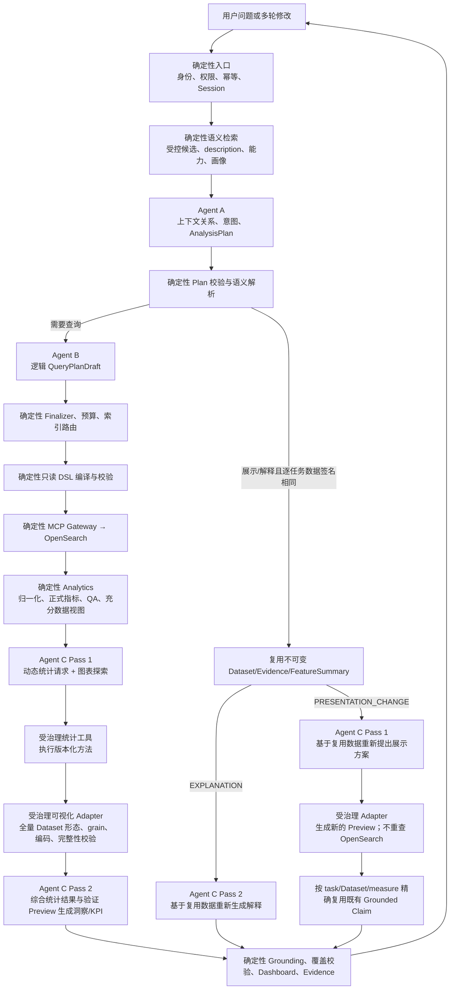

# 三 Agent 全流程决策权与验收矩阵

状态：当前权威实现说明，2026-08-04 / MI-NEW。

本文回答四个问题：每一步由谁决定、AI 能决定什么、程序必须决定什么、内网如何证明没有把 Mock 规则带入正式流程。它与唯一基线、`AGENTS.md`、`INTERNAL_AI_START_HERE.md` 和当前 Contract 共同约束实现；历史 Gate/审计中的旧流程或旧测试数字不能覆盖本文。

## 1. 唯一正确的运行链



这不是三个 Agent 自由聊天，也不是“主 Agent 把 Tool 随机分给其他 Agent”。三个 Agent 依次消费上一层已经校验的 Contract；任何 Agent 都不能调用 MCP、数据库、绘图库或另一个 Agent。

## 2. 全流程决策权矩阵

| 阶段 | 输入 | AI 决定 | 确定性程序决定 | 权威输出与失败行为 |
|---|---|---|---|---|
| 请求入口 | 用户文本、身份、session_id、client_turn_id | 无 | 身份、ACL、幂等、锁、取消、只读请求边界 | 允许进入或受控拒绝；不调用 LLM/MCP |
| 多轮启动 | Session 的 ActiveAnalyticalContext | Agent A 最终判断新问题、追问、时间/过滤/维度/展示变化 | Router 只给 provisional hint；程序逐 task 校验 metric/dimension/grain/method 与 scope 数据签名 | `TurnDecision`；联合粒度、统计方法或 scope 任一变化都必须 requery |
| Semantic Retrieval | 编译后的 Semantic Package | 无 | FTS/allowlist/Top-K；只返回有界 Dataset/Metric/Field/Recipe/Method/Value 候选 | `SemanticCandidateSet`；不把 170+ 字段或完整 Mapping 塞给模型 |
| Agent A | 用户问题、上下文、有界候选、部署的可视化目录、预算 | 分析目标、业务指标选择/拒绝、动态 tasks、维度/粒度、查询前统计假设、展示偏好、是否澄清 | 不允许 invented/重复 ID；task 只能引用本轮非 rejected 指标；校验目录、预算和继承边界 | `AnalysisPlanDraft → AnalysisPlan`；最多两次结构化修复，否则澄清 |
| Semantic Resolution | 已验证 AnalysisPlan、Package | 无 | 字段能力、敏感性、Metric 版本/公式可执行性、Policy、索引候选、description/兼容性/基数投影 | `ResolvedAnalysis`；不满足即不可回答，不让 Agent 猜 |
| Agent B | AnalysisPlan、ResolvedFieldDescriptor、逻辑索引候选、预算 | 最小充分 Dataset grain、逻辑 steps、依赖、可合并建议 | Agent B 不能选物理路径、不能写 DSL、不能改指标公式 | `QueryPlanDraft`；最多两次结构化修复 |
| Query Finalizer | QueryPlanDraft、AnalysisPlan、ResolvedAnalysis | 无 | required task 的 metric/dimension/grain 覆盖、依赖拓扑、桶预算、跨月 Mapping、exact index 路由、合并 | 权威 `QueryPlan`；任何不一致 fail closed |
| DSL Compiler/Validator | 权威 QueryPlan | 无 | 物理字段绑定、时间/过滤/聚合 AST、`size:0`、禁 script/write/raw clause、fingerprint | `CompiledQuery`；LLM 永远不拥有 DSL |
| MCP/OpenSearch | CompiledQuery、固定 binding、Secret | 无 | Tool 选择、只读执行、超时/重试/取消、Composite 分页、响应大小、shard 状态 | `ExecutionRecord + RawSearchResult`；失败可审计 |
| Base Analytics | RawSearchResult、Query semantics、Metric Registry | 无 | Parser、Normalizer、Metric Engine、rollup、reconciliation、QA、FeatureSummary | `DatasetBundle + FeatureSummary`；FATAL QA 阻断洞察 |
| Agent C Pass 1 | AnalysisPlan、Dataset schema、FeatureSummary、MetricDefinition、MethodDefinition、QA、可视化目录 | 动态决定分析哪些数值列、采用哪些统计方法、生成 1/N 张图、每张分析什么/intent/type/roles | 不执行图、不生成数字/代码/公式；非空 QA 可用结果缺图即质量失败 | `VisualizationExplorationDraft(AnalyticsToolRequest[], Candidate[])` |
| Governed Analytics Tool | C1 request、完整受控 Dataset、Method Registry | 无 | Dataset/任务/QA/数值列/方法/参数/样本量/能力校验，确定性执行并审计 NOT_APPLICABLE | `AnalyticsToolResult + enriched FeatureSummary` |
| Visualization Adapter | Candidate、完整受控 Dataset、AnalysisPlan | 无 | Candidate ID、task、列绑定、grain、重复行、变异度、基数、时点、完整性、用户偏好、renderer 白名单 | `VisualizationPreview`：ACCEPT/降级表格/REJECT |
| Agent C Pass 2 | 全量数据的确定性 FeatureSummary、analytics_tool_results、验证 Preview 的最终 encoding/profile/代表行 | 总洞察、主次发现、动态 KPI 选择、每图 purpose/findings/caveat、追问；决定保留或放弃哪些 Preview | 不重算数字，不按标题相似度配图，不读取任意绘图代码；KPI 必须是整体标量受治理列 | `ClaimDraft + overall_claim_ids + KpiSelectionDraft + VisualInsightDraft` |
| Grounding/Coverage | ClaimDraft、VisualInsightDraft、Dataset、Preview、AnalysisPlan | 无 | Claim 至少一个且名称唯一的 binding、selector 唯一解析、数值格式、required task 覆盖、task/Dataset/measure/evidence 一致性、去重 | `ClaimSpec`；不合法内容删除/定向修复，不能“尽量保留” |
| Dashboard | Grounded Claim、Preview、C2 KPI 选择、Dataset | 无新的业务判断 | 总分析置顶、动态 KPI、1/N 图、每图简洁解释、表格补充、block budget、安全 ECharts Contract | `DashboardSpec`；不会从 Agent A 列表回填 KPI，也不会程序自选图 |
| Evidence | Plan、Query、Execution、Dataset、Metric、QA | 无 | Business Evidence 展示原始聚合结果表/计算/QA；Advanced Evidence 按 ACL 展示 DSL | `EvidencePackage`；技术明细不回到主 Dashboard |
| SSE/持久化 | 真实节点完成事件、最终对象 | 无 | 只展示阶段事实和安全摘要；不展示 chain-of-thought、Prompt、Secret、原始模型输出或未授权 DSL | 最终 AnswerSnapshot 到达后进度自动收起 |

## 3. 三个 Agent 的严格职责

### Agent A：决定“本轮应该分析什么”

Agent A 是多轮关系、意图和 AnalysisPlan 的唯一 AI 权威。它必须自己理解用户问题，不得用关键词规则固定拆成“趋势、排名、构成”。Recipe 只是受治理候选建议，不是自动展开模板；统计方法和可视化 intent 在这里仅是查询前假设/展示语义，C1 会在真实数据出现后完成最终分析选择。

Agent A 能看到真实 Excel description 编译出的摘要、semantic type、capability、Mapping compatibility、maturity 和 Policy-safe cardinality；看不到 physical path、完整 Mapping、raw sample 或 MCP Tool。显式“换成折线图/表格”等要求也由 Agent A 结构化，正式路径不得调用自然语言别名 parser。

### Agent B：决定“为这些任务最少需要取什么数据”

Agent B 只做逻辑 QueryPlan。它根据 Agent A 的 tasks 与 `ResolvedFieldDescriptor` 设计足够的维度、grain、measure、step 和依赖。程序随后证明 required task 真正取得了所需 metric/dimension/grain，并以真实画像提升被低估的桶成本。Agent B 输出中出现 physical path、raw DSL、MCP Tool、endpoint 或指标公式都属于失败。

### Agent C：决定“真实结果值得怎样展示和解释”

Agent C 是一个有界 Node 的两个结构化 Pass，不是两个自由 Agent。

1. Pass 1 先看 AnalysisPlan 与全部数据的确定性摘要，提出受限统计工具请求和 1/N 个探索请求。
2. Host 先确定性执行统计方法，再由图表 Adapter 用完整受控 Dataset 检查图是否真的可画，并给出最终 encoding、数据形态、范围、基数、首尾/极值/分布代表行。
3. Pass 2 再看 FeatureSummary、统计结果与验证 Preview，同时生成总分析、KPI、Claim 和每图解释。
4. 程序强制每张最终图至少有一个同 task、同 Dataset、同 measure、同 Evidence 的 Grounded finding。

Pass 2 看的是可复现的结构化“图形结果”，不是浏览器截图；ECharts 只是最后的安全渲染器。这样模型能理解图中关系，同时不会因像素识别、主题或屏幕尺寸产生新的事实。

## 4. 图表为什么既由 LLM 判断、又不能任意执行代码

“LLM 动态选图”和“受治理图表目录”不是矛盾：

- LLM 决定分析哪些值、用什么统计方法、画几张、分析关系、intent、优先类型和字段角色；
- Semantic Package 声明本次部署允许哪些 intent/type；
- Validator 决定真实数据是否满足该图的数学和完整性条件；
- ECharts Adapter 只把已验证 Contract 翻译为安全 option。

当前 Contract 支持 `bar/line/heatmap/stacked_bar/donut/dot/pareto/table/pivot`。这不是固定问题模板，而是可扩展的 renderer 白名单。Plotly 和任意 Python/JavaScript 绘图代码未实现、也不得由 LLM临时执行；新增图种必须一起修改 Contract、Semantic Registry、Feasibility、前端 Adapter、Schema、ADR 和测试。

示例只说明动态性，不构成规则：单指标问题可以是一张单值图；时间变化问题可能一张趋势图；表格请求可附带一张真实图；复合诊断可能多图。数据为空或 QA 阻断时不伪造图；其余非空 ChatBI 结果必须有 1/N 图。任何地方出现“普通问题默认四图”或“固定拆为趋势+排名+构成”都应视为缺陷。

## 5. Mock 与正式 LLM 的隔离

`RuleBasedMockLLMClient`、Fixture、Recorded 仅用于无凭证确定性回归。Mock 中确实存在关键词和固定示例任务，这是测试替身的局限，不是生产策略。自然语言图表别名 parser 已隔离在 `app/llm/mock_chart_preferences.py`，正式 Agent/Prompt/编排/Query/Analytics/Presentation 不导入它。

正式环境必须同时满足：

- `CHATBI_LLM_MODE=openai_compatible`，失败时不回退 Mock；
- `CHATBI_GATEWAY_MODE=mcp` 与 trusted identity；
- 使用审核后的 `semantic-input/internal` 与 `compiled-semantic/internal`，不得直接运行 `internal-template`；
- Agent A 和 Validator 从部署的 Semantic Package 动态取得 visualization catalog；
- 正式 Agent/Prompt/编排/Query/Analytics/Presentation 不存在 Mock import、自然语言 rule parser 或固定 task bundle；
- 四个主 LLM operation 全部真实调用，Agent B 仍不拥有 DSL。

`check-real-llm-cutover` 当前必须得到 15/15 PASSED。少于 15 项表示旧分支或旧脚本。

## 6. MCP、Mapping、description 与画像的时序

MCP 的 `list_indices/get_mapping` 和 Policy-safe `size:0` FieldProfile 只能在 Bootstrap/Refresh 确定性流程调用，不能成为 Agent Tool：

```text
ListIndex → Mapping Snapshot
+ 真实字段 description Excel/CSV
→ staging compile + Policy
→ Policy-safe size:0 FieldProfile
→ mapping/index/hash 校验
→ final compile
→ Agent A candidates / Agent B ResolvedFieldDescriptor
```

这保证 Agent A/B 在规划前已经看到足够字段信息，又不会每轮探测 Schema 或暴露 raw documents。内网只负责提供真实输入、凭证和业务确认，不应重写核心流程。

## 7. 每层验收问题

| 验收对象 | 必须证明 | 失败时修哪里 |
|---|---|---|
| Agent A | 不同问题产生不同 task/metric/dimension/0-1-N intent；显式图表要求能结构化；只引用候选 ID | Prompt、候选语义、真实模型配置；不得加关键词规则 |
| Agent B | 每个 required task 有最小充分 grain；无 physical path/DSL；高基数在查询前拒绝或澄清 | Prompt、Descriptor、Finalizer；不得手写业务 DSL 模板 |
| Analytics | 指标/统计全由版本化程序计算；全量数据 QA/对账；派生视图随 QueryPlan 实际维度变化 | Metric/Statistic/QA Engine 与 Registry |
| Agent C | Pass 1 在非空、QA 可用数据时给出 1/N 图，并动态选择受治理统计方法/数值列；Pass 2 基于统计结果与 Preview 输出总体洞察、KPI 与每图 Grounded findings | Prompt、模型质量、FeatureSummary/Preview；不得扩写 Mock |
| Visualization | 未知 task/intent、错误 grain、重复键、无变异、不完整分布、高基数都安全降级/拒绝 | Registry/Feasibility/Adapter |
| Dashboard/Evidence | 总分析置顶、KPI 动态、技术明细只在 Evidence、Advanced DSL 有 ACL | Builder/API/Frontend，不在前端重算指标 |
| 多轮 | 纯换图零查询但重跑 Agent C Pass 1；解释追问零查询但重跑 Pass 2；scope 或逐 task 的 metric/dimension/grain/method 变化必定 requery | Agent A + 逐任务数据签名守卫 + Agent C 两阶段复用路径 |
| 正式切换 | 15/15 cutover、四 operation 审计、真实 MCP/LLM probe、G01–G25 Shadow 与 Owner verdict | 配置、真实语义输入、模型 Prompt；不绕过门禁 |

## 8. 内网仍需做且仅需做的事项

内网需要注入真实 Excel/CSV、真实 Mapping/Profile、批准的 LLM/MCP endpoint 与 Secret，确认业务指标/状态/时间/敏感性，完成真实 Shadow、Evidence 定位与 Owner verdict。除非真实验收暴露实现缺陷，不得把“内网适配”变成重写 Agent、DSL、Analytics、Dashboard、Evidence、Session 或安全边界。
