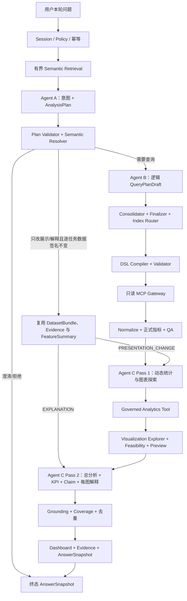

# 受控多 Agent 编排与语义元数据设计

状态：当前权威实现说明（2026-08-04 / MI-NEW）。若历史文档描述“自由 Supervisor、多 Agent 互聊、Agent 直接调用 MCP/绘图库”或“Agent C 一次生成图和结论”，以本文、当前代码和唯一基线为准。

逐节点输入、输出、AI/程序决策权、失败策略和正式验收以 [三 Agent 全流程决策权与验收矩阵](decision_authority_matrix.md) 为统一索引。

## 1. 结论

本系统采用“一个确定性主编排器 + 三个有界专业 Agent + 确定性执行/治理节点”，不是自由多 Agent 网络：

- 主编排器是 LangGraph StateGraph 和版本化 State，不是第四个自由 LLM Agent；
- Agent A 负责理解问题、上下文关系和 AnalysisPlan；
- Agent B 负责逻辑 QueryPlan，不负责物理字段和 DSL；
- Agent C 在查询后分两次结构化调用：先提出数据驱动的统计工具请求和可视化探索，再基于受控统计结果与 Preview 同时生成总体洞察、动态 KPI、每图结论和图文绑定；
- Resolver、Index Router、DSL Compiler、MCP Gateway、Metric/Statistic Engine、QA、Visualization Explorer、Grounding、Dashboard/Evidence Assembly 都是确定性程序；它们执行/校验 Agent C 的选择，绝不按数据形状替它编造图或结论。

多 Agent 的价值来自职责隔离、较小上下文和独立验收，不来自 Agent 数量。再增加一个“汇总 Agent”会重复 Agent C Pass 2、增加延迟并制造两个结论权威，因此不采用。

## 2. 完整流程



用户看到的流式进度来自这些真实节点。最终答案生成后，进度区自动收起；不得展示隐藏 chain-of-thought、Prompt、原始 LLM 输出或未经授权的 DSL。

## 3. Agent A：问题、上下文与分析计划

正式 operation：`turn_and_analysis_plan`；输出：严格 `AnalysisPlanDraft`。

### 3.1 输入

- 当前用户文本、当前时间、locale；
- ActiveAnalyticalContext 和编排器的 provisional hint；
- 有界 Dataset/Metric/Field/Recipe/Method/Value candidates；
- 字段候选的业务 description、aliases、business_domain、semantic_type、mapping_type、capabilities、maturity、compatibility 和可选 cardinality 画像；
- Policy 的候选 ID 边界、查询/桶/Dashboard 预算；
- 允许的展示类型目录。

展示类型与 visualization intent 由当前已编译 Semantic Package 动态注入 Agent A 和 Plan Validator，不允许在正式 Agent 中维护问题到图表的固定映射。Recipe 候选同时携带受治理的 metric/method/dimension-role/visualization-intent 建议，但 Recipe 不是自动展开的任务模板。

Agent A 不接收完整 Mapping、物理路径、索引名、MCP Tool 列表、凭证、raw document、raw DSL 或其他 Agent 的自由推理。

### 3.2 职责

1. 自己判断 NEW_ANALYSIS/NEW_TOPIC/各种变更/展示变更/解释追问；
2. 识别问题里的时间、指标、维度、过滤、比较对象和显式图表要求；
3. 对复合问题拆成分别可验证的 tasks，而不是把所有维度塞进一个固定模板；
4. 选择/拒绝受治理指标，声明 required/recommended/optional；
5. 根据字段 description 和能力选择业务概念，检查是否存在实质歧义；
6. 对纯展示变更保留原数据签名，只改变 presentation preference；
7. 输出分析目标、任务、方法、业务价值、限制和预算。

Agent A 决定“分析什么”，Resolver 决定“候选 ID 是否真实、允许且具备能力”。

## 4. Agent B：最小充分 QueryPlan

正式 operation：`logical_query_plan`；输出：严格 `QueryPlanDraft`。

### 4.1 新增的 ResolvedFieldDescriptor

Resolver 将计划引用的每个受治理字段投影为 `ResolvedFieldDescriptor` 并传给 Agent B：

```text
field_id / dataset_id
display_name / description / aliases / business_domain
semantic_type / mapping_type
capabilities / maturity / compatibility
cardinality_estimate / cardinality_approximate
```

其中没有 `physical_path`、observed index、凭证或 raw sample。这样 Agent B 能理解字段代表什么、能否 group/filter/range、跨月是否兼容、高基数是否可能超预算，但无法绕过 Resolver 和 Compiler。

### 4.2 职责

1. 逐一覆盖 required analytical tasks；
2. 根据任务指标、维度、方法和字段画像设计最小充分结果粒度；
3. 多个真实任务能够从同一最小充分 Dataset 安全派生时进行合并；具体派生类型由本轮 AnalysisPlan 决定；
4. 只有 Top N 依赖等确有必要时才建立 dependent query；
5. 显式声明 QueryStep、purpose_task_ids、grain、result contract、预算估计和依赖来源；
6. 能力或兼容性不足时不发明字段、不偷偷缩小问题，交给确定性 Validator 拒绝或进入澄清/部分回答。

Agent B 不生成物理路径、OpenSearch DSL、MCP Tool/endpoint、指标公式或实际 dependent values。

## 5. Agent C：数据驱动的统计与可视化分析

Agent C 是同一个有界专业节点的两个结构化 Pass，而不是自由绘图 Agent。

### Pass 1：`post_query_visual_exploration`

输入为 AnalysisPlan、Dataset schema、受控 FeatureSummary/QA、MethodDefinition 和图表目录；输出 `AnalyticsToolRequest[]` 与动态 `VisualizationCandidate[]`。每个统计请求只引用已有 numeric metric/measure、受治理方法和允许参数；每个候选绑定 task_id、dataset_id、维度、measure、分析目的和期望关系。统计和图表数量/类型由本轮问题与实际数据决定，不存在默认四图、固定二维组合或程序替 Agent C 选图。

非空且 QA 可用的 ChatBI 结果必须得到 C1 的 1/N 张真实图候选；空结果或 QA 阻断才可以没有图。C2 必须在 Host 返回统计结果与 Preview 后才生成 `overall_claim_ids`、`kpi_selections`、Claim 和图表解释。正式 KPI 仍由 Metric Engine 计算，探索统计由 StatisticEngine 计算；LLM 决定“为什么/分析什么”，不直接计算数字或公式。

确定性 Visualization Explorer 随后检查 grain、cardinality、完整性、单位、排序、显式图表偏好和 Dashboard budget，生成包含最终 encoding、data profile 和可行性状态的 `VisualizationPreview`。当前 renderer 是安全 ECharts Adapter；LLM 不输出 ECharts option、Plotly code、Python 或 JavaScript。

### Pass 2：`post_query_insight_dashboard`

Agent C 同时看到经 QA 的全部分析特征和最终 Preview，生成：

- answer-first 总分析；
- Grounded ClaimDraft；
- 每张 Preview 的 purpose、grounded findings、必要 caveat；`reading_guide` 仅为兼容 Contract 的内部辅助字段，主 UI 不展示机械阅读模板；
- KPI 建议、限制和推荐追问。

图与结论通过 task/dataset/measure/claim ID 显式绑定，不能先画固定图再按自然语言相似度匹配结论。Candidate ID 必须唯一；每条 Claim 必须有至少一个且名称唯一的 evidence binding。Grounding 会删除无证据、重复、跨粒度或绑定不一致的内容。

## 6. OpenSearch MCP 元数据流程

### 6.1 为什么不让 Agent A/B 运行时自由调用 MCP

自由调用会造成每轮 Mapping 漂移、重复查询、延迟、Prompt 膨胀、敏感数据泄露和不可复现。MCP 是连接 Adapter，不是规划大脑。正确做法是在 Bootstrap/Refresh 阶段由确定性 CLI 获取并编译版本化快照，普通用户轮次只读取已发布 Semantic Package。

### 6.2 外网已完成的三段式流程

1. `snapshot-mapping`：可通过 `ListIndexTool` 自动发现匹配索引，再用 `IndexMappingTool` 保存版本化 MappingSnapshot；
2. 第一次 `semantic compile`：将真实 Excel/CSV description、Mapping、Registry 和 Policy 编译为 staging Semantic Package；
3. `snapshot-profile`：仅选择 staging 包中 `model_visible=true`、`aggregatable=true`、未 BLOCKED 的字段，通过 `SearchIndexTool` 执行固定 `size:0` 聚合，得到 FieldProfileSnapshot；再带 `--profile` 重编译正式包。

FieldProfileSnapshot 只包含：document/non-null/missing count、近似 cardinality、数值/日期范围、最多 10 个 terms 聚合样例值、query hash 和 provenance。它不请求 `_source`，不保存 raw documents。样例值不是业务口径；Excel description 和 Registry 才是业务语义权威。

### 6.3 数据充分性四道门

| 阶段 | 检查内容 | 失败行为 |
|---|---|---|
| Semantic compile | Excel 与 Mapping 匹配、类型冲突、敏感性、能力、profile 与 mapping hash/index 一致 | 阻塞发布或 Import Report 警告 |
| Analysis resolution | field/metric/value/policy ID、group/filter/range 能力、metric required fields | 澄清、不可回答或计划修复 |
| Query finalization | required task 覆盖、最小充分 grain、bucket/query budget、逐月 required field availability | 拒绝 QueryPlan；不发送 DSL |
| Post-query QA | shard/timeout/empty/unknown/status reconciliation/sample size/completeness/derived reproducibility | PARTIAL/EMPTY/FAILED，限制 Claim/图表 |

因此“取数后才发现不够”不能完全消除，但会在查询前尽可能由 Mapping、description、capability、compatibility 和 profile 拦截；真实结果仍必须经过 QA，不允许模型把不充分数据解释成确定结论。

Agent B 的 `estimated_buckets` 只是建议。Finalizer 会按时间 grain 和已知字段 cardinality 计算确定性下界：在预算内低估时自动提升 estimate，再交给 Compiler；下界本身超过预算时才拒绝并要求缩小范围/Top-N/澄清。这样既不会因模型低估而漏取数据，也不会把 31 天趋势这类正常问题错误拒绝。

## 7. 运行时与刷新时序

Semantic Package 有 package_version。一次用户轮次固定使用一个版本，不允许执行中热切换。Mapping/Excel/Registry/Profile 变化时：生成新快照 → 编译新目录 → 检查 Import Report 与 drift → 跑 Golden/Shadow → 原子发布新版本。历史 AnswerSnapshot 保留旧 package_version 以供审计。

## 8. 内网 AI 禁止改成的形式

- 第四个自由 Supervisor LLM；
- Agent A/B/C 互相发送自由文本或共享 chain-of-thought；
- Agent A/B 直接 list index/get mapping/search；
- 把完整 Mapping、原始文档或任意 MCP Tool schema放进 Prompt；
- 从 `rule_based.py` 复制关键词/时间/指标/图表规则到正式流程；
- Agent B 输出 DSL；Agent C 输出绘图库代码；前端计算指标；
- 为解决一个例子固定 Channel×Status×Month、四张图、固定 KPI 或固定 Claim 模板。

## 9. 内网验收重点

- 用至少 25 条开放式问题验证 Agent A 的意图、复合任务拆解和多轮关系；
- 验证 Agent B payload 中包含真实字段 description/能力/画像但没有 physical_path；
- 验证每个 required task 被 QueryStep 覆盖，取数粒度足以执行后续统计；
- 验证 Index Router 对所选月份逐字段检查 observed mapping；
- 验证 profile query 固定 `size:0` 且只覆盖政策允许字段；
- 验证 Agent C 在非空、QA 可用数据上选择 1/N 张图表；每图解释和图文同源绑定；
- 验证纯换图复用 DatasetBundle 且重跑 Pass 1，解释追问重跑 Pass 2；新增比较/下钻/统计方法/联合粒度必须重新规划和查询；
- 用真实 Shadow 人工检查“总分析是否完整回答用户问题”，不能只检查 JSON Schema 通过。
